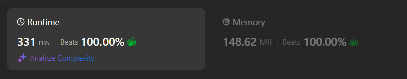

# Easy solution Java and Dart: A Non-Recursive Solution with Optimal Time and Space Complexity 100%

**Author:** m3n99
**Votes:** 0
**Link:** [https://leetcode.com/problems/integer-to-english-words/solutions/5608780/](https://leetcode.com/problems/integer-to-english-words/solutions/5608780/)

---




# Intuition
When converting a number into words, we can break the number into smaller, manageable chunks, typically groups of three digits (hundreds, tens, and ones). By translating these chunks into words and then combining them with the appropriate scale (thousand, million, billion), we can build the complete word representation of the number.

# Approach
<!-- Describe your approach to solving the problem. -->
1. Mapping Digits to Words: Create mappings for the ones (1-19) and the tens (20, 30, ..., 90) to their corresponding word representations.
2. Divide into Chunks: Process the number in chunks of three digits, starting from the least significant digits (rightmost).
3. Convert Each Chunk: Convert each chunk of three digits into words, adding the appropriate scale (thousand, million, billion) as necessary.
4. Combine and Reverse: Combine the converted chunks in reverse order to form the final word representation.
# Complexity
- Time complexity:
    The time complexity is **\uD835\uDC42( log 10(\uD835\uDC5B))** log base 10 where \uD835\uDC5B n is the input number. This is because we are processing each group of three digits individually, and the number of such groups is proportional to the number of digits in \uD835\uDC5B n.

- Space complexity:
<!-- Add your space complexity here, e.g. $$O(n)$$ -->
The space complexity is **\uD835\uDC42( 1 )**  for the storage used by the maps and arrays, assuming the output string does not count towards space complexity. The actual space complexity for the output is proportional to the number of words in the result, which depends on the number of digits in \uD835\uDC5B n.
# Code

```Java []
class Solution {
    public String numberToWords(int num) {
        if (num == 0) {
            return "Zero";
        }

        Map<Integer, String> onesMap = new HashMap<>();
        onesMap.put(1, "One");
        onesMap.put(2, "Two");
        onesMap.put(3, "Three");
        onesMap.put(4, "Four");
        onesMap.put(5, "Five");
        onesMap.put(6, "Six");
        onesMap.put(7, "Seven");
        onesMap.put(8, "Eight");
        onesMap.put(9, "Nine");
        onesMap.put(10, "Ten");
        onesMap.put(11, "Eleven");
        onesMap.put(12, "Twelve");
        onesMap.put(13, "Thirteen");
        onesMap.put(14, "Fourteen");
        onesMap.put(15, "Fifteen");
        onesMap.put(16, "Sixteen");
        onesMap.put(17, "Seventeen");
        onesMap.put(18, "Eighteen");
        onesMap.put(19, "Nineteen");

        Map<Integer, String> tensMap = new HashMap<>();
        tensMap.put(2, "Twenty");
        tensMap.put(3, "Thirty");
        tensMap.put(4, "Forty");
        tensMap.put(5, "Fifty");
        tensMap.put(6, "Sixty");
        tensMap.put(7, "Seventy");
        tensMap.put(8, "Eighty");
        tensMap.put(9, "Ninety");

        String[] post = {"", " Thousand", " Million", " Billion"};

        List<String> words = new ArrayList<>();
        int index = 0;
        while (num != 0) {
            int digit = num % 1000;
            num /= 1000;
            String res = getString(digit, onesMap, tensMap, post, index);
            index += 1;
            words.add(res);
        }
        Collections.reverse(words);
        return String.join("", words).trim();
    }

    private String getString(int num, Map<Integer, String> onesMap, Map<Integer, String> tensMap, String[] post, int index) {
        List<String> word = new ArrayList<>();
        if (num == 0) {
            return "";
        }

        if (num >= 100) {
            word.add(onesMap.get(num / 100) + " Hundred");
            num %= 100;
        }

        if (num >= 20) {
            word.add(tensMap.get(num / 10));
            num %= 10;
        }

        if (num > 0) {
            word.add(onesMap.get(num));
        }

        return String.join(" ", word) + post[index] + " ";
    }
}

```
```Dart []
class Solution {
  String numberToWords(int num) {
    // create maps for transfers.
    if (num == 0) {
      return 'Zero';
    }

    Map<int, String> onesMap = {
      1: 'One',
      2: 'Two',
      3: 'Three',
      4: 'Four',
      5: 'Five',
      6: 'Six',
      7: 'Seven',
      8: 'Eight',
      9: 'Nine',
      10: 'Ten',
      11: 'Eleven',
      12: 'Twelve',
      13: 'Thirteen',
      14: 'Fourteen',
      15: 'Fifteen',
      16: 'Sixteen',
      17: 'Seventeen',
      18: 'Eighteen',
      19: 'Nineteen',
    };

    Map<int, String> tensMap = {
      2: 'Twenty',
      3: 'Thirty',
      4: 'Forty',
      5: 'Fifty',
      6: 'Sixty',
      7: 'Seventy',
      8: 'Eighty',
      9: 'Ninety',
    };

    List<String> post = [
      '',
      ' Thousand',
      ' Million',
      ' Billion',
    ];

    // words for get all words from chunks
    List<String> words = [];
    int index = 0; // to check for post list since hard to cal
    while (num != 0) { // take num as chunks from 3 digit 
      int digit = num % 1000; 
      num = num ~/ 1000;
      String res = getString( // get the word for each 3 digit alone
        num: digit,
        onesMap: onesMap,
        tensMap: tensMap,
        post: post,
        index: index,
      );
      index += 1;
      words.add(res);
    }
    // reverse and trem since the % and / start form left to right less digit to most digit
    return words.reversed.join('').trim();
  }

  String getString({
    required int num,
    required Map<int, String> onesMap,
    required Map<int, String> tensMap,
    required List<String> post,
    required int index,
  }) {
    List<String> word = [];
    if(num == 0){ // if number == 0 in case 100000 like this we can return empty string
        return '';
    }
    // check digits one by one first hundreds, tens then ones.
    if (num >= 100) {
      word.add('${onesMap[num ~/ 100]} Hundred'); // get hundred digit
      num %= 100; // to get tens
    }

    if (num >= 20) {
      word.add('${tensMap[num ~/ 10]}'); // get tens digit
      num %= 10; // git last digit one
    }

    if (num > 0) {
      word.add('${onesMap[num]}');
    }

    return '${word.join(' ')}${post[index]} ';
  }
}

```