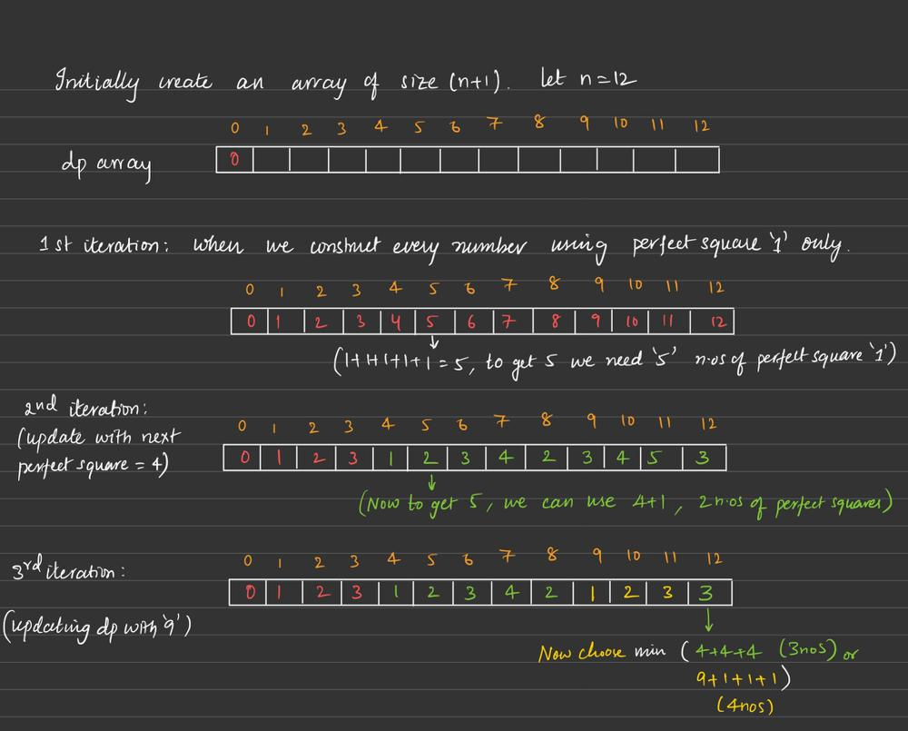

# dp easy to understand - JS, Java, Python, C++

**Author:** vijay_patneedi
**Votes:** 407
**Link:** [https://leetcode.com/problems/perfect-squares/solutions/1520447/](https://leetcode.com/problems/perfect-squares/solutions/1520447/)

---



```
C++:
class Solution {
public:
    int numSquares(int n) {
        //vector for updating the dp array/values
        vector<int> dp(n+1,INT_MAX);
        //base case
        dp[0]=0;
        int count = 1;
        while(count*count <= n) {
        int sq = count*count;
        for(int i = sq; i < n+1; i++) {
            dp[i] = min(dp[i-sq] + 1,dp[i]);
        }
        count++;
    }
    return dp[n];
    }
};

JS/TS
function numSquares(n: number): number {
    let dp: number[] = new Array(n + 1).fill(Number.MAX_SAFE_INTEGER);
        dp[0] = 0;
        let count: number = 1;
        while (count * count <= n) {
            let sq: number = count * count;
            for (let i: number = sq; i <= n; i++) {
                dp[i] = Math.min(dp[i - sq] + 1, dp[i]);
            }
            count++;
        }
        return dp[n];
};

Java:
public class Solution {
    public int numSquares(int n) {
        int[] dp = new int[n + 1];
        Arrays.fill(dp, Integer.MAX_VALUE);
        dp[0] = 0;
        int count = 1;
        while (count * count <= n) {
            int sq = count * count;
            for (int i = sq; i <= n; i++) {
                dp[i] = Math.min(dp[i - sq] + 1, dp[i]);
            }
            count++;
        }
        return dp[n];
    }
}

Python:
class Solution:
    def numSquares(self, n: int) -> int:
        dp = [float('inf')] * (n + 1)
        dp[0] = 0
        count = 1
        while count * count <= n:
            sq = count * count
            for i in range(sq, n + 1):
                dp[i] = min(dp[i - sq] + 1, dp[i])
            count += 1
        return dp[n]

```

Complexity

Time complexity: **O(n*sqrt(n))** outer loop is of sqrt(n) iterations and in the inner loop <n iterations roughly.

Space Complexity: **O(n)**.

*like it? upvote if you can..!*

