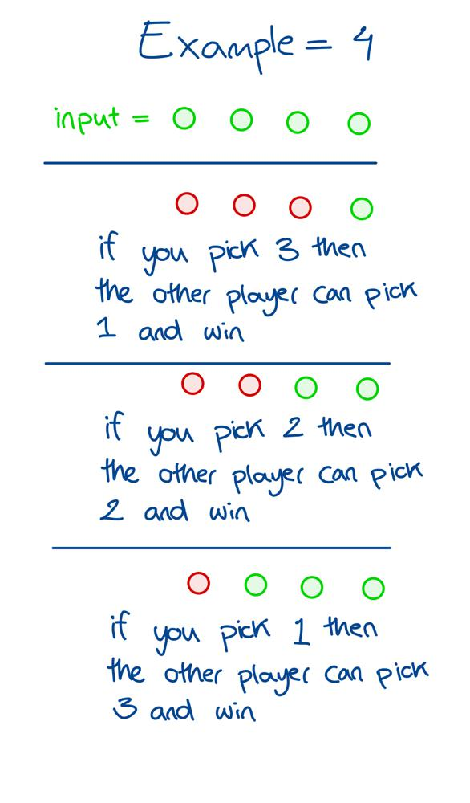
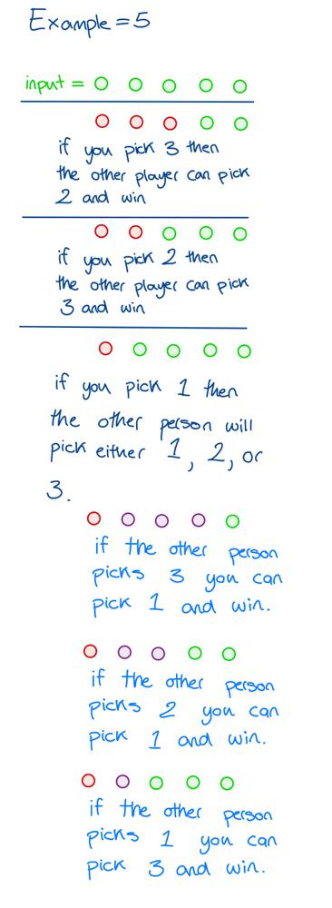

# Golang solution with explanation and images

**Author:** nathannaveen
**Votes:** 2
**Link:** [https://leetcode.com/problems/nim-game/solutions/1115692/](https://leetcode.com/problems/nim-game/solutions/1115692/)

---

```
func canWinNim(n int) bool {
	return n%4 != 0
}
```

This is all the code we need to solve this problem. 

We have to return `n % 4 != 0` because we are asked to pick from `1` to `3` stones, and if we pick;

* If we pick one stone, the other player can choose three stones
* If we pick two stones, the other player can select two stones
* If we pick three stones, the other player can choose one stone

As you can see, when we add the stones together in the examples above, they all equal `4` stones.

We can see that any number that is a multiple of `4` will return false with these pictures:



The next example:

