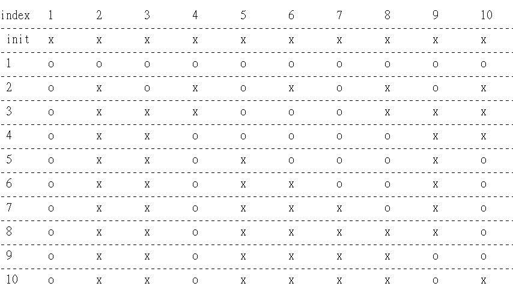

# Python/JS/Java/C++ sol by perfect square. [w/ Visualization]

**Author:** brianchiang_tw
**Votes:** 22
**Link:** [https://leetcode.com/problems/bulb-switcher/solutions/535399/](https://leetcode.com/problems/bulb-switcher/solutions/535399/)

---

sol by math.

---

**Hint**:


Initial state is "OFF" for all bulbs

We have n bulbs, number them from bulb_#1 to buld_#n.

Bulb_#k will be "ON" where k has odd times of *switch toggle*, if and only if, k has odd factors.

For all positive integers, only **perfect square number**s have **odd factors**.

Bulb_#1 : 1 (OFF->**ON**). 
total 1 factor

---

Bulb_#4 : 1 (OFF->ON), 2 (ON->OFF), 4 (OFF->**ON**). 
total 3 factors

---

Bulb_#9 : 1 (OFF->ON), 3 (ON->OFF), 9 (OFF->**ON**). 
total 3 factors

---

Bulb_#16 : 1 (OFF->ON), 2 (ON->OFF), 4 (OFF->ON). , 8 (ON->OFF), 16 (OFF->**ON**). 
total 5 factors

---

Bulb_#25 : 1 (OFF->ON), 5 (ON->OFF), 25 (OFF->**ON**)
total 3 factors

... and so on

---
**Implementation**:

**Python**

```
class Solution:
    def bulbSwitch(self, n: int) -> int:
        
        # Only those bulds with perferct square number index will keep "ON" at last.
        
        return int(n**0.5)
```

---

**Javascript**:

```
var bulbSwitch = function(n) {
    return Math.floor(n**0.5);
};
```

---

**Java**:

```
class Solution {
    public int bulbSwitch(int n) {
        return (int)Math.sqrt(n);
    }
}
```

---

**C++**

```
class Solution {
public:
    int bulbSwitch(int n) {
        return int( sqrt(n) );
    }
};
```

---

Appendix:

Demo for n = 10



