# Image Explanation🏆- [Easiest to Understand - No Clickbait] - C++/Java/Python

**Author:** aryan_0077
**Votes:** 118
**Link:** [https://leetcode.com/problems/bulb-switcher/solutions/3459106/](https://leetcode.com/problems/bulb-switcher/solutions/3459106/)

---

# Video Solution (`Aryan Mittal`) - Link in LeetCode Profile
`Bulb Switcher` by `Aryan Mittal`


# Approach & Intution
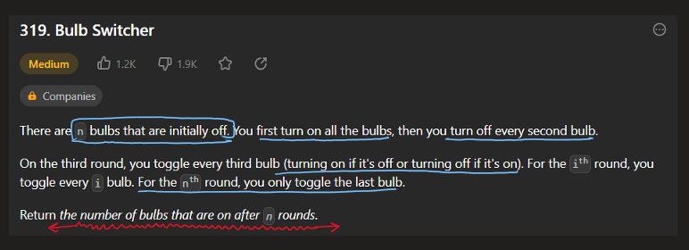
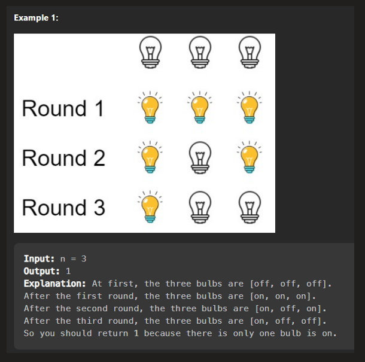
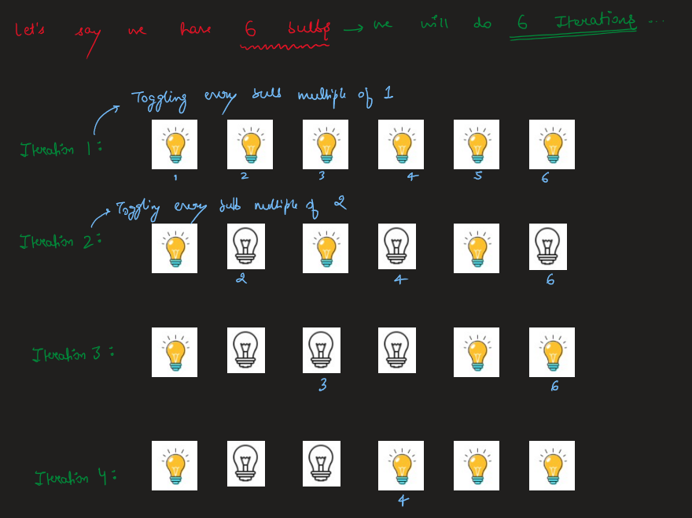
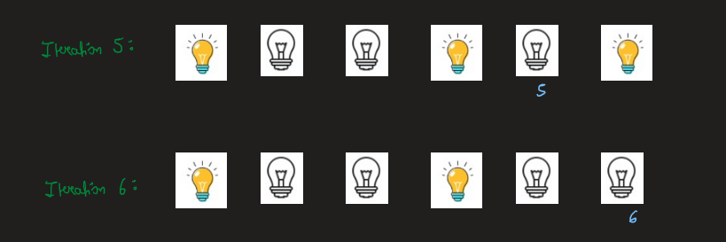
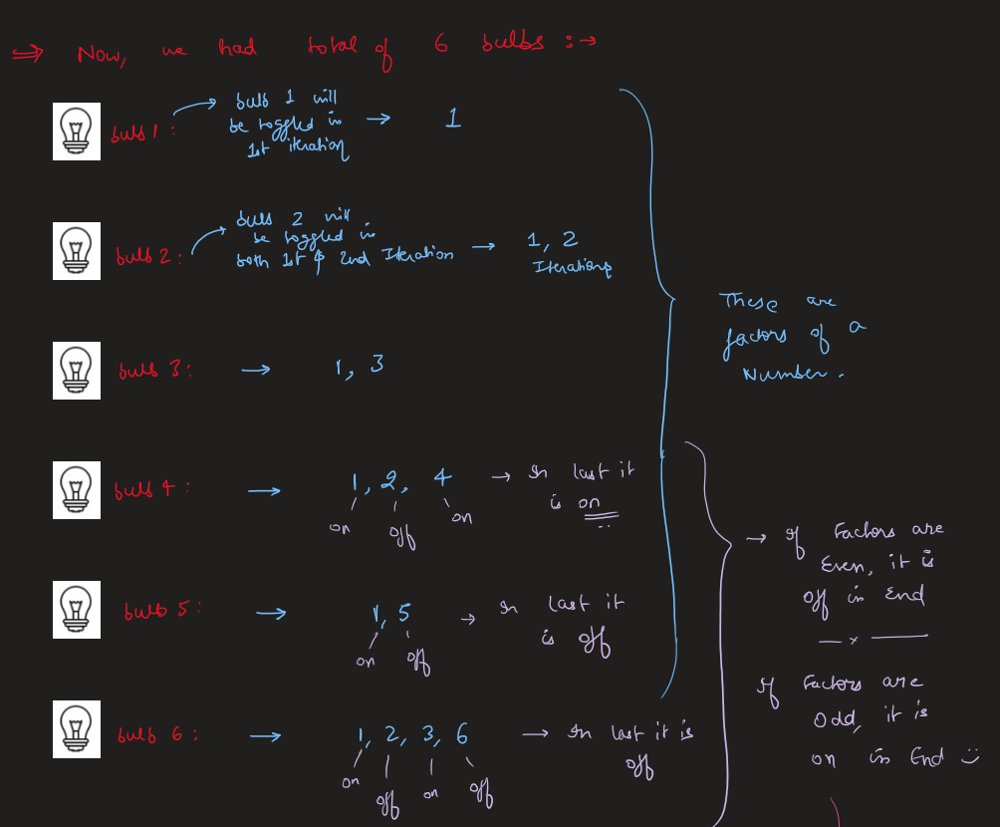
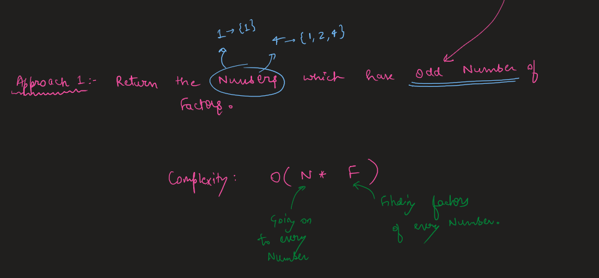
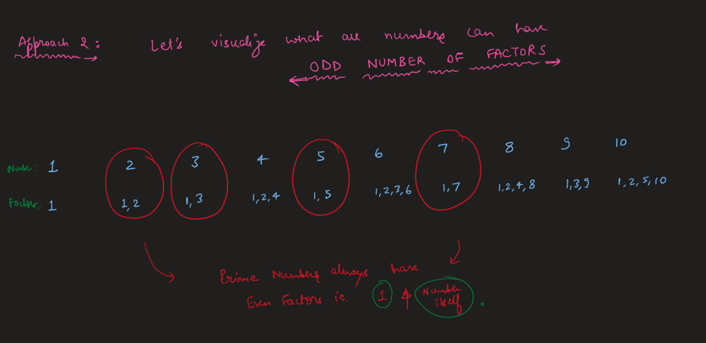
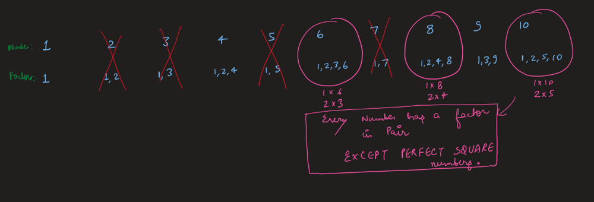
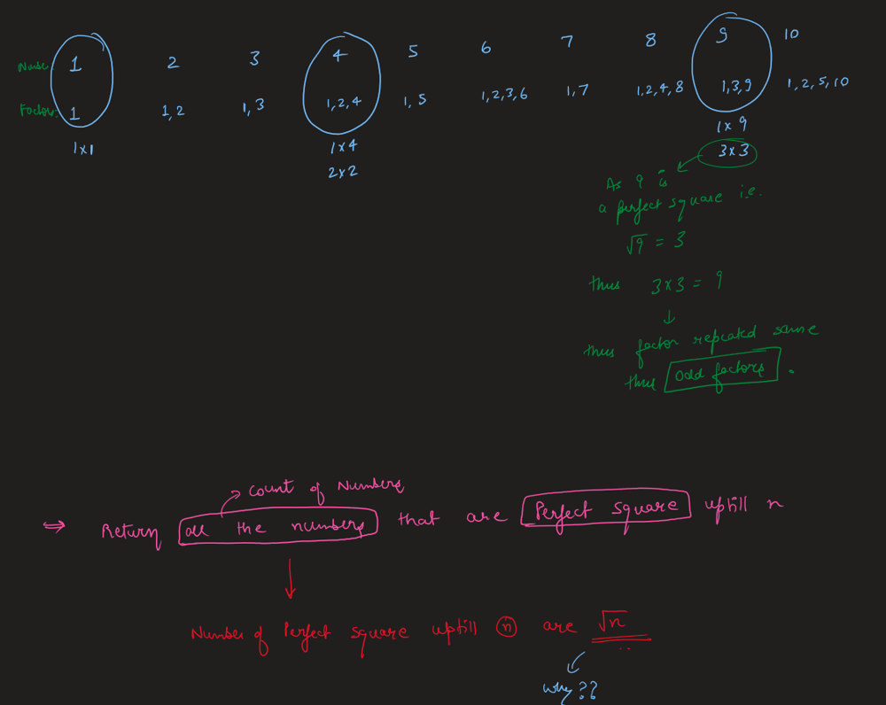
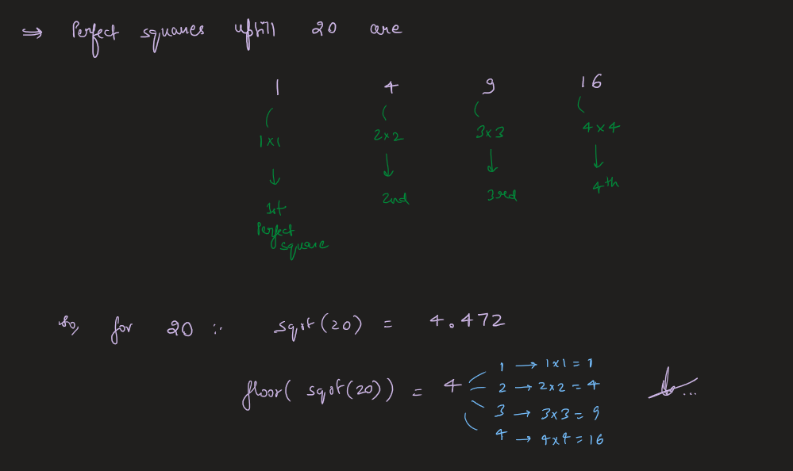
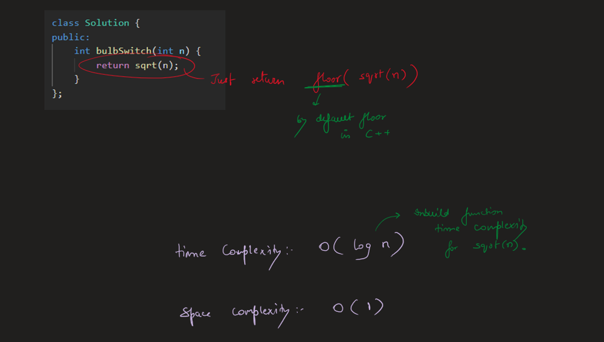


# Code
```C++ []
class Solution {
public:
    int bulbSwitch(int n) {
        return sqrt(n);
    }
};
```
```Java []
class Solution {
    public int bulbSwitch(int n) {
        return (int)Math.sqrt(n);
    }
}
```
```Python []
import math

class Solution:
    def bulbSwitch(self, n: int) -> int:
        return int(math.sqrt(n))
```
