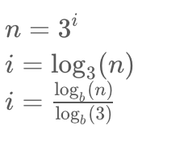

# 3 Methods to Solve

**Author:** HIMANSHUCHHIKARA
**Votes:** 124
**Link:** [https://leetcode.com/problems/power-of-three/solutions/1179332/](https://leetcode.com/problems/power-of-three/solutions/1179332/)

---


We have to check given number is power of 3 or not. 
**Some Observations :**
1.3^anything>0 always . so negatives numbers are discarded just by observation.
2. An integer n is a power of three, if there exists an **integer x** such that n == `3^x`(will be usefull in method-2)
3. -2^31 <= n <= 2^31 - 1 it means given number is in Integer Range (will be useful in method-3)

**Method-1:** `Naive Approch using loops`
**CODE:**
```
public boolean isPowerOfThree(int n) {
        if(n==0) return false;
        while(n!=1){
            int r=n%3; // r: remainder
            n=n/3;
            if(r!=0) return false;
        }
        return true;
    }
```	

Little Better Implementaion of above method
**Code:**
```
 public boolean isPowerOfThree(int n) {
         
        while(n>=3){
            if(n%3!=0) return false;
            n/=3;
        }
        return n==1;
    }
```	

Complexity:
`Time:O(log3(n)) and Space:O(1)`
**Method-2:** `Mathematics`
  
 Here if n is actually a exact power of 3 then i must be integer . so i%1 will be equal to 0.
 In java we  find log using Math.logb and output will be in double. 
 **CODE:**
 ```
  public boolean isPowerOfThree(int n) {
        return (Math.log10(n) / Math.log10(3)) % 1 == 0;
    }
```


**Method-3:** (Propose this to interviewer after above 2 approches )
Q. Have you ever though why in so many question we take modulus of 10^9 + 7 ? 
A. Because `10^9 + 7` is the highest prime number in Integer_Range . 

If somehow we know the largest power of 3 which is in the range of 3 our work is done just check largest power%n ==0 .
Let largest power of 3 be x for a while and n=3 for simplicity. 
`Note : x%3 == 0 and x%-3 ==0 so make a check n should be greater than 0.`
This idea is applicable to all Prime number
**Code:**
```
public boolean isPowerOfThree(int n) {
    // 3^19 =1162261467, 
	//  3^20 is exceding  Integer_Range So 3^19 is the highest power in Integer Range  
    return ( n>0 &&  1162261467%n==0);
}
```

**Complexity:**
`Time:O(1) and Space:O(1)`

Please **UPVOTE** if found it helpful and feel free to reach out to me or comment down if you have any doubt.
