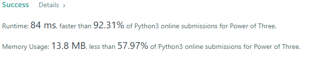

# ✔️Python & C🔥One-liner✅O(1) Easy solution with Detailed Explanation | Beginner-friendly

**Author:** luluboy168
**Votes:** 85
**Link:** [https://leetcode.com/problems/power-of-three/solutions/2471285/](https://leetcode.com/problems/power-of-three/solutions/2471285/)

---

**There are two approach to this problem:**

1. **One-liner** (O(1)):
	* Because `3^19`(1,162,261,467) is the largest power of three under `2^31 - 1`
	* So we just neet to check if `n > 0` and whether` 3^19 % n` is `0`

**Python code:**
```
class Solution:
    def isPowerOfThree(self, n: int) -> bool:
        return (n > 0) and 1162261467 % n == 0
```

**C code:**
```
bool isPowerOfThree(int n){
    return (n > 0) && (1162261467 % n == 0);
```


2. **Loop solution** (Easy to understand):
	* This is two simple loop solution.
	* We can keep mutiply a new variable`x` by 3.
	* or keep divide `n` by 3

**Python code:**

1.
```
class Solution:
    def isPowerOfThree(self, n: int) -> bool:
        
        #loop solution
        x = 1
        while x <= n:
            if x != n:
                x = x * 3
            else:
                return True
        return False
```
2.
```
class Solution:
    def isPowerOfThree(self, n: int) -> bool:
        if n < 1:
            return False
        while(n % 3 == 0):
            n /= 3
        return n == 1
```

**C code:**

1.
```
bool isPowerOfThree(int n){ 
    long x = 1; 
    while(x <= n){ 
        if (x != n) x = x * 3; 
        else return true; 
    } 
    return false; 
}
```
2.
```
bool isPowerOfThree(int n){ 
    if (n < 1) return false; 
    while(n % 3 == 0) n = n / 3; 
    return (n == 1);
}
```
**Please UPVOTE if you LIKE!!**


And you can do this for fun:
Since this is all the power of three
`1, 3, 9, 27, 81, 243, 729, 2187, 6561, 19683, 59049, 177147, 531441, 1594323, 4782969, 14348907, 43046721, 129140163, 387420489, 1162261467`
We can just check if n is in those numbers.
```
class Solution:
    def isPowerOfThree(self, n: int) -> bool:
        def zero():
            return 0
        ans = defaultdict(zero)
        ans[1]=1
        ans[3]=1
        ans[9]=1
        ans[27]=1
        ans[81]=1
        ans[243]=1
        ans[729]=1
        ans[2187]=1
        ans[6561]=1
        ans[19683]=1
        ans[59049]=1
        ans[177147]=1
        ans[531441]=1
        ans[1594323]=1
        ans[4782969]=1
        ans[14348907]=1
        ans[43046721]=1
        ans[129140163]=1
        ans[387420489]=1
        ans[1162261467]=1
        
        return ans[n]
```
