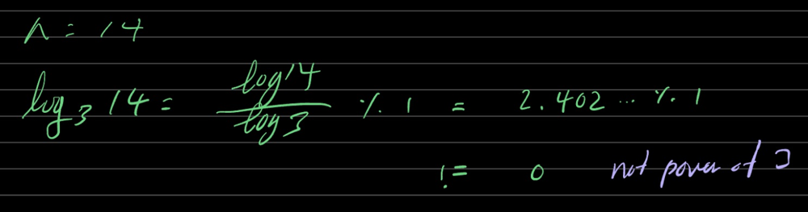
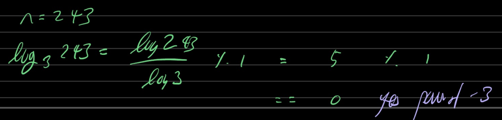

# ✅ Aesthetic TypeScript Solutions (Logarithmic one liner approach) and (Recursive)

**Author:** mlajkim
**Votes:** 3
**Link:** [https://leetcode.com/problems/power-of-three/solutions/3515185/](https://leetcode.com/problems/power-of-three/solutions/3515185/)

---

# Code (Logarithmic one liner approach)
- When number is NOT power of `3`

- When number IS power of `3`

```
function isPowerOfThree(n: number): boolean {
  return n > 0 && Math.log10(n) / Math.log10(3) % 1 === 0;
}
```

# Code (Recursive)
```
function isPowerOfThree(n: number): boolean {
    if (n === 0) return false
    if (n === 1) return true
    if (n % 3 === 0) return isPowerOfThree(n / 3)
    return false
};
```

# Thank you

Upvote if you like \u2B06\uFE0F
If you have any questions, please let me know in the comment section.