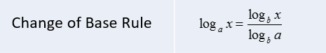

# 🚀 100% || Brute Force & Two Math Solutions || Explained Intuition 🚀

**Author:** MohamedMamdouh20
**Votes:** 143
**Link:** [https://leetcode.com/problems/power-of-four/solutions/4197587/](https://leetcode.com/problems/power-of-four/solutions/4197587/)

---

# Problem Description

Given an integer `n`. The task is to determine whether `n` is a power of **four**. 
An integer `n` is considered a power of **four** if there exists another integer `x` such that `n` is equal to `4` raised to the power of `x` (i.e., $n = 4^x$).
Return `true` if `n` is a power of **four**; otherwise, return `false`.

- Constraints:
    - `-2e31 <= n <= 2e31 - 1`


---

# Intuition

Hi there, 

Let's dive deep \uD83E\uDD3F into today's interesting problem.
The problem says that we want to find if given number `n` is **power** of four $n = 4^x$ or not.

Seems easy ?\uD83E\uDD14
Actually the first valid solution is **Brute Force**.
We can check all the **possible** power of fours and if our number is one of them then we return **true**.
Concise and simple. \uD83D\uDC4C
But what is our **range**, how many number we will **check** ? \uD83E\uDD14
our constraints are `2e31 <= n <= 2e31 - 1` so max number to check it power is `log(2e31) base 4` which is `15.5`.
But since this is the **maximum** value that **int** data type can hold so we will search maximum from `(0 -> 15)` because `4^16` will give us **integer** **overflow**.

Now, this is the **Brute Force** solution with $O(log(N)^2)$ complexity, can we do **better**?\uD83E\uDD14
Actually, we can !\uD83E\uDD2F
We will have some help from **math** especially **Logarithms**.\u2797\u2795
if we know that $n = 4^x$ then for sure `log(n) base 4` is an **integer** and if there is a **fraction** then `n` is not to the power of four.
```
EX1: n = 16
n = 4 ^ 2 => power of four
x = 2
```
```
EX2: n = 256
n = 4 ^ 4 => power of four
x = 4
```
```
EX3: n = 147
n = 4 ^ 3.6 => not power of four
x = 3.6
```

Great ! but how will we get that `log base 4` since programming languages don't implement it !.
Here comes the Logarithms properties. We have a rule called **Change of Base Rule**.



Most of programming languages implements `log base 10` or `log base 2` or even `log base natural number e`.

We will **pick** one of these **implemented** logs and compute `log base 4` using them. and check if result if **integer** if not then it is not power of **four**.

Is there another valid solution ?\uD83E\uDD14
Say that I don't want to use this logarithmic **rule** and I am not good with it can I do something else? \uD83E\uDD28

Actually we can ! \uD83E\uDD2F

Let's see this observation.
n = $4 ^ x$
n = $(2 * 2) ^ x$
n = $2 ^ x$ * $2 ^ x$
sqrt(n) = $2 ^ x$
log2(sqrt(n)) = x

What is this ! \uD83E\uDD2F
This is the beauty of math. \uD83E\uDD29
We can get `x` without using change of base rule. since n = $4 ^ x$ so it is naturally **product** of two similar numbers then we can calculate its **square root**. then get its `log base 2` easily.
most programming languages implements `log base 2`. Sadly, except **Java** so we will go back to change of base rule.
But this also a valid solution if you are not using Java and don't want to calculate many logarithms.\uD83D\uDCAA


And this is the solution for our today'S problem I hope that you understood it\uD83D\uDE80\uD83D\uDE80


---


# Approach

## Brute Force

1. Start an iteration from `i` equal to 0 to 15, representing powers of `4` from `4^0` to `4^15` since the maximum value that **int** can hold is `4^(15.5)`.
2. Calculate the `powerOfFour` by raising `4` to the power of `i`.
3. if `powerOfFour` is equal to the input integer `n`. If they are equal, return `true` because `n` is a power of four.
4. If `powerOfFour` becomes greater than `n`, there's no need to continue the loop, so return `false`.
5. If none of the powers of `4` match `n` during the loop, return `false` to indicate that `n` is not a power of four.

## Complexity
- **Time complexity:** $O(log(N)^2)$
Since we are iterating from `0` to `15` which `15` is `log(INT_MAX)` to the **base** of `4` and in each iteration we calculate the **power** of $4^i$ which is **logarithmic** operations so total complexity is `O(log(N)^2)`.
- **Space complexity:** $O(1)$
Since we are only storing constant variables.


---


## First Math Solution

1. Check if the input integer `n` is equal to `1`. If it is, return **true** since `1` is a power of four.
2. If `n` is **non-positive** (less than or equal to 0), return **false** since powers of four are **positive** integers.
3. Calculate the logarithm of 'n' with a base of 4 and store the result in the variable 'logarithmBase4.'
4. Check if 'logarithmBase4' is an integer by comparing it to its integer cast. If they are equal, return `true`; otherwise, return `false`.

## Complexity
- **Time complexity:** $O(1)$
Since we are only doing math operations without any loops or recursion.
- **Space complexity:** $O(1)$
Since we are only storing constant variables.


---
## Second Math Solution

1. Check if the input integer `n` is equal to `1`. If it is, return **true** since `1` is a power of four.
2. If `n` is **non-positive** (less than or equal to 0), return **false** since powers of four are **positive** integers.
3. Calculate the square root of `n` and store it in the variable `sqrtN`.
4. Compute the logarithm base `2` of `sqrtN` and store it in `log2SqrtN`.
5. Check if `log2SqrtN` is an integer (i.e., it has no fractional part). If it is an integer, return **true**; otherwise, return **false**.

## Complexity
- **Time complexity:** $O(1)$
Since we are only doing math operations without any loops or recursion.
- **Space complexity:** $O(1)$
Since we are only storing constant variables.


---


# Code

## Brute Force

```C++ []
class Solution {
public:
    bool isPowerOfFour(int n) {
        // Iterate through powers of 4 from 4^0 to 4^15
        for (int i = 0; i <= 15; i++) {
            int powerOfFour = pow(4, i);
            
            // If we find a power of four equal to 'n', return true
            if (powerOfFour == n)
                return true;
            
            // If the current power of four is greater than 'n', there's no need to continue
            if (powerOfFour > n)
                return false;
        }
        
        // 'n' is not a power of four
        return false;
    }
};

```
```Java []
public class Solution {
    public boolean isPowerOfFour(int n) {
        // Iterate through powers of 4 from 4^0 to 4^15
        for (int i = 0; i <= 15; i++) {
            int powerOfFour = (int) Math.pow(4, i);
            
            // If we find a power of four equal to 'n', return true
            if (powerOfFour == n)
                return true;
            
            // If the current power of four is greater than 'n', there's no need to continue
            if (powerOfFour > n)
                return false;
        }
        
        // 'n' is not a power of four
        return false;
    }
}
```
```Python []
class Solution:
    def isPowerOfFour(self, n):
        # Iterate through powers of 4 from 4^0 to 4^15
        for i in range(16):
            power_of_four = 4 ** i
            
            # If we find a power of four equal to 'n', return True
            if power_of_four == n:
                return True
            
            # If the current power of four is greater than 'n', there's no need to continue
            if power_of_four > n:
                return False
        
        # 'n' is not a power of four
        return False

```
```C []
bool isPowerOfFour(int n) {
    // Iterate through powers of 4 from 4^0 to 4^15
    for (int i = 0; i <= 15; i++) {
        int powerOfFour = pow(4, i);

        // If we find a power of four equal to 'n', return true
        if (powerOfFour == n)
            return true;

        // If the current power of four is greater than 'n', there's no need to continue
        if (powerOfFour > n)
            return false;
    }

    // 'n' is not a power of four
    return false;
}
```


---


## First Math Solution
```C++ []
class Solution {
public:
    bool isPowerOfFour(int n) {
        // If 'n' is 1, it is a power of four
        if (n == 1)
            return true;
        
        // If 'n' is non-positive, it cannot be a power of four
        if (n <= 0)
            return false; 
        
        // Calculate the logarithm of 'n' with base 4
        double logarithmBase4 = log(n) / log(4);
        
        // Check if the result of the logarithmic operation is an integer
        return (logarithmBase4 == (int)logarithmBase4);
    }
};
```
```Java []
public class Solution {
    public boolean isPowerOfFour(int n) {
        // If 'n' is 1, it is a power of four
        if (n == 1)
            return true;
        
        // If 'n' is non-positive, it cannot be a power of four
        if (n <= 0)
            return false; 
        
        // Calculate the logarithm of 'n' with base 4
        double logarithmBase4 = Math.log(n) / Math.log(4);
        
        // Check if the result of the logarithmic operation is an integer
        return (logarithmBase4 == (int)logarithmBase4);
    }
}
```
```Python []
class Solution:
    def isPowerOfFour(self, n):
        # If 'n' is 1, it is a power of four
        if n == 1:
            return True
        
        # If 'n' is non-positive, it cannot be a power of four
        if n <= 0:
            return False
        
        # Calculate the logarithm of 'n' with base 4
        logarithm_base4 = math.log(n) / math.log(4)
        
        # Check if the result of the logarithmic operation is an integer
        return (logarithm_base4 == int(logarithm_base4))
```
```C []
bool isPowerOfFour(int n) {
    // If 'n' is 1, it is a power of four
    if (n == 1)
        return 1; // True in C is often represented as 1

    // If 'n' is non-positive, it cannot be a power of four
    if (n <= 0)
        return 0; // False in C is often represented as 0

    // Calculate the logarithm of 'n' with base 4
    double logarithmBase4 = log(n) / log(4);

    // Check if the result of the logarithmic operation is an integer
    return (logarithmBase4 == (int)logarithmBase4);
}
```


---

## Second Math Solution

```C++ []
class Solution {
public:
    bool isPowerOfFour(int n) {
        // If 'n' is 1, it is a power of four
        if (n == 1)
            return true;
        
        // If 'n' is non-positive, it cannot be a power of four
        if (n <= 0)
            return false; 
        
        // Calculate the square root of 'n'
        double sqrtN = sqrt(n);

        // Take the logarithm base 2 of the square root
        double log2SqrtN = log2(sqrtN);
        
        // Check if the result of the logarithmic operation is an integer
        return (log2SqrtN == (int)log2SqrtN);
    }
};
```
```Java []
public class Solution {
    public boolean isPowerOfFour(int n) {
        // If 'n' is 1, it is a power of four
        if (n == 1)
            return true;

        // If 'n' is non-positive, it cannot be a power of four
        if (n <= 0)
            return false;

        // Calculate the square root of 'n'
        double sqrtN = Math.sqrt(n);

        // Take the logarithm base 2 of the square root
        double log2SqrtN = Math.log(sqrtN) / Math.log(2);

        // Check if the result of the logarithmic operation is an integer
        return (log2SqrtN == (int) log2SqrtN);
    }
}
```
```Python []
class Solution:
    def isPowerOfFour(self, n):
        # If 'n' is 1, it is a power of four
        if n == 1:
            return True

        # If 'n' is non-positive, it cannot be a power of four
        if n <= 0:
            return False

        # Calculate the square root of 'n'
        sqrtN = math.sqrt(n)

        # Take the logarithm base 2 of the square root
        log2SqrtN = math.log2(sqrtN)

        # Check if the result of the logarithmic operation is an integer
        return log2SqrtN == int(log2SqrtN)
```
```C []
bool isPowerOfFour(int n) {
    // If 'n' is 1, it is a power of four
    if (n == 1)
        return 1; // True in C is often represented as 1

    // If 'n' is non-positive, it cannot be a power of four
    if (n <= 0)
        return 0; // False in C is often represented as 0

    // Calculate the square root of 'n'
    double sqrtN = sqrt(n);

    // Take the logarithm base 2 of the square root
    double log2SqrtN = log2(sqrtN);

    // Check if the result of the logarithmic operation is an integer
    return (log2SqrtN == (int)log2SqrtN);
}
```


