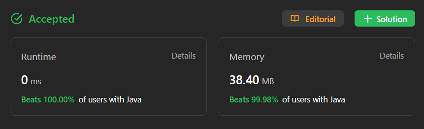

# ✅ Easier Than Easy ✅ Multiple Approach Multiple Languages ✅ Explained In Video

**Author:** millenium103
**Votes:** 27
**Link:** [https://leetcode.com/problems/power-of-four/solutions/4197898/](https://leetcode.com/problems/power-of-four/solutions/4197898/)

---



# YouTube Video Explanation:
[https://youtu.be/OH8TWGJMf30](https://youtu.be/OH8TWGJMf30)

**\uD83D\uDD25 Please like, share, and subscribe to support our channel's mission of making complex concepts easy to understand.**

Subscribe Link: https://www.youtube.com/@leetlogics/?sub_confirmation=1

*Subscribe Goal: 150 Subscribers*
*Current Subscribers: 114*

# Intuition

We're given a number `n`, and we need to determine if it's a power of four. A number is a power of four if:

1. It's a positive integer.
2. It's a power of two (i.e., it has only one bit set in its binary representation).
3. The position of the least significant bit (LSB) set to 1 is even.

We'll explore multiple approaches to solve this problem.


## Brute Force:

```java
class Solution {
    public boolean isPowerOfFour(int n) {
        if (n == 0) return false;
        if (n == 1) return true;
        if (n % 4 != 0) return false;

        return isPowerOfFour(n / 4);
    }
}
```

In the brute force approach, we recursively divide the number by 4 as long as it's divisible by 4. If we eventually reach 1, the number is a power of four.

## Using Logarithmic:

```java
class Solution {
    public boolean isPowerOfFour(int n) {
        if (n == 0) return false;
        return (Math.log(n) / Math.log(4)) % 1 == 0;
    }
}
```

In this approach, we use logarithms to check if the logarithm of `n` base 4 is an integer. If it is, `n` is a power of four.

## Bit Manipulation:

```java
class Solution {
    public boolean isPowerOfFour(int n) {
        if (n <= 0) return false;
        if (n == 1) return true;

        if ((lsb(n) % 2 == 0) && (n & (n - 1)) == 0) {
            return true;
        } else
            return false;
    }

    private int lsb(int n) {
        int p = 1;
        while (n > 0) {
            if ((n & 1) > 0) {
                return p - 1;
            }
            p++;
            n = n >> 1;
        }
        return -1;
    }
}
```

In the bit manipulation approach, we check if the least significant bit (LSB) is at an even position, and if `n` is a power of two (verified by `n & (n - 1) == 0`). If both these conditions are met, `n` is a power of four.

## Complexity Analysis:

- Time Complexity: All three approaches have a time complexity of O(1) because they involve a fixed number of operations for any input value.
- Space Complexity: The space complexity for all three approaches is O(1) as they don't use additional data structures that depend on the input size.

# Code
<iframe src="https://leetcode.com/playground/7LUj6Jdu/shared" frameBorder="0" width="600" height="500"></iframe>

---


