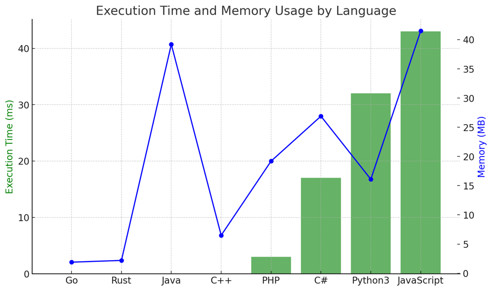

# ✅ 93.65% Why 3s?

**Author:** vanAmsen
**Votes:** 75
**Link:** [https://leetcode.com/problems/integer-break/solutions/4135679/](https://leetcode.com/problems/integer-break/solutions/4135679/)

---

# Intuition
When given an integer `n`, our goal is to break it into sums of smaller integers such that their product is maximized. At first, it might seem that a brute-force approach of trying all combinations is the answer. However, a more in-depth analysis of the numbers reveals patterns that can be utilized to achieve the result more efficiently. 

## Live Coding & Expalin
https://youtu.be/tDZAQM3VMu8?si=MIhHp-nL0EybsyOO

# Approach
1. **Why 3s?** By testing various numbers, it becomes evident that the number 3 plays a significant role in maximizing the product. For example:
   - `4 = 2 + 2` (product = 4)
   - `5 = 2 + 3` (product = 6)
   - `6 = 3 + 3` (product = 9)
   - `7 = 3 + 2 + 2` (product = 12)
   - `8 = 3 + 3 + 2` (product = 18)
   - `9 = 3 + 3 + 3` (product = 27)
   
2. **Why not 4s?** Anytime we have a 4, we can always split it into two 2s, which will give a better or equal product.

3. **Handling Remainders:** When `n` is divided by 3, the remainder can be 0, 1, or 2:
   - Remainder 0: `n` is a perfect multiple of 3. We break `n` entirely into 3s.
   - Remainder 1: It's better to take a 3 out and add a 4 (which is split as two 2s). This is because the product of three numbers, 3, 1, and `n-4`, is less than the product of the two numbers, 4 and `n-4`.
   - Remainder 2: We simply multiply the leftover 2 with the product of all 3s.

# Complexity
- **Time complexity:** `O(log n)`. This is because our primary operation involves raising 3 to the power of `count_of_3s` which, in Python, takes `O(log n)` time.
  
- **Space complexity:** `O(1)`. We only use a constant amount of extra space regardless of the input size.

# Code
```Python []
class Solution:
    def integerBreak(self, n: int) -> int:
        if n == 2: return 1
        if n == 3: return 2
        
        count_of_3s, remainder = divmod(n, 3)
        
        if remainder == 0:
            return 3 ** count_of_3s
        elif remainder == 1:
            return 3 ** (count_of_3s - 1) * 4
        else:  
            return 3 ** count_of_3s * 2
```
``` C++ []
class Solution {
public:
    int integerBreak(int n) {
        if (n == 2) return 1;
        if (n == 3) return 2;
        
        int count_of_3s = n / 3;
        int remainder = n % 3;
        
        if (remainder == 0) {
            return pow(3, count_of_3s);
        } else if (remainder == 1) {
            return pow(3, count_of_3s - 1) * 4;
        } else {
            return pow(3, count_of_3s) * 2;
        }
    }
};
```
``` Java []
public class Solution {
    public int integerBreak(int n) {
        if (n == 2) return 1;
        if (n == 3) return 2;

        int count_of_3s = n / 3;
        int remainder = n % 3;

        if (remainder == 0) {
            return (int) Math.pow(3, count_of_3s);
        } else if (remainder == 1) {
            return (int) Math.pow(3, count_of_3s - 1) * 4;
        } else {
            return (int) Math.pow(3, count_of_3s) * 2;
        }
    }
}
```
``` Go []
func integerBreak(n int) int {
    if n == 2 { return 1 }
    if n == 3 { return 2 }
    
    count_of_3s := n / 3
    remainder := n % 3

    if remainder == 0 {
        return int(math.Pow(3, float64(count_of_3s)))
    } else if remainder == 1 {
        return int(math.Pow(3, float64(count_of_3s - 1))) * 4
    } else {
        return int(math.Pow(3, float64(count_of_3s))) * 2
    }
}
```
``` Rust []
impl Solution {
    pub fn integer_break(n: i32) -> i32 {
        if n == 2 { return 1; }
        if n == 3 { return 2; }

        let count_of_3s = n / 3;
        let remainder = n % 3;

        if remainder == 0 {
            return (3 as i32).pow(count_of_3s as u32);
        } else if remainder == 1 {
            return (3 as i32).pow((count_of_3s - 1) as u32) * 4;
        } else {
            return (3 as i32).pow(count_of_3s as u32) * 2;
        }
    }
}
```
``` JavaScript []
var integerBreak = function(n) {
    if (n === 2) return 1;
    if (n === 3) return 2;

    let count_of_3s = Math.floor(n / 3);
    let remainder = n % 3;

    if (remainder === 0) {
        return 3 ** count_of_3s;
    } else if (remainder === 1) {
        return 3 ** (count_of_3s - 1) * 4;
    } else {
        return 3 ** count_of_3s * 2;
    }
};
```
``` PHP []
class Solution {
    function integerBreak($n) {
        if ($n == 2) return 1;
        if ($n == 3) return 2;

        $count_of_3s = intdiv($n, 3);
        $remainder = $n % 3;

        if ($remainder == 0) {
            return pow(3, $count_of_3s);
        } elseif ($remainder == 1) {
            return pow(3, $count_of_3s - 1) * 4;
        } else {
            return pow(3, $count_of_3s) * 2;
        }
    }
}
```
``` C# []
public class Solution {
    public int IntegerBreak(int n) {
        if (n == 2) return 1;
        if (n == 3) return 2;

        int count_of_3s = n / 3;
        int remainder = n % 3;

        if (remainder == 0) {
            return (int) Math.Pow(3, count_of_3s);
        } else if (remainder == 1) {
            return (int) Math.Pow(3, count_of_3s - 1) * 4;
        } else {
            return (int) Math.Pow(3, count_of_3s) * 2;
        }
    }
}

```

# Why It Works?
Our solution is based on the observation that breaking the number into as many 3s as possible (with exceptions mentioned above) gives the highest product. This is due to the mathematical properties of numbers and the product operation. When multiplying numbers, the more we can distribute the value equally among the multiplicands, the larger the product becomes. 3 is the optimal number for this task.

# What We Learned?
This problem teaches us the importance of mathematical patterns and how they can be applied to derive an efficient solution. Instead of resorting to brute force or dynamic programming, sometimes a clever insight, based on the properties of numbers, can lead us to an elegant and optimal answer.

# Performance

| Language   | Execution Time (ms) | Memory (MB) |
|------------|---------------------|-------------|
| Go         | 0 ms                | 1.9 MB      |
| Rust       | 0 ms                | 2.2 MB      |
| Java       | 0 ms                | 39.2 MB     |
| C++        | 0 ms                | 6.5 MB      |
| PHP        | 3 ms                | 19.2 MB     |
| C#         | 17 ms               | 26.9 MB     |
| Python3    | 32 ms               | 16.1 MB     |
| JavaScript | 43 ms               | 41.5 MB     |


