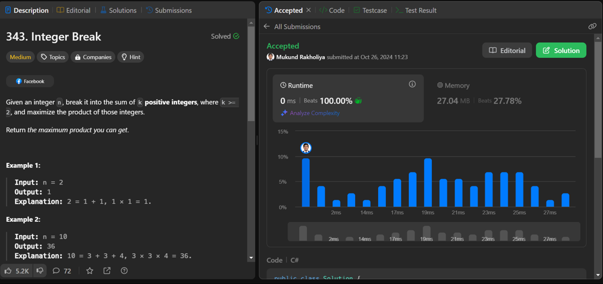

# ✅ EASY || 💯 BEATS - PROOF || ⭐ MULTIPLE LANGUAGE || 🧑‍💻 BEGINNER FRIENDLY

**Author:** mukund_rakholiya
**Votes:** 2
**Link:** [https://leetcode.com/problems/integer-break/solutions/5969510/](https://leetcode.com/problems/integer-break/solutions/5969510/)

---

```
```


```
```

# \u2B50 Intuition
<!-- Describe your first thoughts on how to solve this problem. -->
**The goal is to split $$n$$ into parts such that their product is maximized. Observing how factors contribute to maximizing products, breaking $$n$$ into multiple parts of 2s and 3s yields the largest possible products due to their properties in multiplication.**

```
```
# \u2B50 Approach
<!-- Describe your approach to solving the problem. -->
1. **Dynamic Programming Setup**:

    - Initialize an array arr where `arr[i]` will store the maximum product obtainable by breaking the integer $$i$$.
    - Set `arr[1]` to 1, as a base case.

2. **Populate the DP Array**:

    - For each integer $$i$$ from 2 up to $$n$$:
        - For each integer $$j$$ from 1 up to $$i\u22121$$:
            - Calculate the product by either:
                - Not breaking further: $$j\xD7(i\u2212j)$$
                - Breaking further using stored values in $$arr$$: $$arr[j]$$ \	imes $$(i - j)$$.
            - Update arr[i] with the maximum product found.

3. **Return Result**:

    - After the loop completes, arr[n] holds the maximum product obtainable by breaking $$n$$.

```
```
# \u2B50 Complexity
- Time complexity:
<!-- Add your time complexity here, e.g. $$O(n)$$ -->

**This comes from the nested loop where we calculate maximum products for each pair of $$i$$ and $$j$$ up to $$n$$.**

- Space complexity:
<!-- Add your space complexity here, e.g. $$O(n)$$ -->
**We only need an array of size $$n+1$$ to store the intermediate products.**

```
```
# \u2B50 Code
```Java []
class Solution {
    public int integerBreak(int n) {
        int[] arr = new int[n + 1];

        arr[1] = 1;

        for (int i = 2; i <= n; i++) {
            arr[i] = 1;
            
            for (int j = 1; j < i; j++) {
                arr[i] = Math.max(arr[i], Math.max(arr[j], j) * (i - j));
            }
        }

        return arr[n];
    }
}
```
```C# []
public class Solution {
    public int IntegerBreak(int n) {
        int[] arr = new int[n + 1];

        arr[1] = 1;

        for (int i = 2; i <= n; i++) {
            arr[i] = 1;

            for (int j = 1; j < i; j++) 
                arr[i] = Math.Max(arr[i], Math.Max(arr[j], j) * (i - j));
        
        }
        return arr[n];
    }
}
```
```Python []
class Solution(object):
    def integerBreak(self, n):
        arr = [1] * (n + 1)

        for i in range(2, n + 1):
            for j in range(1, i):
                arr[i] = max(arr[i], max(arr[j], j) * (i - j))
        
        return arr[n]
```
```C++ []
class Solution {
public:
    int integerBreak(int n) {
        std::vector<int> arr(n + 1, 1);

        for (int i = 2; i <= n; i++) 
            for (int j = 1; j < i; j++)
                arr[i] = std::max(arr[i], std::max(arr[j], j) * (i - j));
        
        return arr[n];
    }
};
```
```PHP []
class Solution {
    function integerBreak($n) {
        $arr = array_fill(0, $n + 1, 1);

        for ($i = 2; $i <= $n; $i++) 
            for ($j = 1; $j < $i; $j++)
                $arr[$i] = max($arr[$i], max($arr[$j], $j) * ($i - $j));

        return $arr[$n];
    }
}
```
``` Python3 []
class Solution(object):
    def integerBreak(self, n):
        arr = [1] * (n + 1)

        for i in range(2, n + 1):
            for j in range(1, i):
                arr[i] = max(arr[i], max(arr[j], j) * (i - j))
        
        return arr[n]
```

```
```


```
```
