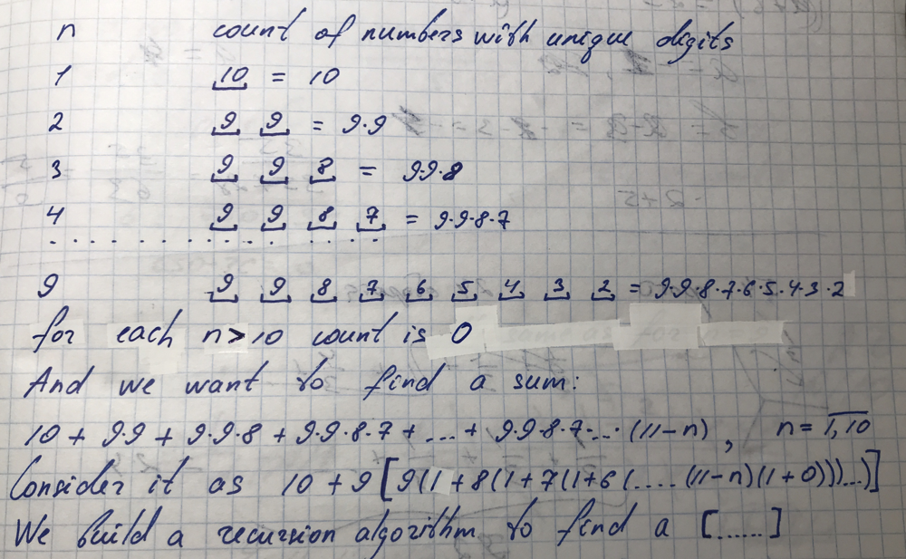

# Python O(1) 99.80% math with explanation

**Author:** DenysCoder
**Votes:** 27
**Link:** [https://leetcode.com/problems/count-numbers-with-unique-digits/solutions/374777/](https://leetcode.com/problems/count-numbers-with-unique-digits/solutions/374777/)

---

```
class Solution(object):
    def countNumbersWithUniqueDigits(self, n):
        """
        :type n: int
        :rtype: int
        """
        def count(k):
            if k == max(10 - n, 0):
                return 0
            return k*(1 + count(k - 1))
        if n == 0:
            return 1
        return 9*count(9) + 10
```


