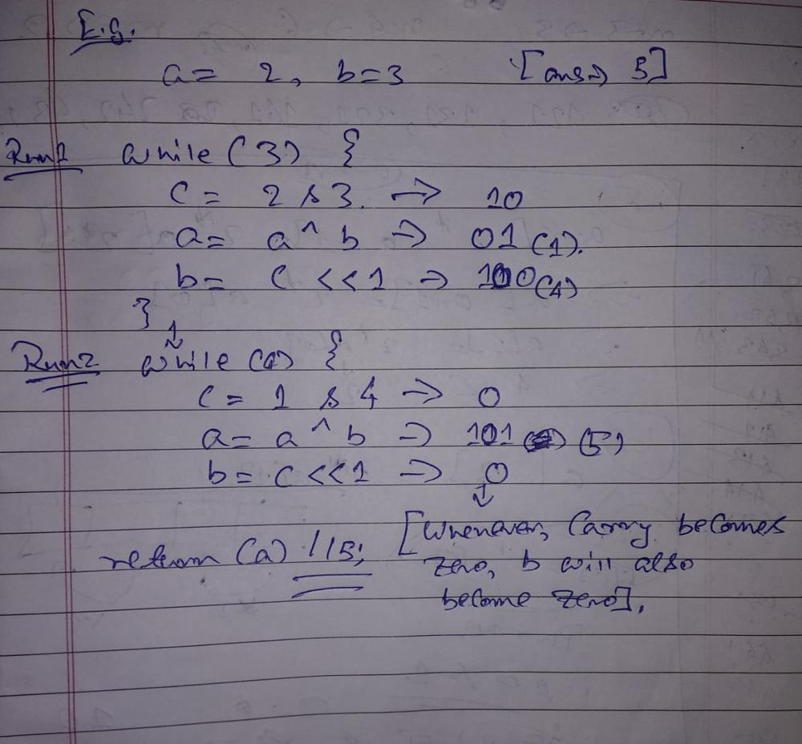

# C++ || 100% faster || With explanation

**Author:** Adityajha0808
**Votes:** 51
**Link:** [https://leetcode.com/problems/sum-of-two-integers/solutions/1394031/](https://leetcode.com/problems/sum-of-two-integers/solutions/1394031/)

---

If you ever confront these type of problems, then bitwise manipulation will always be the key to it.

So, the solution is relatively simple, we loop until the second integer 'b' (vice versa) gets to 0.
We use c variable (for carry condition) to get the common bits between a and b (using & operator). 
Common bit( 0,0 and 1,1) will have carry 0 and 1 respectively. It is set to unsigned as we have negative number cases as well.

Using XOR operator, we will be doing our main operation. ^ this breaks down decimal into binary and checks if we have different values. If 0 and 1, 1 and 0 then it simply adds it to 1 . If 0 0 it does nothing. If 1 1, it produces a carry for the next bit and makes current bit sum as 0. I would recommend reading about XOR and & operators before advancing to this problem.

If we have carry condition and we need to create new bit we add 1 to sum. (Eg. 100 and 111 would be 011, so we need to add 1 at front to get our desired answer).

To take care about termination of the loop we will pass our carry into left shift operator and store that value into b. To put it simply, b becomes zero when carry becomes zero.
Here's an example with a=2, b=3 where sum is 5.

I hope you understood the solution, if you liked it please do upvote the post :)

```
int getSum(int a, int b) {
        while(b) {
            unsigned c = a&b;
            a ^= b;
            b = c << 1;
        }
        return a;
}
```