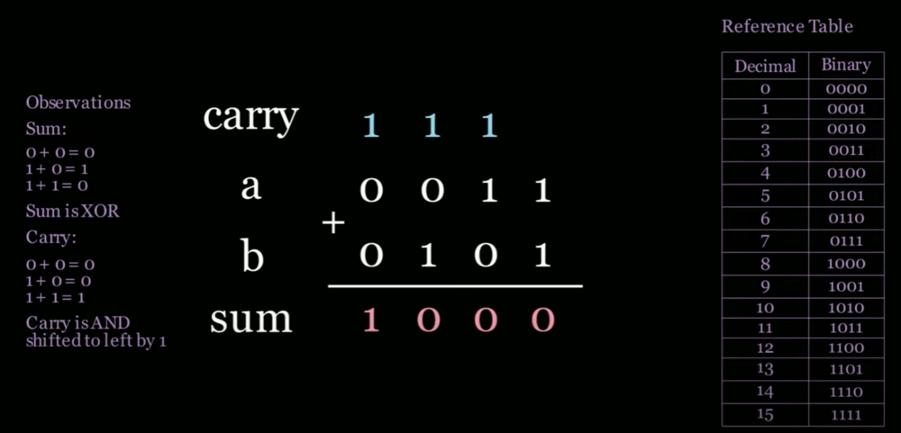

# [Animated Video] Bit Manipulation and Masking Visualized

**Author:** codeinmotion
**Votes:** 8
**Link:** [https://leetcode.com/problems/sum-of-two-integers/solutions/6134267/](https://leetcode.com/problems/sum-of-two-integers/solutions/6134267/)

---


# *CodeInMotion Resources*
## Every Leetcode Pattern You Need To Know
https://www.blog.codeinmotion.io/p/leetcode-patterns

## Blind 75 Animated Playlist
https://www.youtube.com/playlist?list=PLHm8nzcbp3_19DiTlDg8QYvR-hN5jzPCp

## Subscribe to YouTube
https://www.youtube.com/@CodeInMotion-IO?sub_confirmation=1

---
## Animated Video
https://youtu.be/mXB9jbJzXwU

## Intuition

To solve the problem of summing two integers without using the `+` or `-` operators, we can utilize bitwise operations. The key is to understand how binary addition works:
- The XOR (`^`) operation gives the sum without carrying over.
- The AND (`&`) operation identifies where the carry occurs.
- Shifting the carry by one bit (`<<`) simulates carrying over to the next significant bit.
We repeat this process until there are no more carry operations left.

## Approach
1. Use a 32-bit mask (`0xFFFFFFFF`) to handle negative numbers and simulate a 32-bit integer.
2. Perform the addition using XOR for the sum and AND for the carry.
3. Shift the carry by one position to the left.
4. Update the operands with the new sum and carry.
5. Repeat until the carry becomes zero.
6. Adjust for negative numbers if the result exceeds the maximum 32-bit integer.

## Example Walkthrough
### Input: `a=3`, `b=5`  
Binary representation:  
- `a = 0011`  
- `b = 0101`  

**Step 1:**  
- XOR (`^`): `0011 ^ 0101 = 0110` (sum without carry)  
- AND (`&`): `0011 & 0101 = 0001` (carry)  
- Shift carry: `0001 << 1 = 0010`  

**Step 2:**  
- Update `a = 0110` and `b = 0010`.  
- XOR: `0110 ^ 0010 = 0100`  
- AND: `0110 & 0010 = 0010`  
- Shift carry: `0010 << 1 = 0100`  

**Step 3:**  
- Update `a = 0100` and `b = 0100`.  
- XOR: `0100 ^ 0100 = 0000`  
- AND: `0100 & 0100 = 0100`  
- Shift carry: `0100 << 1 = 1000`  

**Step 4:**  
- Update `a = 0000` and `b = 1000`.  
- XOR: `0000 ^ 1000 = 1000`  
- AND: `0000 & 1000 = 0000` (no carry left).  

**Result:** `a = 1000` (decimal `8`).

## Python-Specific Explanation

Python handles integers differently compared to other programming languages. Python integers are **not limited to 32-bits** and can grow arbitrarily large. However, in this problem, we need to simulate **32-bit integer behavior**, where integers are bounded to 32 bits and can represent both positive and negative values. This requires additional handling in Python using a **mask** and the concept of **two's complement** for signed integers.

### What is a Mask?
A **mask** is a bit pattern used to isolate or manipulate specific bits of a number. In this solution, we use the mask `0xFFFFFFFF`, which represents a 32-bit binary number of all 1's (`11111111111111111111111111111111` in binary). 

This mask helps us:
1. Ensure all calculations stay within 32 bits.
2. Handle signed numbers by simulating the boundaries of 32-bit integers.

#### Why AND the Results with the Mask?
When performing bitwise operations in Python, numbers can exceed 32 bits. To restrict results to 32 bits, we use the bitwise AND operator (`&`) with the mask. You can imagine that since the mask is only 32 bits, AND'ing a number with a mask forces us to only use 32 bits.
```python
mask = 0xFFFFFFFF # 1111 .... 1111, 32 ones
number & mask # we effectively trim the number to only use 32 bits
```

#### Why Flip the Bits and Take Two's Complement?
In Python, numbers are treated as unsigned by default, meaning Python will interpret all binary representations as positive integers. To simulate signed 32-bit integers (e.g., negative numbers), we need to handle cases where the result of our operation exceeds the maximum positive value of a 32-bit integer `(2^31 - 1)`.

Here\u2019s the process:
1. If the result of the computation exceeds the 32-bit signed integer max `(2^31 - 1)`, we know it\u2019s a negative number in the context of 32-bit integers.
2. To convert this value into its correct signed representation, we invert its bits using a bitwise XOR with the mask `0xFFFFFFFF`:
```
# this example assumes an int is 4 bits instead of 32 for easier reading
mask = 1111
a =    1100 # python treats this as 12 in unsigned format
flipped_bits = a ^ mask = 0011
```
3. Next, we re-flip back the bits using python's two complement operator to force python to treat the number as a signed, negative value
```
# ~ is the 2s complement operator in python. ~x = -x-1 
flipped_bits = a ^ mask = 0011
~flipped_bits = ~(a ^ mask) = 1100 # python now treats this as -4
```
4. Therefore, if our final sum is less than `2^31 - 1`, we return back the answer, else we return back `~(a ^ mask)`

## Complexity
- Time complexity: $$O(32)$$
- Space complexity: $$O(1)$$

## Code
```Python []
class Solution:
    def getSum(self, a: int, b: int) -> int:
        mask = 0xFFFFFFFF  # 32 bit mask
        maxInt = 2**31 - 1

        while b != 0:
            sum = (a ^ b) & mask # contain to 32 bits
            carry = (a & b) & mask # contain to 32 bits
            a = sum
            b = carry << 1
        
        return a if a <= maxInt else ~(a ^ mask)
```
```Java []
class Solution {
    public int getSum(int a, int b) {
        while (b != 0) {
            int sum = a ^ b; // sum without carry
            int carry = (a & b) << 1; // carry shifted left
            a = sum;
            b = carry;
        }
        return a;
    }
}
```
```JavaScript []
var getSum = function(a, b) {
    while (b !== 0) {
        let sum = a ^ b; // sum without carry
        let carry = (a & b) << 1; // carry shifted left
        a = sum;
        b = carry;
    }
    return a;
};
```
```C# []
public class Solution {
    public int GetSum(int a, int b) {
        while (b != 0) {
            int sum = a ^ b; // sum without carry
            int carry = (a & b) << 1; // carry shifted left
            a = sum;
            b = carry;
        }
        return a;
    }
}
```
```C++ []
class Solution {
public:
    int getSum(int a, int b) {
        while (b != 0) {
            int sum = a ^ b; // sum without carry
            int carry = (a & b) << 1; // carry shifted left
            a = sum;
            b = carry;
        }
        return a;
    }
};
```
```Go []
func getSum(a int, b int) int {
    for b != 0 {
        sum := a ^ b // sum without carry
        carry := (a & b) << 1 // carry shifted left
        a = sum
        b = carry
    }
    return a
}
```
### Please thumbs up on the bottom-left corner!<br>It motivates me to create more solutions and videos for you!

