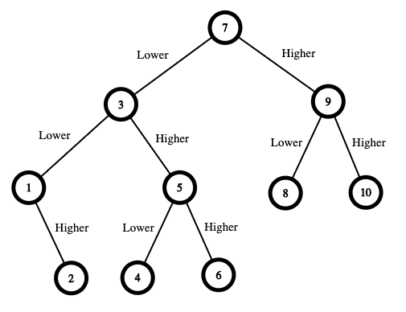

# [375. Guess Number Higher or Lower II](https://leetcode.com/problems/guess-number-higher-or-lower-ii/)

| Category | Difficulty | Likes | Dislikes |
| :------: | :--------: | :---: | :------: |
| Algorithms | Medium | 2307 | 2161 |

**Tags:** [`math`](https://leetcode.com/tag/math), [`dynamic-programming`](https://leetcode.com/tag/dynamic-programming), [`game-theory`](https://leetcode.com/tag/game-theory)

**Companies:** `google`

## Description

We are playing the Guessing Game. The game will work as follows:

	- I pick a number between `1` and `n`.

	- You guess a number.

	- If you guess the right number, **you win the game**.

	- If you guess the wrong number, then I will tell you whether the number I picked is **higher or lower**, and you will continue guessing.

	- Every time you guess a wrong number `x`, you will pay `x` dollars. If you run out of money, **you lose the game**.

Given a particular `n`, return *the minimum amount of money you need to **guarantee a win regardless of what number I pick***.

 

**Example 1:**


```

Input: n = 10
Output: 16
Explanation: The winning strategy is as follows:
- The range is [1,10]. Guess 7.
&nbsp;   - If this is my number, your total is $0. Otherwise, you pay $7.
&nbsp;   - If my number is higher, the range is [8,10]. Guess 9.
&nbsp;       - If this is my number, your total is $7. Otherwise, you pay $9.
&nbsp;       - If my number is higher, it must be 10. Guess 10. Your total is $7 + $9 = $16.
&nbsp;       - If my number is lower, it must be 8. Guess 8. Your total is $7 + $9 = $16.
&nbsp;   - If my number is lower, the range is [1,6]. Guess 3.
&nbsp;       - If this is my number, your total is $7. Otherwise, you pay $3.
&nbsp;       - If my number is higher, the range is [4,6]. Guess 5.
&nbsp;           - If this is my number, your total is $7 + $3 = $10. Otherwise, you pay $5.
&nbsp;           - If my number is higher, it must be 6. Guess 6. Your total is $7 + $3 + $5 = $15.
&nbsp;           - If my number is lower, it must be 4. Guess 4. Your total is $7 + $3 + $5 = $15.
&nbsp;       - If my number is lower, the range is [1,2]. Guess 1.
&nbsp;           - If this is my number, your total is $7 + $3 = $10. Otherwise, you pay $1.
&nbsp;           - If my number is higher, it must be 2. Guess 2. Your total is $7 + $3 + $1 = $11.
The worst case in all these scenarios is that you pay $16. Hence, you only need $16 to guarantee a win.

```

**Example 2:**

```

Input: n = 1
Output: 0
Explanation:&nbsp;There is only one possible number, so you can guess 1 and not have to pay anything.

```

**Example 3:**

```

Input: n = 2
Output: 1
Explanation:&nbsp;There are two possible numbers, 1 and 2.
- Guess 1.
&nbsp;   - If this is my number, your total is $0. Otherwise, you pay $1.
&nbsp;   - If my number is higher, it must be 2. Guess 2. Your total is $1.
The worst case is that you pay $1.

```

 

**Constraints:**

	- `1 <= n <= 200`

---

**Links:** [Submissions](https://leetcode.com/problems/guess-number-higher-or-lower-ii/) | [Solutions](https://leetcode.com/problems/guess-number-higher-or-lower-ii/)
