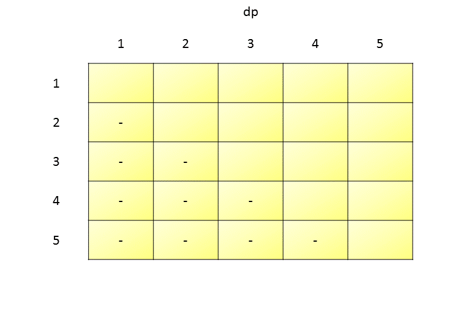

# Official Solution

**Link:** [https://leetcode.com/problems/guess-number-higher-or-lower-ii/solution/](https://leetcode.com/problems/guess-number-higher-or-lower-ii/solution/)

---

[TOC]

## Summary

Given a number $$n$$, we have to find the worst-case cost of guessing a number chosen from the range $$(1, n)$$, assuming that the guesses are made intelligently(minimize the total cost). The cost is incremented by $$i$$ for every wrong guess $$i$$.

For example:
```
n=5
1 2 3 4 5
```
If we start with 3 as the initial guess, the next guess would certainly be 4 as in the worst case required number is 5. Total Cost $$= 4+3=7$$.

But if we start with 4 as the initial guess, our next guess would be 2 as in the worst case required number is 3 or 1. Total Cost $$=4+2=6$$ which is the minimum cost.

```
n=8
1 2 3 4 5 6 7 8
```
In this case, we have to guess 5 followed by 7. Total Cost $$=5+7=12$$.
If we choose 4 as our initial guess. Total Cost $$=4+5+7=16$$.

## Solution

---
### Approach #1 Brute Force [Time Limit Exceeded]

Firstly, we need to be aware of the fact that out of the range $$(1, n)$$, we have to guess the numbers intelligently in order to minimize the cost. But, along with that we have to take into account the worst-case scenario possible, that is we have to assume that the original number chosen is such that it will try to maximize the overall cost.

In Brute Force, we can pick up any number $$i$$ in the range $$(1, n)$$. Assuming it is a wrong guess(worst-case scenario), we have to minimize the cost of reaching the required number. Now, the required number could be lying either to the right or left of the number picked($$i$$). But to cover the possibility of the worst case number chosen, we need to take the maximum cost out of the cost of reaching the worst number out of the right and left segments of $$i$$. Thus, if we pick up $$i$$ as the pivot, the overall minimum cost for the worst required number will be:

$$
\mathrm{cost}(1, n)=i + \max\big(\mathrm{cost}(1,i-1), \mathrm{cost}(i+1,n)\big)
$$

For every segment, we can further choose another pivot and repeat the same process for calculating the minimum cost.

By using the above procedure, we found out the cost of reaching the required number starting with $$i$$ as the pivot. In the same way, we iterate over all the numbers in the range $$(1, n)$$, choosing them as the pivot, calculating the cost of every pivot chosen, and thus, we can find the minimum cost out of those.


<iframe src="https://leetcode.com/playground/QW3ndyqL/shared" frameBorder="0" name="QW3ndyqL" width="100%" height="326"></iframe>

**Complexity Analysis**

* Time complexity : $$O(n!)$$. We choose a number as the pivot and repeat the pivoting process further $$n$$ times $$O(n!)$$. We repeat the same process for $$n$$ pivots.
* Space complexity : $$O(n)$$. Recursion of depth $$n$$ is used.

---
### Approach #2 Modified Brute Force [Time Limit Exceeded]

**Algorithm**

In Brute Force, for numbers in the range $$(i, j)$$, we picked up every number from $$i$$ to $$j$$ as the pivot and found the maximum cost out of its left and right segments. But an important point to observe is that if we choose any number from the range $$\big( i,\frac{i+j}{2} \big)$$ as the pivot, the right segment(consisting of numbers larger than the picked up pivot) will be longer than the left segment(consisting of numbers smaller than it). Thus, we will always get the maximum cost from the right segment and it will be larger than the minimum cost achievable by choosing some other pivot. Therefore, our objective here is to reduce the larger cost that is coming from the right segment. Thus, it is wise to choose the pivot from the range $$\big(\frac{i+j}{2}, j\big)$$. In this way the costs of the two segments will be nearer to each other and this will minimize the overall cost.

Thus, while choosing the pivot instead of iterating from $$i$$ to $$j$$, we iterate from $$\frac{i+j}{2}$$ to $$j$$ and find the minimum achievable cost similar to brute force.

<iframe src="https://leetcode.com/playground/juXrfQvD/shared" frameBorder="0" name="juXrfQvD" width="100%" height="309"></iframe>

**Complexity Analysis**

* Time complexity : $$O(n!)$$. We choose a number as the pivot and repeat the pivoting process further $$n$$ times $$O(n!)$$. We repeat the same process for $$n$$ pivots.
* Space complexity : $$O(n)$$. Recursion of depth $$n$$ is used.

---
### Approach #3 Using DP [Accepted]

**Algorithm**

The problem of finding the minimum cost of reaching the destination number by choosing $$i$$ as a pivot can be divided into the subproblem of finding the maximum out of the minimum costs of its left and right segments as explained above. For each segment, we can continue the process leading to smaller and smaller subproblems. This leads us to the conclusion that we can use DP for this problem.

We need to use a $$dp$$ matrix, where $$dp(i, j)$$ refers to the minimum cost of finding the worst number given only the numbers in the range $$(i, j)$$. Now, we need to know how to fill in the entries of this $$dp$$. If we are given only a single number $$k$$, no matter what the number is the cost of finding that number is always 0 since we always hit the number directly without any wrong guess. Thus, firstly, we fill in all the entries of the $$dp$$ which correspond to segments of length 1 i.e. all entries $$dp(k, k)$$ are initialized to 0. Then, in order to find the entries for segments of length 2, we need all the entries for segments of length 1. Thus, in general, to fill in the entries corresponding to segments of length $$len$$, we need all the entries of length $$len-1$$ and below to be already filled. Thus, we need to fill the entries in the order of their segment lengths. Thus, we fill the entries of $$dp$$ diagonally.

Now, what criteria do we need to fill up the $$dp$$ matrix? For any entry  $$dp(i, j)$$, given the current segment length of interest is $$len$$ i.e. if $$len=j-i+1$$, we assume as if we are available only with the numbers in the range $$(i, j)$$. To fill in its current entry, we follow the same process as Approach 1, choosing every number as the pivot and finding the minimum cost as:

$$
\mathrm{cost}(i, j)=\mathrm{pivot} + \max\big(\mathrm{cost}(i,\mathrm{pivot}-1), \mathrm{cost}(\mathrm{pivot}+1,j)\big)
$$

But, we have an advantage in terms of calculating the cost here, since we already know the costs for the segments of length smaller than $$len$$ from $$dp$$. Thus, the dp equation becomes:

$$
\mathrm{dp}(i, j) = \min_{\mathrm{pivot} \in (i, j)} \big[ \mathrm{pivot} + \max \big( \mathrm{dp}(i,\mathrm{pivot}-1) , \mathrm{dp}(\mathrm{pivot}+1,j) \big) \big]
$$

  where $$\min_{\mathrm{pivot} \in (i, j)}$$ indicates the minimum obtained by considering every number in the range $$(i, j)$$ as the pivot.

The following animation will make the process more clear for n=5:
<!---->
!?!../Documents/375_Guess.json:791,552!?!


<iframe src="https://leetcode.com/playground/X99KiHYD/shared" frameBorder="0" name="X99KiHYD" width="100%" height="326"></iframe>
**Complexity Analysis**

* Time complexity : $$O(n^3)$$. We traverse the complete $$dp$$ matrix once $$(O(n^2))$$. For every entry, we take at most $$n$$ numbers as pivot.

* Space complexity : $$O(n^2)$$. $$dp$$ matrix of size $$n^2$$ is used.

---

### Approach #4 Better Approach using DP [Accepted]

**Algorithm**

In the last approach, we chose every possible pivot from the range $$(i, j)$$. But, as per the argument given in Approach 2, we can choose pivots only from the range $$\big(i+(len-1)/2,j\big)$$, where $$len$$ is the current segment length of interest.
Thus the governing equation is:

$$
\mathrm{dp}(i, j)=\min_{\mathrm{pivot} \in \big(i+\frac{len-1}{2}, j\big)}\big[\mathrm{pivot} + \max\big(\mathrm{dp}(i,\mathrm{pivot}-1), \mathrm{dp}(\mathrm{pivot}+1,j)\big)\big]
$$

 Thus, we can optimize the Approach 3 to some extent.


<iframe src="https://leetcode.com/playground/vxpg2Chd/shared" frameBorder="0" name="vxpg2Chd" width="100%" height="360"></iframe>
**Complexity Analysis**

* Time complexity : $$O(n^3)$$. We traverse the complete $$dp$$ matrix once $$(O(n^2))$$. For every entry, we take at most $$n$$ numbers as pivot.

* Space complexity : $$O(n^2)$$. $$dp$$ matrix of size $$n^2$$ is used.