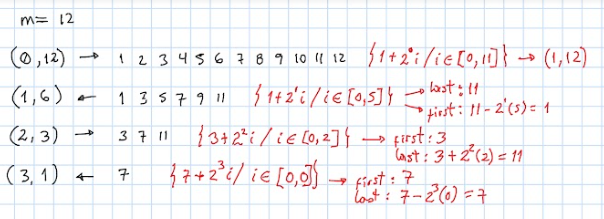

# Dart || Two pointers || simple solution

**Author:** warcayac
**Votes:** 0
**Link:** [https://leetcode.com/problems/elimination-game/solutions/3245749/](https://leetcode.com/problems/elimination-game/solutions/3245749/)

---

# Intuition



# Approach
one only needs to know the first and last values of the previous vector, the current iteration and the number of elements for the present vector to find the solution

# Complexity
- Time complexity:
<!-- Add your time complexity here, e.g. $$O(n)$$ -->

- Space complexity:
<!-- Add your space complexity here, e.g. $$O(n)$$ -->

# Code
```
import 'dart:math';

class Solution {
  var debug = false;
  /* ---------------------------------------------------------------------------- */
  int lastRemaining(int n) {
    if (n == 1) return 1;

    return 2 * applyElimination(n ~/ 2);
  }
  /* ---------------------------------------------------------------------------- */
  int applyElimination(int m, [int iter = 0, int priorHead = 1, int priorTail = 0, bool reverse = false]) {
    if (priorHead == priorTail) return priorHead;

    late int curHead, curTail;

    if (iter == 0) {
      curHead = 1;
      curTail = m;
    } else {
      var priorFactor = pow(2, iter-1).toInt();
      var curFactor = pow(2, iter).toInt();
      if (reverse) {
        curTail = priorTail - priorFactor;
        curHead = curTail - curFactor * (m-1);
      } else {
        curHead = priorHead + priorFactor;
        curTail = curHead + curFactor * (m-1);
      }
    }

    if (debug) print('iter: $iter -> m: $m ${reverse ? '<-' : '->'} ($curHead, $curTail)');
    return applyElimination(m ~/ 2, ++iter, curHead, curTail, !reverse);
  }
  /* ---------------------------------------------------------------------------- */
}
```