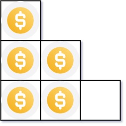
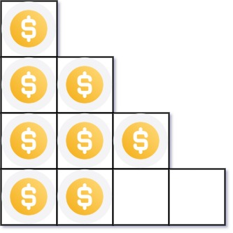

# [441. Arranging Coins](https://leetcode.com/problems/arranging-coins/)

| Category | Difficulty | Likes | Dislikes |
| :------: | :--------: | :---: | :------: |
| Algorithms | Easy | 4252 | 1371 |

**Tags:** [`math`](https://leetcode.com/tag/math), [`binary-search`](https://leetcode.com/tag/binary-search)

**Companies:** `microsoft`, `amazon`, `bloomberg`, `facebook`, `google`, `godaddy`

## Description

You have `n` coins and you want to build a staircase with these coins. The staircase consists of `k` rows where the `i^th` row has exactly `i` coins. The last row of the staircase **may be** incomplete.

Given the integer `n`, return *the number of **complete rows** of the staircase you will build*.

 

**Example 1:**


```

Input: n = 5
Output: 2
Explanation: Because the 3rd row is incomplete, we return 2.

```

**Example 2:**


```

Input: n = 8
Output: 3
Explanation: Because the 4th row is incomplete, we return 3.

```

 

**Constraints:**

	- `1 <= n <= 2^31 - 1`

---

**Links:** [Submissions](https://leetcode.com/problems/arranging-coins/) | [Solutions](https://leetcode.com/problems/arranging-coins/)
