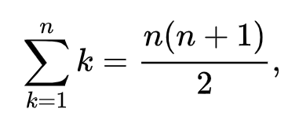

# C++ Two Simple and Clean Solutions, O(sqrt(n)) / O(logn), Explained

**Author:** YehudisK
**Votes:** 25
**Link:** [https://leetcode.com/problems/arranging-coins/solutions/1559887/](https://leetcode.com/problems/arranging-coins/solutions/1559887/)

---

**Solution I - Simulation**
Just simulate the process of building the steps.
Each time we increment `i` and add it to `sum`.

**Time Complexity:** O(sqrt(n))
**Space Complexity:** O(1)
```
class Solution {
public:
    int arrangeCoins(int n) {
        long i = 0, sum = 0;
        while (sum <= n) sum += ++i;
        return i-1;
    }
};
```
****
**Solution II - Binary Search**
We are looking for a number that will answer this condition:
All the steps will be 1 + 2 + 3 + ... + x <= n
The formula of finding the sum is: (x(x+1))/2.


So we check if the current `mid` is less or more than `n` and according to that continue our regular binary search.

**Time Complexity:** O(logn)
**Space Complexity:** O(1)
```
class Solution {
public:
    int arrangeCoins(int n) {
        long lo = 0, hi = n, mid, tmp;
        while (lo <= hi) {
            mid = lo + (hi - lo) / 2;
            tmp = mid * (mid + 1) / 2;
            
            if (tmp == n) return mid;
            
            if (tmp <= n) lo = mid + 1;
            else hi = mid - 1;
        }
        return lo-1;
    }
};
```
**Like it? please upvote!**