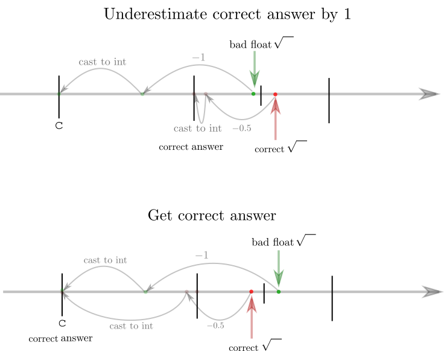

# 2 solutions (+rant & pictures) ^^

**Author:** andrii_khlevniuk
**Votes:** 17
**Link:** [https://leetcode.com/problems/arranging-coins/solutions/537200/](https://leetcode.com/problems/arranging-coins/solutions/537200/)

---

**Solution 1: O(sqrt(N))** `8 ms`, `100.00% space` 
Here's pretty standard "programmer"'s solution
```
int arrangeCoins(int n) 
{
	   int i(0);
	   for( ; n>=0; n-=++i);
	   return i-1;   
}
```

**Solution 2: O(1)** `0 ms`, `100.00% space` 
Here's a "mathematician"'s solution
```
int arrangeCoins(int n) 
{
	return -0.5d+sqrt(2.0d*n+0.25d);     //double precision   
}
```
based on the formula (https://en.wikipedia.org/wiki/Triangular_number):
```
1 + 2 + 3 + ... + x = x * (x + 1)/2.
```
Although this solution passes all the tests, it's potentially erroneous. Note, if we used single float precision it would fail
```
return -0.5f+sqrt(2.0f*n+0.25f);            //single precision -> fail        
```
The problem is that `sqrt` returns `float` that becomes obvious because
```
return -0.5d+sqrtf(2.0d*n+0.25d);            //sqrtf -> fail      
```
fails.
In particular for `n=2146467959` we have
```
sqrt(2.0f*n+0.25f) = 65520.500000000...
sqrt(2.0d*n+0.25d) = 65520.4999847...
```


This can hint that `double` precision could potentially run into this problem as well.
Actually although double precision works for `int`, it will fail to `long long int`'s in the same way `float` fails for `int`'s.
In particular for `long long int n=9223372034707291647 ` the function
`return -0.5d+sqrt(2.0d*n+0.25d); `
fails.

What can we do about it?
The solution could be as follows:
1. Choose a candidate `c` that either underestimates the answer by `1` or gets it right (floating point inaccuracies give us answer that could be off by `1` anyway)
`int c = sqrtf(2.0f*n+0.25f)-1;`





2. Calculate `int sum = c*(c+1)/2` (use this trick to avoid overflow)
`int sum = c&1 ? (c+1)/2*c : c/2*(c+1); `
3. Check weither there is enough space between `n` and `sum` to squize another number that would be `c+1`.
That leads to the following algo:
```
int arrangeCoins(int n) 
{
	int c = sqrtf(2.0f*n+0.25f)-1;                               // 1. candidate that could give the correct answer or could be 1 less
	int sum = c&1 ? (c+1)/2*c : c/2*(c+1);                       // 2. sum (no need in integer types with extra range)
	return n-sum < c+1 ? c : c+1;                                // 3. check weither we underestimated the answer and need to take c+1
}
```
Thus we avoid **thoughtless** precision buffs that are so common in solutions in the comments.
We can even simplify `c` by dropping `0.25f` as algo handles small imprecisions. Thus
```
int arrangeCoins(int n) 
{
	const int c(sqrtf(2.0f*n)-1);
	const int sum(c&1 ? (c+1)/2*c : c/2*(c+1));    
	return n-sum < c+1 ? c : c+1;        
}
```
This solution does pretty fine (`0-4 ms`, `100.00% space` ),  is still **O(1)** and uses no `uint`'s, `long long int`'s  or `double`'s.


