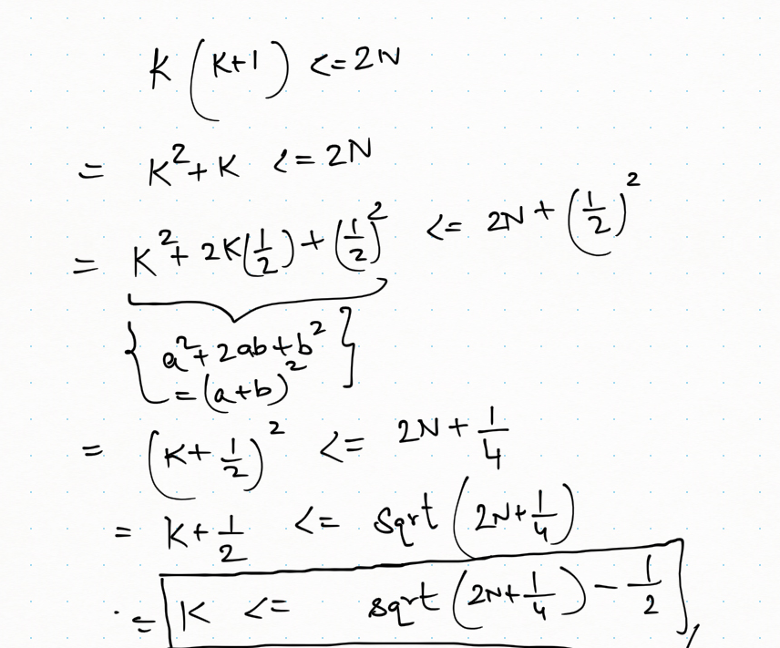

# Python - O(N) ➜ O(LogN) ➜ O(1) | EXPLAINED

**Author:** itsarvindhere
**Votes:** 43
**Link:** [https://leetcode.com/problems/arranging-coins/solutions/2654856/](https://leetcode.com/problems/arranging-coins/solutions/2654856/)

---

## **1. BRUTE FORCE - O(N)**

The simplest approach is to try to fill as many rows as we can completely. 

For this, we can start with row 1 and as we know, row 1 will have 1 coin, row 2 will have 2 coins and so on...

So in each iteration, we move to the next row and also reduce i coins from the numbr of coins we have because we used them to fill the current row. If after filling, n is still not negative, that means the current row can be filled fully.

```
 def arrangeCoins(self, n: int) -> int:
        completeStairs = 0
        
        # i = row number
        i = 1
        while n >= 0:
            # For ith row, we use i coins to fill it completely
            # So reduce i coins from n
            n -= i
            # If n is not negative
            # that means this row can be fully filled so increment count of completeStairs
            if n >= 0: completeStairs += 1
            # Move to the next row
            i += 1

        return completeStairs
```

## **2. BINARY SEARCH - O(LogN)**

I was not able to fully implement Binary Search approach myself, because I was stuck at the main part of Binary Search which is -> How to decide if mid is correct value or not.

First, let me explain how to identify Binary Search approach for this problem or any problem.

See, whenever you see a pattern like - 
	
		If one value is valid, all values less than or greater than it are also valid

Then you can apply binary search.

Here we have the same scenario.

	Suppose, we have n = 6.

	So if I ask you that if we can fill row 2 completely, can we also fill row 1 completely? 
	
	Ofcourse we can right?

	So if a row is getting filled completely, ofcourse all rows before it are also filled completely. 
	Only then we are able to have enough coins to fill current row completely.
	
	
And that is exactly what we do in Binary Search approach for this problem. 

Let me ask you -> 

		What can be the minimum number of completely filled rows? 

		It is 1, right? Becase n's minimum value is 1, not 0. 
		So no matter what the test case is, we will have at least 1 coin and we can fill the first row with it.

		So lower bound of our binary search is 1. 

		Now, What can be the maximum number of completely filled rows? 
		
		We don't know because that's what we have to find, right?
		
		But we can take an upper bound as the number of coins we have. 
		
		Yes, completely filled rows will be < n but still, we can take n as upper bound because we have to take some upper bound.
		
		
So, we now have a range 1 to n and in this range, each number shows completely filled rows. 1 means 1 row is completely filled, 2 means 2 rows  are completely filled and so on...

WE are basically doing something called "**BINARY SEARCH ON ANSWER**" 

Because, instead of performing binary search on some input, we are performing it on all the possible answers.

Each value in this range is a possible answer and we want the maximum possible answer from this range.

		Lets take an example -> n = 8
		
		So our range for binary search is ->
		
				1 2 3 4 5 6 7 8
		
		Hence, Initially, start = 1, end = 8
		mid = 4
		
		So, we now want to check, how many coins we will need to completely fill 4 rows.
		
		Because if we are able to fill 4 rows with n coins, that means 4 is a possible answer and to find a maximum value, 
		we need to now search on the right of mid. 
		There is no point to move to left of mid because if 4 is valid, all numbers less than 4 are also valid.
		
One way to check if we can fill x rows using n coins is to do it in O(N) time using a loop.
		
But can we do better?

Yes, we can. And this is the step I struggled with so had to look at the discussion section and search online. That's using "**Gauss Summation**.

You can read more about it online but basically, it is an equation to calculate the sum of a range 1 to n in O(1) time. This equation is - 

		(n * (n + 1)) / 2


So, if we have a range -> 
			
					1,2,3,4
					Then all we can do is -
					
					(Number of elements in this range * (Last Element + 1)) / 2
					4 * (4 + 1) / 2
					
					=> 10
					
					Imagine for huge ranges how efficient this equation is!
					

Coming back to the problem, we had mid = 4 so we wanted to know how many coins we need to fill 4 rows completely.

We know each row has row number of coins. So, for 4 rows to be completely filled, we need to have coins -

		1      -> 1 coin
		1 1   -> 2 coins
		1 1 1 -> 3 coins
		1 1 1 1 -> 4 coins
		
		1 + 2 + 3 + 4 => 10 coins
		
       And as discussed above, instead of a loop, we can do this sum in O(1) time using Gauss Summation. 
	   
So for any mid value, we use Gauss Summation to find how many coins are needed to fill it completely. If number of coins needed are <= n that basically means mid is a possible solution. But there might be a higher value solution on right of mid. So, we store this solution and move to right side of mid.

Otherwise, if number of rows needed is > n, that means we cannot fill "mid" rows completely if we have n coins. So not just mid but all numbers on right of mid are also not the solutions because every number on right of mid is greater than it. So if mid is not valid, how can any number greater than mid be valid. So move to left of mid in that case.

```
def arrangeCoins(self, n: int) -> int:
        completeStairs = 0
		
		start = 1
        end = n

        while start <= end:
            mid = start + (end - start) // 2
			# How many coins required to completely fill 'mid' rows?
			# Use Gauss Summation to find that in O(1) time
            if (mid * ( mid + 1)) // 2 <= n:
                completeStairs = mid
                start = mid + 1
            else:
                end = mid - 1


        return completeStairs
```
		
## **3. BINARY SEARCH - O(LogN) - SLIGHT IMPROVEMENT**

Because we know number of completely filled rows will always be less than n, why take n as upper bound if it can never be a solution.

We can take (n + 1 / 2) as the upper bound as for any n, maximum number of completely filled rows can never exceed n + 1 / 2

```
def arrangeCoins(self, n: int) -> int:
        completeStairs = 0

        start = 1
        end = (n + 1) // 2
        
        while start <= end:
            mid = start + (end - start) // 2
			# How many coins required to completely fill 'mid' rows?
			# Use Gauss Summation to find that in O(1) time
            if (mid * ( mid + 1)) // 2 <= n:
                completeStairs = mid
                start = mid + 1
            else:
                end = mid - 1


        return completeStairs
```
		
## **4. MATH SOLUTION - O(1)** 

Thanks to -> https://leetcode.com/problems/arranging-coins/discuss/1559913/Java-3-Solutions-Bit-Manipulation-Binary-Search-Math-or-TC%3A-O(1)-SC%3A-O(1)-or-Beats-100

Since from above approach, we know that for any Kth row,we need to have  (K * ( K + 1)) // 2 coins to fill it completely. How can we say if a particular K is the maximum possible row number after which no row can be filled completely?

So why not try to find K from this equation, instead of using possible K values to get to the max value?

			(K * ( K + 1)) // 2 <= n
			K^2 + K <= 2*N
			
PS: Ignore the bad handwriting
[]

So any value of K is valid for which - 

		K <= sqrt(2N + 0.25) - 0.5
		
	So what is the maximum possible valid value of K?

	Ofcourse it is that value which is equal to  sqrt(2N + 0.25) - 0.5

	because a valid K value cannot be greater than  sqrt(2N + 0.25) - 0.5.

And that's all we need to return.

```
def arrangeCoins(self, n: int) -> int:
         return int(sqrt(2 * n + 0.25) - 0.50)
```


