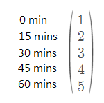
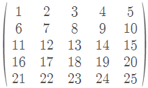

# 🔥 Python || Detailed Explanation ✅ || Faster Than 98% || Easily Understood || Simple || MATH

**Author:** wingskh
**Votes:** 37
**Link:** [https://leetcode.com/problems/poor-pigs/solutions/2387610/](https://leetcode.com/problems/poor-pigs/solutions/2387610/)

---

**Appreciate if you could upvote this solution**
<br/>
Method: `Math`

Let `T` be the number of times to test so `T = minutesToTest / minutesToDie`
& `p` be the numbers of pigs to test in each round
& `b` be the maximum number of buckets that can be test.

First of all, we need to find out the relatioship between `T` and `p`.

<br/>

For the example 1: `T = 60 / 15 = 4`


When `p` = 1
```
At 0 mins: 
	- Feed pig with b1

At 15 mins: 
	- If pig dies, b1 is poisonous.
	- else feed pig with b2

At 30 mins: 
	- If pig dies, b2 is poisonous.
	- else feed pig with b3

At 45 mins: 
	- If pig dies, b3 is poisonous.
	- else feed pig with b4

At 60 mins: 
	- If pig dies, b4 is poisonous.
	- else b5 is poisonous.
```
Thus, when `p = 1`, `b = 5 < 1000 buckets`
If we stores those step into a matrix, it looks like:


When `p` = 2, the matrix looks like:


Then `p1` would drink the buckets at each row in each round 
& `p2` would drink the buckets at each column in each round.

```
At 0 mins: 
	- Feed p1 with b1 + b2 + b3 + b4 + b5
	- Feed p2 with b1 + b6 + b11 + b16 + b21

At 15 mins: 
	- If p1 and p2 die, b1 is poisonous.
	- If p1 dies and p2 lives, one of b2 + b3 + b4 + b5 is poisonous
		- Feed b2 + b3 + b4 in the following rounds
	- If p1 lives and p2 dies, one of b6 + b11 + b16 + b21 is poisonous
		- Feed b6 + b11 + b16 in the following rounds
	- If p1 lives and p2 lives, 
		- Feed p1 with b6 + b7 + b8 + b9 + b10 (b6 is not poisonous, but put it here for easy-understanding)
		- Feed p2 with b2 + b7 + b12 + b17 + b22 (b2 is not poisonous, but put it here for easy-understanding)

And so on...
```
Thus, we can find that `b = 25`.

When `p = 1` and `T = 5`, 
 - `b = 5 = T ^ 1`
 
When `p = 2` and `T = 5`, 
 - `b = 25 = T ^ 2`

Thus, we can inference that 
`T ^ p \u2265 buckets` 
`p * log(T) \u2265 log(buckets)`
`p \u2265 log(T, buckets)`
Thus, `p = roundup(log(T, buckets))`

Code:

```
# Added round() to handle the numeric floating point error when using math.log()
class Solution:
    def poorPigs(self, buckets: int, minutesToDie: int, minutesToTest: int) -> int:
        return math.ceil(round(math.log(buckets, minutesToTest // minutesToDie + 1), 10))
```


**Time complexity**: 
 - Ignore the log calculation: `O(1)`

**Space complexity**:
 - Ignore the log calculation: `O(1)`

