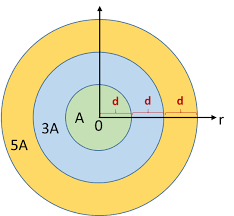
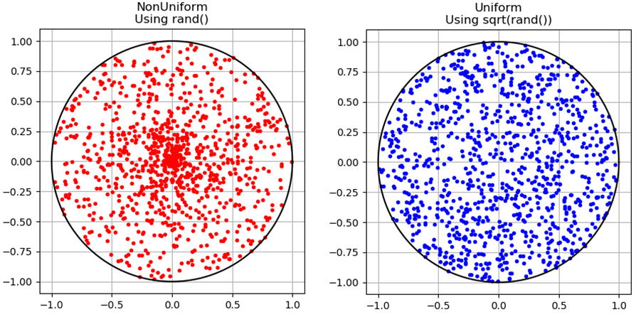

# ✅Generate Random Point in a Circle | Short & Easy w/ Explanation and Diagrams

**Author:** archit91
**Votes:** 77
**Link:** [https://leetcode.com/problems/generate-random-point-in-a-circle/solutions/1113792/](https://leetcode.com/problems/generate-random-point-in-a-circle/solutions/1113792/)

---

We know that any point in a circle is of the form - `(Rcos\u03B8, Rsin\u03B8)`. For circles having center other than origin, this becomes - `(Xc + Rcos\u03B8, Yc + Rsin\u03B8)`. We might choose the approach to select random integer `[0, 1]` and multiply by `R` to generate a point uniformly between [0, R], then generate a random `\u03B8` and finally generate points using the above-mentioned formula.

However, the set of points generated by above approach won't be uniformly distributed and more biased towards the center. This is because, the area towards the outer of circle is greater than towards the inner end of circle.


So, for a section of circle `(\u03B8, \u03B8+\u0394)`, for the points to be uniform, we need to generate more points towards the outer circle than we need towards inner of circle. 

---------

For this purpose, we use the square root function on the randomly generated point between [0, 1] (watch `sqrt()` is applied to `random()` in below code) to bias the outer end circle points. **Note that after applying sqrt on `random()` (a point between [0, 1]), the result would be a value greater than the original `random()` thus making it biased more towards the outer end**. This makes the point uniformly generated over all of the circle.


```
class Solution {
    double R, X, Y;
public:
    Solution(double radius, double x_center, double y_center) : R(radius), X(x_center), Y(y_center) {
        srand(time(0));
    }
    double random(){
        return (double)rand() / RAND_MAX; // for generating random points between 0 to 1
    }
    vector<double> randPoint() {
        vector<double> randomPoint(2);
        double len = sqrt(random()) * R, deg = 2 * M_PI * random();
        randomPoint[0] = X + len * cos(deg);
        randomPoint[1] = Y + len * sin(deg);
        return randomPoint;
    }
};
```

-----------
----------------------

**Reason for choosing Square root function**

The reason for choosing `sqrt()` rather than any other functions like `cbrt()` to bias it towards outer end is that in the first approach mentioned above, the points generated were proportional to `R^2` because our random was proportional to `R`, thus making points over all area of circle proportional to `R^2` which made them concentrated more towards the center. Making our random proportional to `sqrt(R)` would make the points generated over all the area of circle proportional to `R` which would make all the points generate uniformly throughout the circle.



