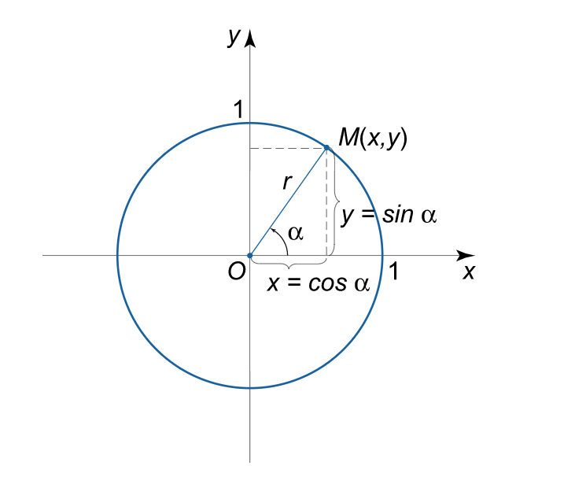

# Python/Go sol by math [w/ Comment]

**Author:** brianchiang_tw
**Votes:** 2
**Link:** [https://leetcode.com/problems/generate-random-point-in-a-circle/solutions/1113640/](https://leetcode.com/problems/generate-random-point-in-a-circle/solutions/1113640/)

---

Python sol by math

---

Review of circle and polar coordination system



[Source: Math24](https://www.math24.net/definition-graphs-trigonometric-functions)


---

Python:

```
from random import random, seed
from math import pi, cos, sin, sqrt

class Solution:

    def __init__(self, radius: float, x_center: float, y_center: float):
        
        self._x_center = x_center
        self._y_center = y_center
        self._r = radius
        
        # Initialize random seed with system time
        seed()

    def randPoint(self) -> List[float]:
        
        # random theta from 0 to 2*pi
        rand_theta = random() * 2 * pi
        
        # random radius from 0 to R
        rand_radius = sqrt( random() ) * self._r
        
        # compute random point based on polar coordination
        rand_x_coord = rand_radius * cos(rand_theta) + self._x_center
        rand_y_coord = rand_radius * sin(rand_theta) + self._y_center
        
        return [rand_x_coord, rand_y_coord]
    
    
# Your Solution object will be instantiated and called as such:
# obj = Solution(radius, x_center, y_center)
# param_1 = obj.randPoint()
```

---

Go:

```
import (
    "math/rand"
    "math"
	"time"
)

type Solution struct {
    X_Center float64
    Y_Center float64
    Radius float64
}


func Constructor(radius float64, x_center float64, y_center float64) Solution {
    
    // Initialize random seed with system time
    rand.Seed( time.Now().UnixNano() )
    
    return Solution{ Radius: radius, X_Center: x_center, Y_Center: y_center }
}


func (this *Solution) RandPoint() []float64 {
    
    // random theta from 0 to 2 * pi
    randTheta := rand.Float64() * 2 * math.Pi
    
    // random radius from 0 to R
    randRadius := math.Sqrt( rand.Float64() ) * (this.Radius)
    
    // compute random point based on polar coordination
    randX_Coord := randRadius * math.Cos( randTheta ) + this.X_Center
    randY_Coord := randRadius * math.Sin( randTheta ) + this.Y_Center
    
    return []float64{ randX_Coord, randY_Coord }
}


/**
 * Your Solution object will be instantiated and called as such:
 * obj := Constructor(radius, x_center, y_center);
 * param_1 := obj.RandPoint();
 */
```

---

Reference:

[1] [Wiki: Polar coordination](https://en.wikipedia.org/wiki/Polar_coordinate_system)

[2] [Python official docs about random](https://docs.python.org/3/library/random.html)

[3] [Python official docs about math](https://docs.python.org/3/library/math.html?highlight=math#trigonometric-functions)

[4] [Golang officials docs about random](https://golang.org/pkg/math/rand/)

[5] [Golang officials docs about math](https://golang.org/pkg/math/)