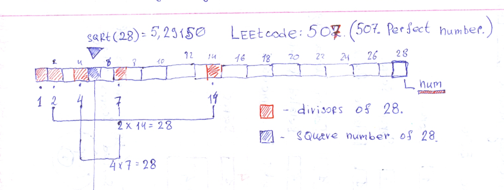

# Ruby. Explanation with an image.

**Author:** user9697N
**Votes:** 2
**Link:** [https://leetcode.com/problems/perfect-number/solutions/529898/](https://leetcode.com/problems/perfect-number/solutions/529898/)

---

#### Leetcode: 507.  

The Trick is to find out that there are divisors from both sides of `sqrt(num)`. All except 1. 



```Ruby
# 507. Perfect Number
# https://leetcode.com/problems/perfect-number/
# Runtime: 40 ms, faster than 57.14% of Ruby online submissions for Perfect Number.
# Memory Usage: 9.3 MB, less than 100.00% of Ruby online submissions for Perfect Number
# @param {Integer} num
# @return {Boolean}
require "prime"
def check_perfect_number(num)
    return false if 1 == num
    sum = 1
    i = 2
    while i*i <= num
        sum += i + num/i if 0 == num%i
        i += 1
    end
    p sum
    sum == num
end
```