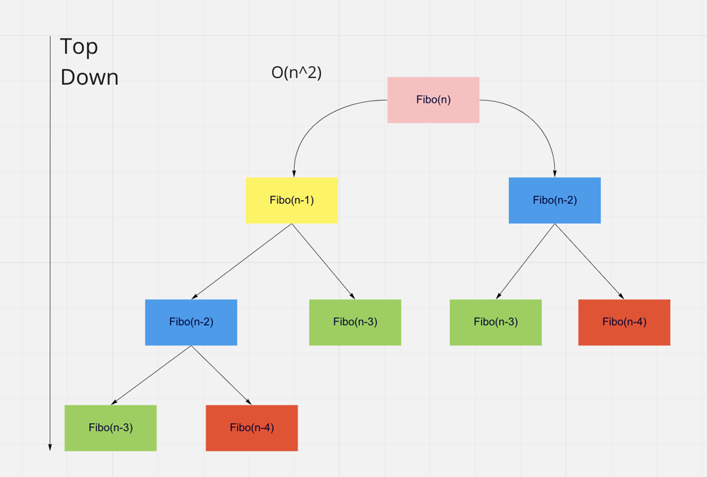
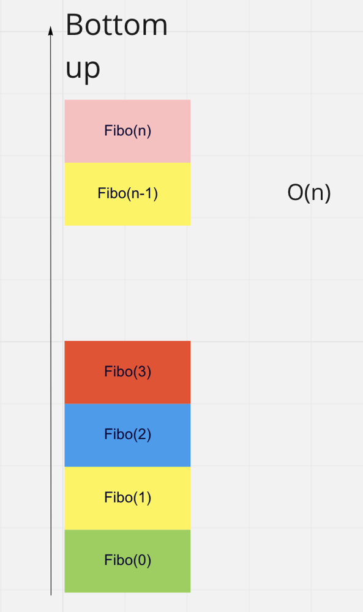

# Graphical explanations Bottom Up, Top  Down , recursive, iterative approaches (Java, Kotlin, Python)

**Author:** chenon
**Votes:** 12
**Link:** [https://leetcode.com/problems/fibonacci-number/solutions/2247654/](https://leetcode.com/problems/fibonacci-number/solutions/2247654/)

---

Most solutions posted give the code without explanation.

Fibonacci number is defined as 
`fib(N) = fib(N-1) + fib(N-2)`  with fib(0) = 0 and fib(1) = 1

# Top  Down , naive recursive
```
	public int fib(int n)  {
		if (n == 1) {
			return 1;
		} else if (n == 2) {
			return 1;
		} else {
			return (fib(n - 1) + fib(n - 2));
		}
	}
```

But the runtime complexity is **O(2^n)**.
The 



At level n, there is 1 element.
At level n-1, there are 2 elements.
At level n-2, there are 4 elements.
At level  n-3, there are 8 \xE9l\xE9ments.
Notice each level, the number of elements double.
...
At the very bottom at level 0 , there are 2 ^n elements 

Notice that each same color element are calculated independently.
For example, once `fib(n-3) in green` has been calculated once, the result can be `memoized` to avoid the recalculation.

# Bottom Up 
The calculations start from the bottom then up (0 to n).
The runtime complexity is O(n).
We go from O(2^n ) to O(n).



## Bottom Up , iterative

```
	public static int fib(int n) {
		if (n < 2) return n; 

		int a = 0;
		int b = 1;
		for (int i = 2; i <= n; i++) {
			int sum = a + b;
			a = b;
			b = sum;
		}
		return b;
	}

```

Time complexity : O(n)
Space complexity : O(1)


## Bottom Up , recursive

```
public int fiboRecursiveMemoization(int n) {
    List<Integer> list = new ArrayList<>();
    list.add(0); // initial values
    list.add(1);
    return fiboRecursiveMemoization(n, 2, list);
}

private int fiboRecursiveMemoization(int n, int iteration, List<Integer> cache) {
    int res = cache.get(iteration-1) + cache.get(iteration-2);
    cache.add(res);

    if(n == iteration) return cache.get(iteration);
    return fiboRecursiveMemoization(n, iteration+1, cache);
}

```
Time Complexity: O(n)
Space Complexity: O(n)

Notice **only** the two immediate previous values are needed. The method can run in constant space like the iterative version.

## Bottom Up , recursive, constant space

Time Complexity: O(n)
Space Complexity: O(1)

### Java
```
    public int fiboRecursiveConstantSpace(int n) {
        if(n < 2) return n;
        return fiboRecursiveConstantSpace(n,2, 0,1);
    }

    private int fiboRecursiveConstantSpace(int n, int currentIteration, int prevN_2, int prevN_1) {
        if(n == currentIteration) return prevN_2 + prevN_1;
        int res = prevN_2 + prevN_1;
        return fiboRecursiveConstantSpace(n, currentIteration+1, prevN_1, res);
    }
```
### Kotlin
```
    fun fiboRecursiveConstantSpace(n: Int): Int {
        return if (n < 2) n else fiboRecursiveConstantSpace(n, 2, 0, 1)
    }

    private fun fiboRecursiveConstantSpace(n: Int, currentIteration: Int, prev2: Int, prev1: Int): Int {
        if (n == currentIteration) return prev2 + prev1
        val res = prev2 + prev1
        return fiboRecursiveConstantSpace(n, currentIteration + 1, prev1, res)
    }
```

###  Python 3
```
    def fib(self, n: int) -> int:
        def fib_recur(n:int, ite: int, prev2: int, prev1: int) -> int:
            res = prev1 + prev2 
            if(n == ite): return res
            return fib_recur(n,ite+1, prev1, res)
        
        if n < 2: return n
        return fib_recur(n, 2, 0,1)
```