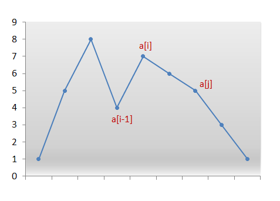
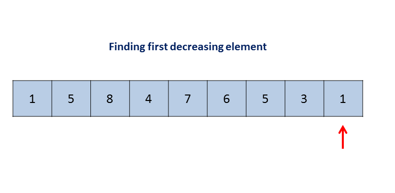

# Official Solution

**Link:** [https://leetcode.com/problems/next-greater-element-iii/solution/](https://leetcode.com/problems/next-greater-element-iii/solution/)

---

[TOC]

## Solution

---
### Approach #1 Brute Force

To solve the given problem, we treat the given number as a string, $$s$$. In this approach, we find out every possible permutation of list formed by the elements of the string $$s$$ formed. We form a list of strings, $$list$$, containing all the permutations possible. Then, we sort the given $$list$$ to find out the permutation which is just larger than the given one. But this one will be a very naive approach, since it requires us to find out every possible permutation which will take really long time.

<!---iframe src="https://leetcode.com/playground/UBNhHzjo/shared" frameBorder="0" name="UBNhHzjo" width="100%" height="515"></iframe>--->

<iframe src="https://leetcode.com/playground/gK2XV52c/shared" frameBorder="0" width="100%" height="500" name="gK2XV52c"></iframe>

**Complexity Analysis**

* Time complexity : $$O(n!)$$. A total of $$n!$$ permutations are possible for a number consisting of $$n$$ digits.

* Space complexity : $$O(n!)$$. A total of $$n!$$ permutations are possible for a number consisting of $$n$$ digits, with each permutation consisting of $$n$$ digits.


---
### Approach #2 Linear Solution

**Algorithm**

In this case as well, we consider the given number $$n$$ as a character array $$a$$.
First, we observe that for any given sequence that is in descending order, no next larger permutation is possible.
 For example, no next permutation is possible for the following array:
 ```
 [9, 5, 4, 3, 1]
 ```

We need to find the first pair of two successive numbers $$a[i]$$ and $$a[i-1]$$, from the right, which satisfy
 $$a[i] > a[i-1]$$. Now, no rearrangements to the right of $$a[i-1]$$ can create a larger permutation since that subarray consists of numbers in descending order.
 Thus, we need to rearrange the numbers to the right of $$a[i-1]$$ including itself.

Now, what kind of rearrangement will produce the next larger number? We want to create the permutation just larger than the current one. Therefore, we need to replace the number $$a[i-1]$$ with the number which is just larger than itself among the numbers lying to its right section, say $$a[j]$$.




We swap the numbers $$a[i-1]$$ and $$a[j]$$. We now have the correct number at index $$i-1$$. But still the current permutation isn't the permutation
    that we are looking for. We need the smallest permutation that can be formed by using the numbers only to the right of $$a[i-1]$$. Therefore, we need to place those
     numbers in ascending order to get their smallest permutation.

But, recall that while scanning the numbers from the right, we simply kept decrementing the index
      until we found the pair $$a[i]$$ and $$a[i-1]$$ where,  $$a[i] > a[i-1]$$. Thus, all numbers to the right of $$a[i-1]$$ were already sorted in descending order.
      Furthermore, swapping $$a[i-1]$$ and $$a[j]$$ didn't change that order.
      Therefore, we simply need to reverse the numbers following $$a[i-1]$$ to get the next smallest lexicographic permutation.

The following animation will make things clearer:

<!---->
!?!../Documents/556_Next_Greater_Element_III.json!?!

<!--iframe src="https://leetcode.com/playground/uSrWDrPW/shared" frameBorder="0" name="uSrWDrPW" width="100%" height="515"></iframe>-->

<iframe src="https://leetcode.com/playground/KGMkdwjK/shared" frameBorder="0" width="100%" height="500" name="KGMkdwjK"></iframe>

**Complexity Analysis**

* Time complexity : $$O(n)$$. In worst case, only two scans of the whole array are needed. Here, $$n$$ refers to the number of digits in the given number.

* Space complexity : $$O(n)$$. An array $$a$$ of size $$n$$ is used, where $$n$$ is the number of digits in the given number.