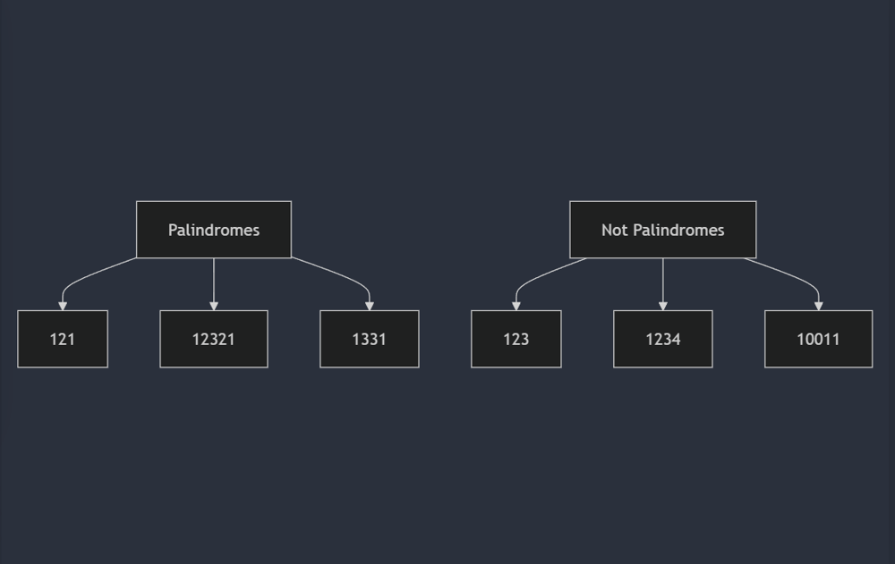
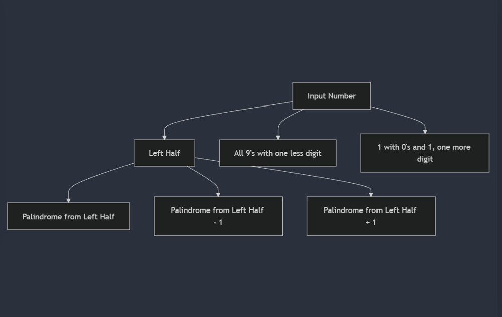
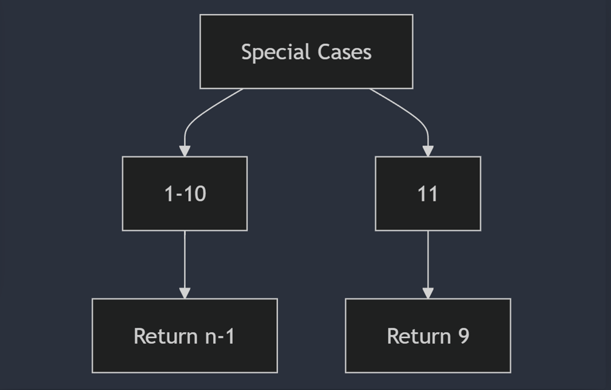
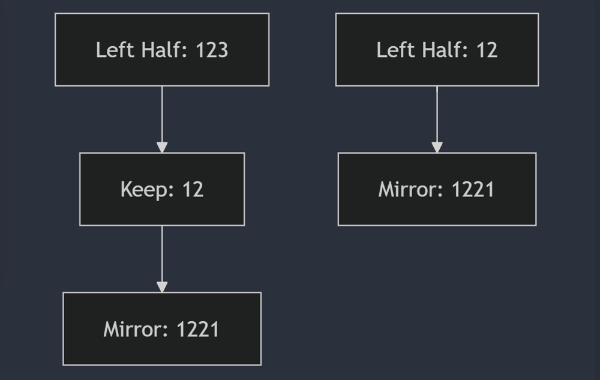
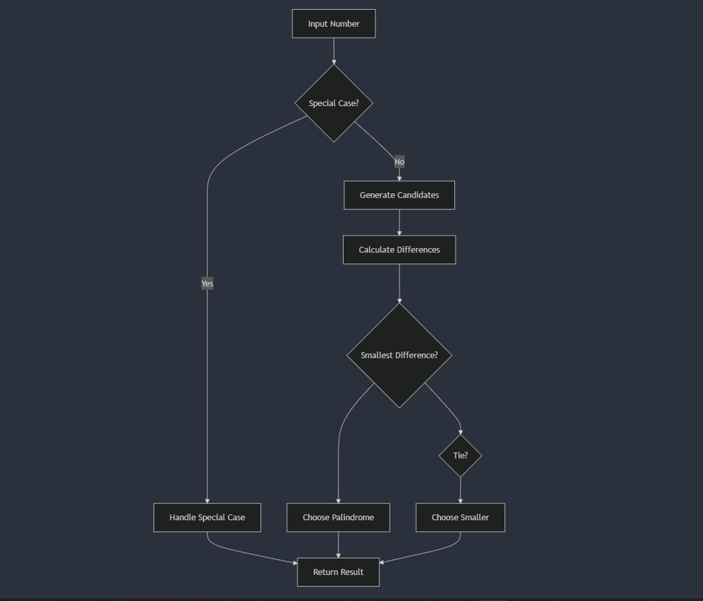

# O(1) | Beats 100% | C++ | Java  | Python | Go | Rust | JavaScript

**Author:** kartikdevsharma_
**Votes:** 162
**Link:** [https://leetcode.com/problems/find-the-closest-palindrome/solutions/5675172/](https://leetcode.com/problems/find-the-closest-palindrome/solutions/5675172/)

---

### Intuition
First, we need to understand what the problem is asking. Lets say we are Given a string representation of a number, we're asked to find the closest palindrome to that number, excluding the number itself. If there's a tie (two palindromes equally close), we should return the smaller one. The "closest" is defined by the smallest absolute difference between the given number and the palindrome.

>The constraints are very important to consider:
    1. The input string length is between 1 and 18 characters.
    2. The input consists only of digits.
    3. There are no leading zeros.
    4. The number represented is between 1 and  $10 ^{18}$ - 1

By just looking at these constraints  we can tell that we're dealing with potentially very large numbers, which also explains why the input is given as a string. We'll use long integers in our calculations since we need to be careful about integer overflow.

Now, let's think about palindromes. What makes a number a palindrome? It reads the same forwards and backwards. For example, 12321 is a palindrome.



 This structure tell us that we can focus on the left half of the number (which we'll call the "palindrome root") and use it to generate the full palindrome.

 for a palindrome like 12321, the next larger palindrome is 12421, and the next smaller is 12221. This pattern holds for both odd and even-length palindromes. This means that we can generate candidate palindromes by using left half of the number

My First approach had some limitations it was failing a lot of edge cases. It was handling several special cases separately, which made my code more complex plus It also wasn't considering all possible nearest palindromes in some cases for ex consider that we're dealing with numbers up to 18 digits long. That's a range from 1 to 999,999,999,999,999,999! We can't simply generate all palindromes and check which one is closest. That would take far too long. We need to be think about this. So in this approach, I'll consider five candidate palindromes:

>1. The palindrome formed by the left half of the number as is.
>2. The palindrome formed by decrementing the left half of the number.
>3. The palindrome formed by incrementing the left half of the number.
>4. The number with all 9's that has one digit less than the input.
>5. The number with all 0's and 1's at the ends that has one digit more than the input.

Why these five candidates? Let's think about it:




1-3: These cover the cases where the nearest palindrome is close to the original number. By considering the current left half and its incremented and decremented versions, we cover a range of nearby palindromes. So in simple terms the closest palindrome is likely to be very near our original number. By considering these three options, we're exploring the immediate neighborhood of our number in the world of palindromes.

4: This covers cases where the nearest palindrome might be a "9" palindrome just below our number. For example, if our number is 1000, the nearest smaller palindrome is 999.

5: This covers cases where the nearest palindrome might be just above our number with an additional digit. For example, if our number is 999, the nearest larger palindrome is 1001.

These cases (4 and 5) occur when we're near a "boundary" where the number of digits changes. To handle these, we need to consider two more special cases:
>  The number with all 9's that has one digit less than our original number
> The number with all 0's (and 1's at the ends) that has one more digit than our original number

Since we are considering these five candidates, we are making sure that we don't miss any potential nearest palindromes, regardless of  what the input number's structure is.

Another thing to note here is that we can generate palindromes by manipulating just the left half of the number. This is because the right half is always a mirror of the left half (with a possible middle digit for odd-length palindromes).

Now we need to generate these palindromes, compare them to find the closest one, and handle all the edge cases correctly. We need to be careful about numbers at the boundaries (like 1, 10, 11, etc.) and make sure our solution works for all possible inputs within the given constraints. This approach is better because it works for any number in our range, whether it's small like 11 or massive like 999,999,999,999,999,999. We're not generating all palindromes; we're smartly picking just a few candidates that are most likely to be the answer.


### Approach


**1. Handle special cases for small numbers:**
   ```
   if number <= 10:
       return string(number - 1)
   if number == 11:
       return "9"
   ```
   -  If the number is 1-10, the closest palindrome is always the previous number. For example, for 6, it's 5; for 10, it's 9.
-  If the number is 11, the closest palindrome is 9.

>We handle these separately because they don't follow the general pattern we'll use for larger numbers.




**2. Calculate the length of the input number and extract the left half:**
   ```
   length = length(numberStr)
   leftHalf = parse_long(numberStr.substring(0, (length + 1) / 2))
   ```
   For our main algorithm, we start by extracting the left half of our number. If the number has an odd number of digits, we include the middle digit in this left half.

For example:
- For "12345", the left half would be "123"
- For "1234", the left half would be "12"
>We use (length + 1) / 2 to handle both odd and even length numbers correctly.

**3. Generate the five candidate palindromes:**
  ```
   candidates = new array of size 5
   candidates[0] = generatePalindrome(leftHalf, length % 2 == 0)
   candidates[1] = generatePalindrome(leftHalf - 1, length % 2 == 0)
   candidates[2] = generatePalindrome(leftHalf + 1, length % 2 == 0)
   candidates[3] = 10^(length - 1) - 1
   candidates[4] = 10^length + 1
   ```
   
1. The palindrome formed by the left half as is
2. The palindrome formed by decrementing the left half
3. The palindrome formed by incrementing the left half
4. The number with all 9's that has one digit less than our input
5. The number with 1 followed by 0's and ending with 1, with one more digit than our input

>To generate palindromes from the left half, we use a helper function. This function takes the left half, creates a palindrome from it, and handles both odd and even-length numbers correctly.
   The generatePalindrome function (which we'll define later) creates a palindrome from the left half.
   

**4. Find the nearest palindrome:**
   ```
   nearestPalindrome = 0
   minDifference = MAX_LONG_VALUE
   for each candidate in candidates:
       if candidate == number:
           continue
       difference = abs(candidate - number)
       if difference < minDifference OR (difference == minDifference AND candidate < nearestPalindrome):
           minDifference = difference
           nearestPalindrome = candidate
   ```
>Once we have our candidates, we compare each of them to our original number. We're looking for the one with the smallest absolute difference from our original number.
If two palindromes have the same difference, we choose the smaller one, as per the problem requirements.

**5. Return the result:**
   ```
   return string(nearestPalindrome)
   ```

Now, let's define the generatePalindrome function:

```
function generatePalindrome(leftHalf, isEvenLength):
    palindrome = leftHalf
    if not isEvenLength:
        leftHalf = leftHalf / 10
//mirror the remaining digits to create the right half
    while leftHalf > 0:
        palindrome = palindrome * 10 + leftHalf % 10
        leftHalf = leftHalf / 10
    return palindrome
```

This function works as follows:
- It starts with the left half of the palindrome.
- If the length is odd, it removes the last digit of the left half (which will be the middle digit of the palindrome).

    >while leftHalf > 0:
       palindrome = palindrome * 10 + leftHalf % 10
       leftHalf = leftHalf / 10

-  It then mirrors the remaining digits to create the right half of the palindrome.
    -  `leftHalf % 10`: This extracts the last digit of `leftHalf`.
    - `palindrome * 10 + leftHalf % 10`: We\u2019re shifting the current digits in `palindrome` to the left This  mirrors the digit to the other side of the palindrome.
    - `leftHalf = leftHalf / 10`: This removes the last digit from `leftHalf`, preparing it for the next iteration.
    This process repeats until all digits of leftHalf have been mirrored. The result is a full palindrome formed by reflecting leftHalf




The key to this approach is considering all possible nearest palindromes efficiently. By generating just five candidates, we cover all cases:

1. The palindrome formed by decrementing the left half covers cases where the nearest palindrome is slightly smaller.
2. The palindrome formed by the left half as-is covers cases where the nearest palindrome is very close to the original number.
3. The palindrome formed by incrementing the left half covers cases where the nearest palindrome is slightly larger.
4. The all-9s number with one less digit covers cases like 1000, where 999 is the nearest palindrome.
5. The number with 1 and trailing 0s with one more digit covers cases like 999, where 1001 is the nearest palindrome.

It works for both odd and even length numbers and correctly handles edge cases at the boundaries of the input range.




### Complexity
- **Time complexity: O(1)**
>Well TBH its O(log n) where n is the input number. This is because we're primarily working with the digits of the number, and the number of digits is logarithmic in the value of the number. The generatePalindrome function runs in O(log n) time, and we call it a constant number of times.

- **Space complexity: O(1)**. 
>We're using a constant amount of extra space (the candidates array is always size 5), but we need O(log n) space to store the string representation of the number and the result.

In a general context (without these input constraints), both the TC and SC  would be O(log n), But here Problem's constraints create an effective "ceiling" on the input size So dont get confused when the leetcode engine show it as O(1).


# Code
```java []
class Solution {
    public String nearestPalindromic(String numberStr) {
        long number = Long.parseLong(numberStr);
        if (number <= 10) return String.valueOf(number - 1);
        if (number == 11) return "9";

        int length = numberStr.length();
        long leftHalf = Long.parseLong(numberStr.substring(0, (length + 1) / 2));
        
        long[] palindromeCandidates = new long[5];
        palindromeCandidates[0] = generatePalindromeFromLeft(leftHalf - 1, length % 2 == 0);
        palindromeCandidates[1] = generatePalindromeFromLeft(leftHalf, length % 2 == 0);
        palindromeCandidates[2] = generatePalindromeFromLeft(leftHalf + 1, length % 2 == 0);
        palindromeCandidates[3] = (long)Math.pow(10, length - 1) - 1;
        palindromeCandidates[4] = (long)Math.pow(10, length) + 1;

        long nearestPalindrome = 0;
        long minDifference = Long.MAX_VALUE;

        for (long candidate : palindromeCandidates) {
            if (candidate == number) continue;
            long difference = Math.abs(candidate - number);
            if (difference < minDifference || (difference == minDifference && candidate < nearestPalindrome)) {
                minDifference = difference;
                nearestPalindrome = candidate;
            }
        }

        return String.valueOf(nearestPalindrome);
    }

    private long generatePalindromeFromLeft(long leftHalf, boolean isEvenLength) {
        long palindrome = leftHalf;
        if (!isEvenLength) leftHalf /= 10;
        while (leftHalf > 0) {
            palindrome = palindrome * 10 + leftHalf % 10;
            leftHalf /= 10;
        }
        return palindrome;
    }
}

//https://leetcode.com/problems/find-the-closest-palindrome/submissions/1364740180/
```
```C++ []
class Solution {
public:
    string nearestPalindromic(string numberStr) {
        long long number = stoll(numberStr);
        
        // Edge cases for small numbers
        if (number <= 10) return to_string(number - 1);
        if (number == 11) return "9";
        
        // Special case for 18-digit number with all 9s, thanks to dcodeDV for pointing this out
        if (numberStr == "999999999999999999") {
            return "1000000000000000001";
        }
        
        int length = numberStr.length();
        long long leftHalf = stoll(numberStr.substr(0, (length + 1) / 2));
        
        vector<long long> palindromeCandidates(5);
        palindromeCandidates[0] = generatePalindromeFromLeft(leftHalf - 1, length % 2 == 0);
        palindromeCandidates[1] = generatePalindromeFromLeft(leftHalf, length % 2 == 0);
        
        // Handle potential overflow for leftHalf + 1
        if (leftHalf < 999999999) {
            palindromeCandidates[2] = generatePalindromeFromLeft(leftHalf + 1, length % 2 == 0);
        } else {
            palindromeCandidates[2] = stoll("1" + string(length - 1, '0') + "1");
        }
        
        palindromeCandidates[3] = pow(10, length - 1) - 1;
        palindromeCandidates[4] = pow(10, length) + 1;
        
        long long nearestPalindrome = 0;
        long long minDifference = LLONG_MAX;
        
        for (long long candidate : palindromeCandidates) {
            if (candidate == number) continue;
            long long difference = abs(candidate - number);
            if (difference < minDifference || (difference == minDifference && candidate < nearestPalindrome)) {
                minDifference = difference;
                nearestPalindrome = candidate;
            }
        }
        
        return to_string(nearestPalindrome);
    }

private:
    long long generatePalindromeFromLeft(long long leftHalf, bool isEvenLength) {
        long long palindrome = leftHalf;
        if (!isEvenLength) leftHalf /= 10;
        while (leftHalf > 0) {
            palindrome = palindrome * 10 + leftHalf % 10;
            leftHalf /= 10;
        }
        return palindrome;
    }
};


//https://leetcode.com/problems/find-the-closest-palindrome/submissions/1366449944/
```
```Python []
class Solution:
    def nearestPalindromic(self, numberStr: str) -> str:
        number = int(numberStr)
        if number <= 10:
            return str(number - 1)
        if number == 11:
            return "9"

        length = len(numberStr)
        leftHalf = int(numberStr[:(length + 1) // 2])
        
        palindromeCandidates = [
            self.generatePalindromeFromLeft(leftHalf - 1, length % 2 == 0),
            self.generatePalindromeFromLeft(leftHalf, length % 2 == 0),
            self.generatePalindromeFromLeft(leftHalf + 1, length % 2 == 0),
            10**(length - 1) - 1,
            10**length + 1
        ]

        nearestPalindrome = 0
        minDifference = float('inf')

        for candidate in palindromeCandidates:
            if candidate == number:
                continue
            difference = abs(candidate - number)
            if difference < minDifference or (difference == minDifference and candidate < nearestPalindrome):
                minDifference = difference
                nearestPalindrome = candidate

        return str(nearestPalindrome)

    def generatePalindromeFromLeft(self, leftHalf: int, isEvenLength: bool) -> int:
        palindrome = leftHalf
        if not isEvenLength:
            leftHalf //= 10
        while leftHalf > 0:
            palindrome = palindrome * 10 + leftHalf % 10
            leftHalf //= 10
        return palindrome


#https://leetcode.com/problems/find-the-closest-palindrome/submissions/1365095966/
```
```Go []
func nearestPalindromic(numberStr string) string {
    number, _ := strconv.ParseInt(numberStr, 10, 64)
    if number <= 10 {
        return strconv.FormatInt(number-1, 10)
    }
    if number == 11 {
        return "9"
    }

    length := len(numberStr)
    leftHalf, _ := strconv.ParseInt(numberStr[:(length+1)/2], 10, 64)
    
    palindromeCandidates := make([]int64, 5)
    palindromeCandidates[0] = generatePalindromeFromLeft(leftHalf-1, length%2 == 0)
    palindromeCandidates[1] = generatePalindromeFromLeft(leftHalf, length%2 == 0)
    palindromeCandidates[2] = generatePalindromeFromLeft(leftHalf+1, length%2 == 0)
    palindromeCandidates[3] = int64(math.Pow10(length-1)) - 1
    palindromeCandidates[4] = int64(math.Pow10(length)) + 1

    var nearestPalindrome int64
    minDifference := int64(math.MaxInt64)

    for _, candidate := range palindromeCandidates {
        if candidate == number {
            continue
        }
        difference := abs(candidate - number)
        if difference < minDifference || (difference == minDifference && candidate < nearestPalindrome) {
            minDifference = difference
            nearestPalindrome = candidate
        }
    }

    return strconv.FormatInt(nearestPalindrome, 10)
}

func generatePalindromeFromLeft(leftHalf int64, isEvenLength bool) int64 {
    palindrome := leftHalf
    if !isEvenLength {
        leftHalf /= 10
    }
    for leftHalf > 0 {
        palindrome = palindrome*10 + leftHalf%10
        leftHalf /= 10
    }
    return palindrome
}

func abs(x int64) int64 {
    if x < 0 {
        return -x
    }
    return x
}

//https://leetcode.com/problems/find-the-closest-palindrome/submissions/1364986993/
```

```Rust []
impl Solution {
    pub fn nearest_palindromic(number_str: String) -> String {
        let number: i64 = number_str.parse().unwrap();
        if number <= 10 {
            return (number - 1).to_string();
        }
        if number == 11 {
            return "9".to_string();
        }

        let length = number_str.len();
        let left_half: i64 = number_str[..(length + 1) / 2].parse().unwrap();
        
        let mut palindrome_candidates = vec![
            Self::generate_palindrome_from_left(left_half - 1, length % 2 == 0),
            Self::generate_palindrome_from_left(left_half, length % 2 == 0),
            Self::generate_palindrome_from_left(left_half + 1, length % 2 == 0),
            10i64.pow((length - 1) as u32) - 1,
            10i64.pow(length as u32) + 1
        ];

        let mut nearest_palindrome = 0;
        let mut min_difference = i64::MAX;

        for candidate in palindrome_candidates.iter() {
            if *candidate == number {
                continue;
            }
            let difference = (candidate - number).abs();
            if difference < min_difference || (difference == min_difference && *candidate < nearest_palindrome) {
                min_difference = difference;
                nearest_palindrome = *candidate;
            }
        }

        nearest_palindrome.to_string()
    }

    fn generate_palindrome_from_left(mut left_half: i64, is_even_length: bool) -> i64 {
        let mut palindrome = left_half;
        if !is_even_length {
            left_half /= 10;
        }
        while left_half > 0 {
            palindrome = palindrome * 10 + left_half % 10;
            left_half /= 10;
        }
        palindrome
    }
}

//https://leetcode.com/problems/find-the-closest-palindrome/submissions/1364987848/
```

```JavaScript []
/**
 * @param {string} numberStr
 * @return {string}
 */
var nearestPalindromic = function(numberStr) {
    let number = BigInt(numberStr);
    if (number <= 10n) return (number - 1n).toString();
    if (number === 11n) return "9";

    let length = numberStr.length;
    let leftHalf = BigInt(numberStr.slice(0, (length + 1) / 2));
    
    let palindromeCandidates = [
        generatePalindromeFromLeft(leftHalf - 1n, length % 2 === 0),
        generatePalindromeFromLeft(leftHalf, length % 2 === 0),
        generatePalindromeFromLeft(leftHalf + 1n, length % 2 === 0),
        BigInt(10n ** BigInt(length - 1)) - 1n,
        BigInt(10n ** BigInt(length)) + 1n
    ];

    let nearestPalindrome = 0n;
    let minDifference = BigInt(Number.MAX_SAFE_INTEGER);

    for (let candidate of palindromeCandidates) {
        if (candidate === number) continue;
        let difference = candidate > number ? candidate - number : number - candidate;
        if (difference < minDifference || (difference === minDifference && candidate < nearestPalindrome)) {
            minDifference = difference;
            nearestPalindrome = candidate;
        }
    }

    return nearestPalindrome.toString();
};

function generatePalindromeFromLeft(leftHalf, isEvenLength) {
    let palindrome = leftHalf;
    if (!isEvenLength) leftHalf = leftHalf / 10n;
    while (leftHalf > 0n) {
        palindrome = palindrome * 10n + leftHalf % 10n;
        leftHalf = leftHalf / 10n;
    }
    return palindrome;
}
```
---
# Better to skip this. 

### **1. Palindrome Structure and Reflection**
For any positive integer $n$ (where $1 \\leq n \\leq 10^{18} - 1$), the nearest palindromic number (excluding $n$ itself if it's already a palindrome) is one of the following five candidates:

1. $P_1$: The palindrome formed by decrementing the left half of $n$ by 1 and mirroring it.
2. $P_2$: The palindrome formed by the left half of $n$ as is and mirroring it.
3. $P_3$: The palindrome formed by incrementing the left half of $n$ by 1 and mirroring it.
4. $P_4$: The smallest palindrome larger than $10^{\	ext{len}(n)}$.
5. $P_5$: The largest palindrome smaller than $10^{\	ext{len}(n)-1}$.

Where $\	ext{len}(n)$ is the number of digits in $n$.

A palindrome is a number that reads the same forward and backward. For any given number `n` with `d` digits, we can divide `n` into two halves:
- **Left Half (`L`)**: The first ${\\lceil\\frac{d}{2} \\rceil}$ digits.
- **Right Half (`R`)**: The remaining $\\lfloor\\frac{d}{2} \\rfloor$ digits, which are the mirror image of the left half.

Mathematically, if `n` is a palindrome, then:
$n = L \	imes 10^{\\lfloor \\frac{d}{2} \\rfloor} + \	ext{reverse}(L)$
where `reverse(L)` is the reverse of the left half.

## 2. Key Observations About Palindromes

1. **Generation of Palindromes from Left Half**:
   - The closest palindrome to any given number `n` can be derived by altering the left half `L` slightly and reflecting it.
   - For a given `L`, we consider three key palindromes:
     - **Equal Palindrome**: Reflect `L` as it is.
     - **Higher Palindrome**: Increment `L` by 1, then reflect.
     - **Lower Palindrome**: Decrement `L` by 1, then reflect.

2. **Boundary Conditions**:
   - For numbers like `999`, the closest palindromes can jump to a different order of magnitude (e.g., `1001`). 
   - Similarly, numbers like `1000` may have their closest palindrome in the lower order (e.g., `999`).
   - To handle these cases, we include two additional candidates:
     - The largest palindrome with one less digit: $10^{d-1} - 1$
     - The smallest palindrome with one more digit: $10^d + 1$

## 3. Proof of Optimality in Candidate Selection

### Generating Five Palindrome Candidates:

1. **Lower Palindrome** ($P_1$): 
   $P_1 = (L - 1) \	imes 10^{\\lfloor \\frac{d}{2} \\rfloor} + \	ext{reverse}(L - 1)$
   This palindrome is slightly smaller than `n`, and it might be the closest if `n` is just above a midpoint between two palindromes.

2. **Equal Palindrome** ($P_2$): 
   $P_2 = L \	imes 10^{\\lfloor \\frac{d}{2} \\rfloor} + \	ext{reverse}(L)$
   This palindrome has the same order of magnitude as `n` and is typically close to `n`.

3. **Higher Palindrome** ($P_3$): 
   $P_3 = (L + 1) \	imes 10^{\\lfloor \\frac{d}{2} \\rfloor} + \	ext{reverse}(L + 1)$
   This palindrome is slightly larger than `n`, and it might be the closest if `n` is just below a midpoint between two palindromes.

4. **Smallest Palindrome with One More Digit** ($P_5$):
   $P_4 = 10^d + 1$
   This handles cases where `n` is just below a palindrome that has one more digit (e.g., 999, where 1001 is the closest palindrome).

5. **Largest Palindrome with One Less Digit** ($P_4$):
   $P_5 = 10^{d-1} - 1$
   This handles cases where `n` is just above a power of 10 (e.g., 1000, where 999 is the closest palindrome).


### **4. Proving Minimum Distance**

Given the five palindrome candidates $P_1$, $P_2$, $P_3$, $P_4$, and $P_5$, we need to show that the closest palindrome to `n` is always among these.

Mathematically, the closest palindrome $P_{min}$ is defined as:

$P_{min} = \\min_{all P} |n - P|$

where `P` is any possible palindrome. 

### Proof:

1. **Exhaustive Coverage**: Our five candidates cover all possible cases:
   - $P_1$, $P_2$, and $P_3$ cover all palindromes with the same number of digits as `n`.
   - $P_4$ covers the case where the closest palindrome has one less digit.
   - $P_5$ covers the case where the closest palindrome has one more digit.

2. **Optimality within Same Digit Count**:
    Any palindrome $P$ with $d$ digits must have a left half that is either $L-1$, $L$, or $L+1$:

    - If the left half were $L-2$ or smaller, $|n - P| > |n - P_1|$
    - If the left half were $L+2$ or larger, $|n - P| > |n - P_3|$

    Therefore, $P_1$, $P_2$, and $P_3$ cover all optimal possibilities within the same digit count.

3. **Optimality across Digit Boundaries**:
    - $P_4$ is the smallest possible palindrome with $d+1$ digits
    - $P_5$ is the largest possible palindrome with $d-1$ digits
    - Any palindrome with $d-2$ or fewer digits would be further from $n$ than $P_5$
    - Any palindrome with $d+2$ or more digits would be further from $n$ than $P_4$
4. **Distance Calculation and Comparison**:
   - For each candidate palindrome $P_i$, we calculate $|n - P_i|$.
        The nearest palindrome $P_{min}$ is defined as:

        $P_{min} = \\arg\\min_{P \\in \\{P_1, P_2, P_3, P_4, P_5\\}} |n - P|$

        In case of a tie (i.e., two palindromes at equal distance), we choose the smaller one.
   - If $| n - P_{low}|$ $<=$ $| n - P_{high}|$ and  $| n - P_{low}|$ $<=$  $| n - P_{equal}|$, then $P_{low}$ is the closest.
   -  The palindrome with the smallest difference is the closest.


This approach guarantees finding the closest palindrome for any given number within the specified range $(1 \u2264 n \u2264 10^{18} - 1)$. We are considering a carefully chosen set of five candidates that cover all possible cases, including edge cases at digit boundaries. The mathematical structure of palindromes allows us to generate these candidates by manipulating only the left half of the number, resulting in an algorithm with O(log n) time complexity. 


