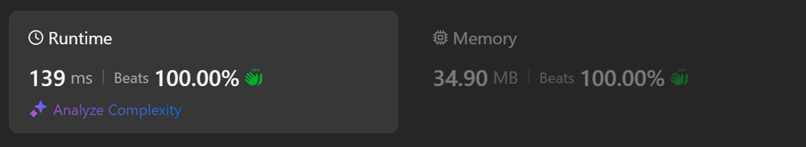

# Kotlin. Beats 100% (139 ms). OOP approach + gcd

**Author:** mobdev778
**Votes:** 1
**Link:** [https://leetcode.com/problems/fraction-addition-and-subtraction/solutions/5680593/](https://leetcode.com/problems/fraction-addition-and-subtraction/solutions/5680593/)

---




# Code
```kotlin []
class Solution {
    fun fractionAddition(expression: String): String {
        FractionalNumberReader(expression).use { reader ->
            var number = reader.parseFractionNumber()
            while (reader.ready()) {
                number = number.add(reader.parseFractionNumber())
            }
            return number.toString()
        }
    }

    class FractionalNumber(private val m: Int, private val n: Int) {

        fun add(other: FractionalNumber): FractionalNumber {
            val newM = m * other.n + other.m * n
            val newN = n * other.n
            val gcd = gcd(newM, newN)
            return FractionalNumber(
                newM / gcd, 
                newN / gcd
            )
        }

        private fun gcd(a: Int, b: Int): Int {
            var a = a
            var b = b
            while (b != 0) {
                val tmp = a % b
                a = b
                b = tmp
            }
            return a
        }

        override fun toString(): String {
            return if (n < 0) "${-m}/${-n}" else "$m/$n"
        }
    }

    class FractionalNumberReader(expression: String): AutoCloseable {

        val stream = PushbackReader(InputStreamReader(expression.byteInputStream()))

        fun ready(): Boolean {
            return stream.ready()
        }

        fun parseFractionNumber(): FractionalNumber {
            val m = if (parsePlus()) parseNumber() else -parseNumber()
            parseSeparator()
            val n = parseNumber()
            return FractionalNumber(m, n)
        }

        private fun parsePlus(): Boolean = when (val char = stream.read()) {
            '-'.code -> false
            '+'.code -> true
            else -> { stream.unread(char); true }
        }

        private fun parseSeparator() {
            val char = stream.read()
            if (char != '/'.code) throw java.lang.IllegalStateException("Unknown separator: ${char.toChar()}")
        }

        private fun parseNumber(): Int {
            var number = 0
            while (stream.ready()) {
                val code = stream.read()
                if (code >= '0'.code && code <= '9'.code) {
                    number = number * 10 + (code - '0'.code)
                } else {
                    stream.unread(code)
                    break
                }
            }
            return number
        }

        override fun close() {
            stream.close()
        }
    }
}
```

# Approach 

The main difficulty of this task is related to the large number of subtasks that arise at different levels.

The task requires:
1) Parse each fraction
2) Add the fractions
3) Display correctly on the screen

1. Parse each fraction
For parsing, I decided to use the standard mechanism - PushbackReader, which allows you to return the last read character. This is very convenient for situations when we expect a number during parsing, but we receive something else from the stream.

2. Add fractions
There is nothing complicated here - we apply the standard rule of adding fractions, reducing the upper and lower parts of the fraction by the greatest common divisor. I find the greatest common divisor using the Euclidean algorithm.

3. Display correctly on the screen
In the code, I did not bother with the signs that appear in the upper and lower parts of the fraction. But when returning the final result, a correction is necessary if the lower part of the fraction (n) turns out to be negative. If the lower part of the fraction turns out to be negative, simply move the "minus" from the lower part of the fraction to the upper part of the fraction.

# "Growing divisor" approach

As an alternative, you can consider using a "constantly growing divisor" approach. This is used in some optimizations when you want to avoid unnecessary "heavy" division operations.

What is the essence of this approach? It takes a long time to calculate the GCD each time a fraction is added. You can avoid simplifying the fraction after each addition, and do it only at the very end, when a string representation of the fraction is required.

Thus, we can simply add fractions to each other without reducing common divisors. This will be a large fraction with an impressive upper and lower parts.

Only when we reach the operation of obtaining the final result - only then will the GCD algorithm be called and the reduction will be performed.


```
class Solution {
    fun fractionAddition(expression: String): String {
        FractionalNumberReader(expression).use { reader ->
            var number = reader.parseFractionNumber()
            while (reader.ready()) {
                number = number.add(reader.parseFractionNumber())
            }
            return number.toString()
        }
    }

    class FractionalNumber(private val m: BigInteger, private val n: BigInteger) {

        fun add(other: FractionalNumber): FractionalNumber {
            return FractionalNumber(m * other.n + other.m * n, n * other.n)
        }

        override fun toString(): String {
            val gcd = m.gcd(n)
            var newM = m / gcd
            var newN = n / gcd
            if (newN.signum() < 0) { newM = -newM; newN = -newN }
            return "$newM/$newN"
        }
    }

    class FractionalNumberReader(expression: String): AutoCloseable {

        val stream = PushbackReader(InputStreamReader(expression.byteInputStream()))

        fun ready(): Boolean {
            return stream.ready()
        }

        fun parseFractionNumber(): FractionalNumber {
            val plus = parsePlus()
            val m = parseNumber()
            parseSeparator()
            val n = parseNumber()
            return FractionalNumber(
                BigInteger(if (plus) 1 else -1, byteArrayOf(m.toByte())),
                BigInteger(1, byteArrayOf(n.toByte()))
            )
        }

        private fun parsePlus(): Boolean = when (val char = stream.read()) {
            '-'.code -> false
            '+'.code -> true
            else -> { stream.unread(char); true }
        }

        private fun parseSeparator() {
            val char = stream.read()
            if (char != '/'.code) throw java.lang.IllegalStateException("Unknown separator: ${char.toChar()}")
        }

        private fun parseNumber(): Int {
            var number = 0
            while (stream.ready()) {
                val code = stream.read()
                if (code >= '0'.code && code <= '9'.code) {
                    number = number * 10 + (code - '0'.code)
                } else {
                    stream.unread(code)
                    break
                }
            }
            return number
        }

        override fun close() {
            stream.close()
        }
    }
}
```