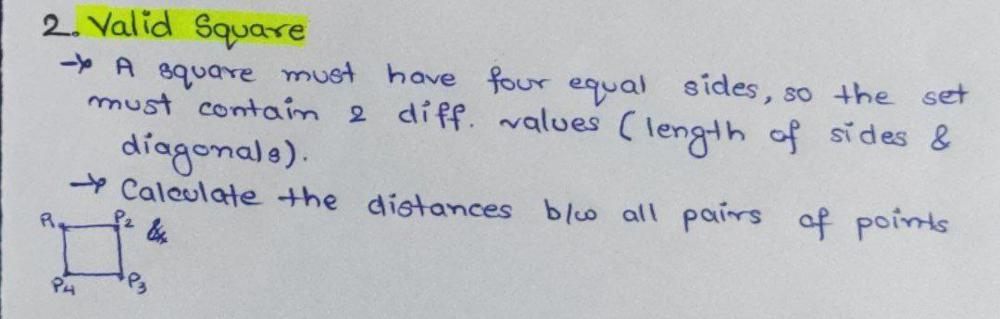

# ✅easiest-solution | 🔥Goldman Sachs | 👁️well-explained

**Author:** nandini-gangrade
**Votes:** 14
**Link:** [https://leetcode.com/problems/valid-square/solutions/3016027/](https://leetcode.com/problems/valid-square/solutions/3016027/)

---

# If you found my answer helpful, please consider giving it an upvote\uD83D\uDE0A
**#ReviseWithArsh #6Companies30Days Challenge 2023**
**Challenge Company 2 : Goldman Sachs**
**Q2. Valid Square**



### Complexity: O(1)
,as it only performs a constant number of operations regardless of the size of the input. Specifically, it calculates the distance between 6 pairs of points and adds them to a set, which takes constant time.

### Code:
```
class Solution {
    // This method returns true if the given 4 points form a square, false otherwise
    public boolean validSquare(int[] p1, int[] p2, int[] p3, int[] p4) {
        // We use a set to store the distances between the points
        Set<Integer> set = new HashSet();
        // Calculate the distances between all pairs of points and add them to the set
        set.add(distanceSquare(p1,p2));
        set.add(distanceSquare(p1,p3));
        set.add(distanceSquare(p1,p4));
        set.add(distanceSquare(p2,p3));
        set.add(distanceSquare(p2,p4));
        set.add(distanceSquare(p3,p4));
        // A square must have 4 equal sides, so the set must contain 2 different values (the lengths of the sides and the diagonals)
        // The set should not contain 0, as that would mean that two points have the same coordinates
        return !set.contains(0) && set.size() == 2;
    }
    // This method calculates the distance between two points and returns its square
    private int distanceSquare(int[] a, int[] b){
        // We use the Pythagorean theorem to calculate the distance between the points
        return (a[0]-b[0])*(a[0]-b[0]) + (a[1]-b[1])*(a[1]-b[1]);
    }
}

```