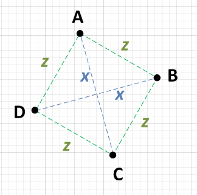

# Simple Javascript solution w/ explanation

**Author:** eggplantkiller
**Votes:** 16
**Link:** [https://leetcode.com/problems/valid-square/solutions/600599/](https://leetcode.com/problems/valid-square/solutions/600599/)

---

I struggled w/ this question so I sought out some answers to really help me understand it:

**Credit to [joel brown](https://softwareengineering.stackexchange.com/users/35490/joel-brown) for the explanation:**

Assuming that your square might be rotated against whatever coordinates system you have in place, you can't rely on there being any repetition of X and Y values in your four points.

What you can do is calculate the distances between each of the four points. If you find the following to be true, you have a square:

There are two points, say A and C which are distance x from each other, and two other points, say B and D which are also distance x from each other.

Each point {A, B, C, D} is an equal distance from the two points which aren't x away. i.e.: If A is x away from C, then it will be z away from both B and D.

Incidentally, the distance z will have to be SQRT((x^2)/2), but you don't need to confirm this. If conditions 1 and 2 are true then you have a square. NOTE: Some people are concerned about the inefficiency of square root. I didn't say that you should do this calculation, I just said that if you did you would get a predictable result!



The bare minimum of work that you would need to do would be to pick a point, say A and calculate the distance to each of the other three points. If you can find that A is x from one point and z from two other points, then you just need to check those two other points against each other. If they are also x from each other then you have a square. i.e.:

AB = z
AC = x
AD = z
Since AB = AD, check BD:

BD = x
Just to be sure, you need to check the other sides: BC and CD.

BC = z
CD = z
Since AC = BD and since AB = AD = BC = CD, this is therefore a square.

Along the way, if you find more than two distinct edge distances then the figure cannot be a square, so you can stop looking.

**Credit to [eradicator](https://leetcode.com/eradicator) for the solution:**

```
var validSquare = function(p1, p2, p3, p4) {
	// Distance formula: d(P, Q) = \u221A (x2 \u2212 x1)2 + (y2 \u2212 y1)2
    function dist(a, b) 
        return (a[0] - b[0]) * (a[0] - b[0]) + (a[1] - b[1]) * (a[1] - b[1]);
    }
	
	// Compute the 6 pt-pt distances (squared, since we don't care about actual distance value)
    const distances = [
        dist(p1, p2),
        dist(p1, p3),
        dist(p1, p4),
        dist(p2, p3),
        dist(p2, p4),
        dist(p3, p4)
    ];
    // Sort & check for non-zero (points must be distinct), check for four equal sides, check for two equal diagonals.
    distances.sort((a, b) => a - b);
    
    return distances[0] &&
        distances[0] === distances[1] &&
        distances[0] === distances[2] &&
        distances[0] === distances[3] &&
        distances[4] === distances[5];
};
```