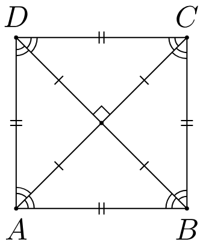

# Easy to understand - Time O(1)

**Author:** trungtrn
**Votes:** 2
**Link:** [https://leetcode.com/problems/valid-square/solutions/5098995/](https://leetcode.com/problems/valid-square/solutions/5098995/)

---

# Intuition
<!-- Describe your first thoughts on how to solve this problem. -->
A valid square has four equal sides with positive length and four equal angles (90-degree angles).
-> There are only 2 values of side (4 equal sides and 2 diagonals) and no 0 side



# Complexity
- Time complexity: O(4^2) -> O(1)
<!-- Add your time complexity here, e.g. $$O(n)$$ -->

- Space complexity: O(4*3) -> O(1)
<!-- Add your space complexity here, e.g. $$O(n)$$ -->

# Code
```
function validSquare(p1, p2, p3, p4) {
    const getDistance = (x, y) => ((x[0] - y[0]) ** 2 + (x[1] - y[1]) ** 2);
    const sides = new Set();
    const points = [p1, p2, p3, p4];
    for (let i = 0; i < 4; i++) {
        for (let j = 0; j < 4; j++) {
            if (i != j) sides.add(getDistance(points[i], points[j]));
        }
    }
    return !sides.has(0) && sides.size == 2;
}
```