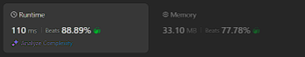
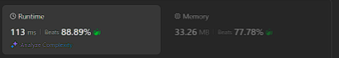

# Kotlin. Beats 88% (110 ms). Two pointers + avoiding multiplication operations.

**Author:** mobdev778
**Votes:** 2
**Link:** [https://leetcode.com/problems/sum-of-square-numbers/solutions/5328998/](https://leetcode.com/problems/sum-of-square-numbers/solutions/5328998/)

---



# Code
```
class Solution {
    fun judgeSquareSum(c: Int): Boolean {
        var a = 0L
        var b = sqrt(c).toLong()
        var sum = b * b
        while (a <= b) { // for case "8 = 4 + 4"
            when {
                sum < c -> { sum += a shl 1; a++ }
                sum > c -> { sum -= b shl 1; b-- }
                else -> break
            }
            sum++
        }
        return sum.toInt() == c
    }

    private fun sqrt(c: Int): Int {
        var left = 0
        var right = 65535
        while (left < right) {
            val middle = (left + right) shr 1
            if (middle * middle < c) {
                left = middle + 1
            } else {
                right = middle
            }
        }
        return left
    }
}
```

# Approach

Here we can use the usual approach with two pointers (a and b) moving towards each other.

Pointer "a" is assigned the role of enumerating small squares, pointer "b" is assigned the role of enumerating large squares.

We set the initial a = 0 and b = sqrt(c).
If a^2 + b^2 < c, this means that the small square "a" is too small and we should increase "a" by one.
If a^2 + b^2 > c, this means that the large square "b" is too large and we should choose a smaller value.

There is some room for optimization here - if we know that in the sum "a^2 + b^2" only one term changes, "a" or "b", then we can play with this moment by calculating a new sum of squares through the difference between neighboring values.

Case #1: a++
old sum: a^2 + b^2
new sum: (a + 1)^2 + b^2 = a^2 + 2a + 1 + b^2 => sum = sum + 2a + 1

Case #2: b--
old sum: a^2 + b^2
new sum: a^2 + (b - 1)^2 = a^2 + b^2 - 2b + 1 => sum = sum - 2b + 1

We can not use the multiplication by 2 operation, but replace it with a bitwise shift to the right:

Case #1 (a++):
```
sum += a shl 1
sum++
```

Case #2 (b--):
```
sum -= b shl 1
sum++
```

# Alternative approach



```
class Solution {
    fun judgeSquareSum(c: Int): Boolean {
        var a  = 0
        var b = Math.sqrt(c.toDouble()).toInt()
        var diff = c - b * b

        // diff = c - b^2 - (a + 1)^2 = c - b^2 - (a^2 + 2a + 1) = c - b^2 - a^2 - (2a - 1)
        // diff = c - (b - 1)^2 - a^2 = c - (b^2 - 2b + 1) - a^2 = c - b^2 + (2b - 1) - a^2

        while (a <= b) { // for case "8 = 4 + 4"
            when {
                diff > 0 -> { diff -= a shl 1; diff--; a++ }
                diff < 0 -> { diff += b shl 1; diff--; b-- }
                else -> break
            }
        }
        return diff == 0
    }
}
```