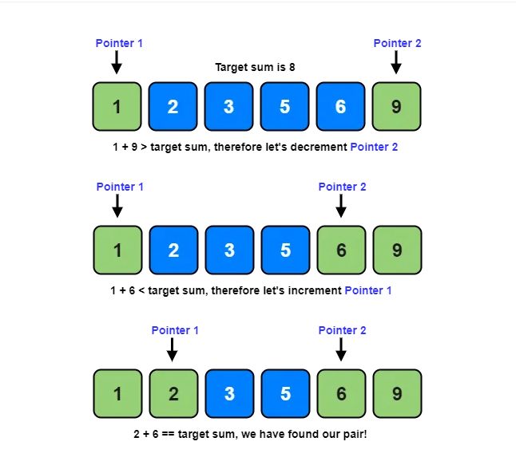

# [Two Pointer + Tutorial] Sum of Square Numbers

**Author:** never_get_piped
**Votes:** 19
**Link:** [https://leetcode.com/problems/sum-of-square-numbers/solutions/5324384/](https://leetcode.com/problems/sum-of-square-numbers/solutions/5324384/)

---

**Topic** :  Two Pointer
The Two Pointer technique involves iterating two pointers across a sorted array to efficiently search for a pair of indices that satisfy a given condition in linear time.


___

## Solution
We need to find two numbers  `a` and `b` such that  `a^2 + b^2 = c`. We can represent `a^2` as the first number and `b^2` as the second number. Our goal is to determine whether there exist two such numbers that sum up to `c`. We can select any perfect square number within the range from `0` to `sqrt(c)`.

```
Find a pair of numbers in a sorted array that sum up to a given target.
```
Does this scenario sound familiar from your first day exploring LeetCode? 
* [Two Sum](https://leetcode.com/problems/two-sum/) 
* [Two Sum II - Input Array Is Sorted](https://leetcode.com/problems/two-sum-ii-input-array-is-sorted/) 
<br/>

We can employ the two-pointer technique to solve the above problem. We initialized out left pointer `l` as `0` and right pointer `r` as `sqrt(c)`.
If the expression  `l^2 + r^2` is greater than  `c`, we move the right pointer to the left. If the expression is smaller than  `c` , we move the left pointer to the right. If the expression equals  `c`, it means we have found two numbers that sum up to the given target, and we return true. (The expression `l^2 + r^2` ensures that we select only perfect square numbers.)





```c++ []
class Solution {
public:
    bool judgeSquareSum(int c) {
        long long l = 0, r = sqrt(c);
        while(l <= r) {
            if(l * l + r * r == c) return true;
            if(l * l + r * r > c) r--;
            else l++;
        }
        return false;
    }
};
```
```java []
class Solution {
    public boolean judgeSquareSum(int c) {
        long l = 0, r = (long) Math.sqrt(c);
        while (l <= r) {
            if (l * l + r * r == c) return true;
            if (l * l + r * r > c) r--;
            else l++;
        }
        return false;
    }
}
```
```python []
class Solution:
    def judgeSquareSum(self, c: int) -> bool:
        l, r = 0, int(math.sqrt(c))
        while l <= r:
            if l * l + r * r == c:
                return True
            elif l * l + r * r > c:
                r -= 1
            else:
                l += 1
        return False
```
```Go []
func judgeSquareSum(c int) bool {
    l, r := 0, int(math.Sqrt(float64(c)))
    for l <= r {
        sum := l * l + r * r
        if sum == c {
            return true
        } else if sum > c {
            r--
        } else {
            l++
        }
    }
    return false
}
```
```PHP []
class Solution {

    /**
     * @param Integer $c
     * @return Boolean
     */
    function judgeSquareSum($c) {
        $l = 0;
        $r = (int) sqrt($c); // Ensure r is cast to int
        while ($l <= $r) {
            $sum = $l * $l + $r * $r;
            if ($sum == $c) return true;
            else if ($sum > $c) $r--;
            else $l++;
        }
        return false;
    }
}
```
```javascript []
/**
 * @param {number} c
 * @return {boolean}
 */
var judgeSquareSum = function(c) {
    let l = 0, r = Math.floor(Math.sqrt(c)) ; // Ensure r is an integer
    while (l <= r) {
        let sum = l * l + r * r;
        if (sum === c) return true;
        else if (sum > c) r--;
        else l++;
    }
    return false;
};
```


**Complexity**:
* Time Complexity : `O(sqrt(c))`
* Space Complexity : `O(1)`

**Feel free to leave a comment if something is confusing, or if you have any suggestions on how I can improve the post.**