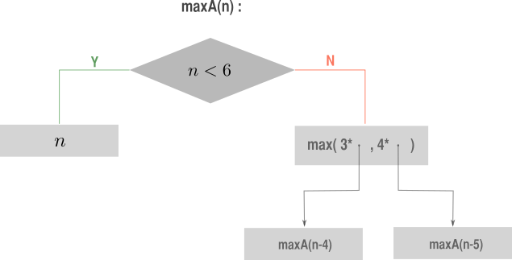
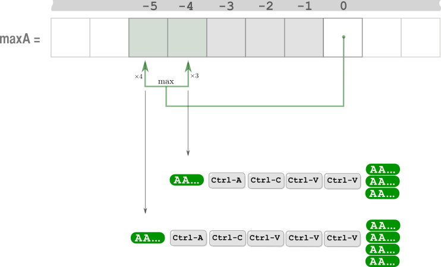
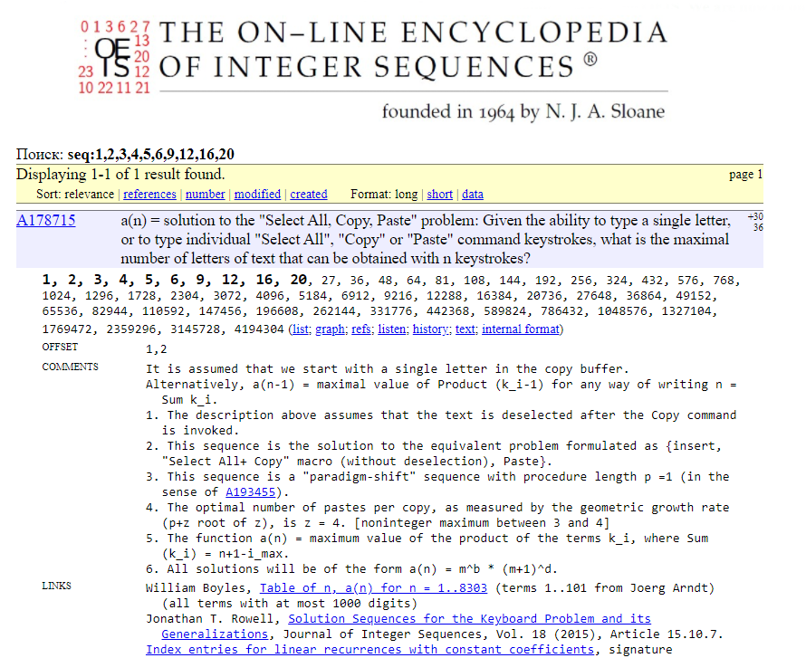

# 1-liner ^^

**Author:** andrii_khlevniuk
**Votes:** 5
**Link:** [https://leetcode.com/problems/4-keys-keyboard/solutions/1660374/](https://leetcode.com/problems/4-keys-keyboard/solutions/1660374/)

---

**Recursive**



```
int maxA(int n)
{
	return n<6 ? n : max(3*maxA(n-4), 4*maxA(n-5));  
}
```
<br>
<br>

**Iterative** (`6` variables)

<br>



<br>

```
int maxA(int n)
{
	int out{min(n, 6)};
	for(int i{6}, a[]{2,3,4,5}; i<n; ++i)
		a[0] = exchange(a[1], exchange(a[2], exchange(a[3], exchange(out, max(3*a[1], 4*a[0])))));
	return out;
}
```

**"Select All, Copy, Paste "**

I've googled this [sequence](https://oeis.org/search?q=1%2C2%2C3%2C4%2C5%2C6%2C9%2C12%2C16%2C20&language=russian&go=%D0%9F%D0%BE%D0%B8%D1%81%D0%BA) in Online Encyclopedia of Integer Sequences and here's what I've got:





It turns out if `n>16` the recursive relation is even simpler:

```
int maxA(int n)
{
	const int t[]{0,1,2,3,4,5,6,9,12,16,20,27,36,48,64,81,108};
	return n<17 ? t[n] : 4*maxA(n-5);
}
```