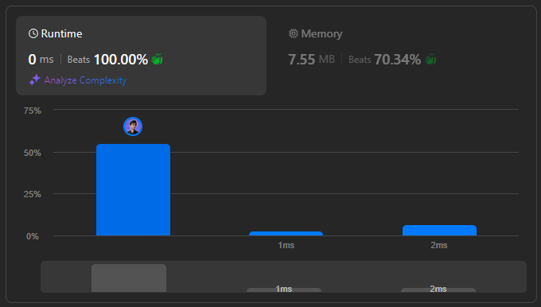

# 🌟 Beats 100.00% 👏  ||  Step-by-Step Breakdown 💯🔥

**Author:** withaarzoo
**Votes:** 100
**Link:** [https://leetcode.com/problems/maximum-swap/solutions/5922945/](https://leetcode.com/problems/maximum-swap/solutions/5922945/)

---


## **\uD83C\uDF1F Access Daily LeetCode Solutions Repo :** [click here](https://github.com/withaarzoo/LeetCode-Solutions)



---

# Intuition
The problem asks us to find the maximum possible number by swapping two digits in the given number at most once. Intuitively, to maximize the number, we want to place the largest digits in the most significant positions. By scanning through the digits, we aim to swap the smallest possible significant digit with the largest possible digit that appears after it in the number.

---

# Approach
1. **Track the last occurrence of each digit**: We store the last position of every digit (from 0 to 9) in an array, allowing us to know where the highest digits appear.
2. **Identify a potential swap**: As we traverse the number, for each digit, we check if there's a larger digit appearing later. If we find one, we swap the two digits.
3. **Return the result**: Once the optimal swap is performed (if any), return the new number. If no swap is needed, return the original number.

---

# Complexity
- **Time complexity**:  
  $$O(n)$$, where \\(n\\) is the number of digits in the input number. We traverse the number twice: once to store the last occurrence of each digit, and once to find the optimal swap.
  
- **Space complexity**:  
  $$O(1)$$, since we only use an array of fixed size (10) to store the last occurrences of digits.

---

# Code
```C++ []
class Solution {
public:
    int maximumSwap(int num) {
        // Convert the number to a string for easier digit manipulation
        string numStr = to_string(num);
        int n = numStr.size();
        
        // Store the last occurrence of each digit (0-9)
        vector<int> last(10, -1);
        for (int i = 0; i < n; ++i) {
            last[numStr[i] - '0'] = i;
        }
        
        // Traverse each digit from left to right
        for (int i = 0; i < n; ++i) {
            // Check if there's a larger digit appearing later
            for (int d = 9; d > numStr[i] - '0'; --d) {
                if (last[d] > i) {
                    // Swap the current digit with the larger one
                    swap(numStr[i], numStr[last[d]]);
                    return stoi(numStr); // Convert back to integer and return
                }
            }
        }
        
        // If no swap was made, return the original number
        return num;
    }
};

```
```Java []
class Solution {
    public int maximumSwap(int num) {
        // Convert number to string for digit manipulation
        char[] numArr = Integer.toString(num).toCharArray();
        int n = numArr.length;

        // Track the last occurrence of each digit (0-9)
        int[] last = new int[10];
        for (int i = 0; i < n; i++) {
            last[numArr[i] - '0'] = i;
        }

        // Traverse the number from left to right
        for (int i = 0; i < n; i++) {
            // Check if we can find a larger digit to swap
            for (int d = 9; d > numArr[i] - '0'; d--) {
                if (last[d] > i) {
                    // Swap and return the new number
                    char temp = numArr[i];
                    numArr[i] = numArr[last[d]];
                    numArr[last[d]] = temp;
                    return Integer.parseInt(new String(numArr));
                }
            }
        }

        // Return the original number if no swap occurred
        return num;
    }
}

```
```JavaScript []
/**
 * @param {number} num
 * @return {number}
 */
var maximumSwap = function(num) {
    // Convert the number to a string array
    let numArr = num.toString().split('');
    
    // Track the last occurrence of each digit
    let last = new Array(10).fill(-1);
    for (let i = 0; i < numArr.length; i++) {
        last[parseInt(numArr[i])] = i;
    }

    // Traverse the digits from left to right
    for (let i = 0; i < numArr.length; i++) {
        // Check if a larger digit can be swapped later
        for (let d = 9; d > numArr[i]; d--) {
            if (last[d] > i) {
                // Swap the digits and return the new number
                [numArr[i], numArr[last[d]]] = [numArr[last[d]], numArr[i]];
                return parseInt(numArr.join(''));
            }
        }
    }
    
    // Return the original number if no swap was performed
    return num;
};

```
```Python []
class Solution:
    def maximumSwap(self, num: int) -> int:
        # Convert the number to a list of characters for easy manipulation
        num_list = list(str(num))
        
        # Track the last occurrence of each digit (0-9)
        last = {int(d): i for i, d in enumerate(num_list)}
        
        # Traverse the number from left to right
        for i, digit in enumerate(num_list):
            # Check for a larger digit to swap
            for d in range(9, int(digit), -1):
                if last.get(d, -1) > i:
                    # Swap and return the new number
                    num_list[i], num_list[last[d]] = num_list[last[d]], num_list[i]
                    return int(''.join(num_list))
        
        # If no swap occurred, return the original number
        return num

```
```Go []
func maximumSwap(num int) int {
    // Convert the number to a string array for manipulation
    numStr := []rune(fmt.Sprint(num))
    n := len(numStr)
    
    // Track the last occurrence of each digit (0-9)
    last := make([]int, 10)
    for i := 0; i < n; i++ {
        last[numStr[i]-'0'] = i
    }
    
    // Traverse the number from left to right
    for i := 0; i < n; i++ {
        // Check if a larger digit can be found later
        for d := 9; d > int(numStr[i]-'0'); d-- {
            if last[d] > i {
                // Swap the digits and return the new number
                numStr[i], numStr[last[d]] = numStr[last[d]], numStr[i]
                result, _ := strconv.Atoi(string(numStr))
                return result
            }
        }
    }
    
    // Return the original number if no swap is done
    return num
}

```

---

# Step-by-Step Detailed Explanation

1. **Tracking last occurrence of digits**:  
   We iterate through the number's digits and store the **last occurrence** of each digit (0-9). This helps us quickly look up where a larger digit might be located in the number.

2. **Traversing the number**:  
   We traverse the digits of the number from left to right. For each digit, we check if there is any larger digit that appears **after** the current digit. If a larger digit exists, we can perform a swap to maximize the number.

3. **Performing a swap**:  
   As soon as we find a larger digit that can be swapped with the current digit, we perform the swap. This is done because we are allowed only **one swap** to maximize the number. After the swap, we return the new number immediately.

4. **Returning the result**:  
   If no swap was performed (because the number was already in its maximum form), we simply return the original number.

---


