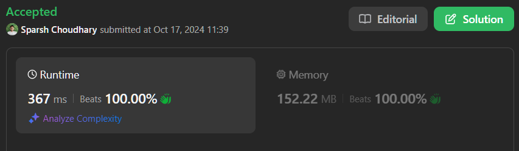

# 🔥BEATS 💯 % 🎯 |✨SUPER EASY BEGINNERS 👏

**Author:** CodeWithSparsh
**Votes:** 2
**Link:** [https://leetcode.com/problems/maximum-swap/solutions/5923854/](https://leetcode.com/problems/maximum-swap/solutions/5923854/)

---



### **Intuition**
The goal is to maximize the given number by swapping two digits. The best approach would be to swap the current digit with a larger one that occurs later in the number, thereby getting the largest possible value.

### **Approach**
1. Convert the number into a list of its digits.
2. Record the last occurrence of each digit (from 0 to 9) in the number, which helps in determining where the largest possible swap can happen.
3. Traverse the digits list and check if a larger digit exists later in the number. If found, swap it with the current digit.
4. Return the new number formed by the digits after the swap. If no swap is made, return the original number.

### **Complexity**
- **Time Complexity**: \\(O(n)\\), where \\(n\\) is the number of digits in the number. We traverse the digits once to record their last occurrence and once more to find the best swap.
- **Space Complexity**: \\(O(n)\\), where \\(n\\) is the number of digits, as we store the digits in a list.

---


```dart []
class Solution {
  int maximumSwap(int num) {
    // Convert the number to a list of digits (characters).
    List<int> digits = num.toString().split('').map(int.parse).toList();
    
    // Record the last occurrence of each digit (0-9).
    List<int> last = List.filled(10, -1);
    for (int i = 0; i < digits.length; i++) {
      last[digits[i]] = i;
    }

    // Try to find the first swap opportunity.
    for (int i = 0; i < digits.length; i++) {
      // Check if there is a bigger digit later in the number.
      for (int d = 9; d > digits[i]; d--) {
        if (last[d] > i) {
          // Swap the current digit with the later bigger digit.
          int temp = digits[i];
          digits[i] = digits[last[d]];
          digits[last[d]] = temp;
          
          // Convert the digits list back to an integer and return it.
          return int.parse(digits.join(''));
        }
      }
    }

    // If no swap was made, return the original number.
    return num;
  }
}
```


```python []
class Solution:
    def maximumSwap(self, num: int) -> int:
        digits = [int(d) for d in str(num)]
        last = [-1] * 10
        
        for i, digit in enumerate(digits):
            last[digit] = i
        
        for i, digit in enumerate(digits):
            for d in range(9, digit, -1):
                if last[d] > i:
                    digits[i], digits[last[d]] = digits[last[d]], digits[i]
                    return int("".join(map(str, digits)))
        
        return num
```


```java []
class Solution {
    public int maximumSwap(int num) {
        char[] digits = Integer.toString(num).toCharArray();
        int[] last = new int[10];

        for (int i = 0; i < digits.length; i++) {
            last[digits[i] - '0'] = i;
        }

        for (int i = 0; i < digits.length; i++) {
            for (int d = 9; d > digits[i] - '0'; d--) {
                if (last[d] > i) {
                    char temp = digits[i];
                    digits[i] = digits[last[d]];
                    digits[last[d]] = temp;
                    return Integer.parseInt(new String(digits));
                }
            }
        }

        return num;
    }
}
```


```cpp []
class Solution {
public:
    int maximumSwap(int num) {
        string digits = to_string(num);
        int last[10] = {0};
        
        for (int i = 0; i < digits.size(); i++) {
            last[digits[i] - '0'] = i;
        }
        
        for (int i = 0; i < digits.size(); i++) {
            for (int d = 9; d > digits[i] - '0'; d--) {
                if (last[d] > i) {
                    swap(digits[i], digits[last[d]]);
                    return stoi(digits);
                }
            }
        }
        
        return num;
    }
};
```


```javascript []
class Solution {
    maximumSwap(num) {
        let digits = num.toString().split('').map(Number);
        let last = Array(10).fill(-1);
        
        for (let i = 0; i < digits.length; i++) {
            last[digits[i]] = i;
        }
        
        for (let i = 0; i < digits.length; i++) {
            for (let d = 9; d > digits[i]; d--) {
                if (last[d] > i) {
                    [digits[i], digits[last[d]]] = [digits[last[d]], digits[i]];
                    return parseInt(digits.join(''), 10);
                }
            }
        }
        
        return num;
    }
}
```


```go []
package main

import (
	"fmt"
	"strconv"
)

func maximumSwap(num int) int {
	digits := []byte(strconv.Itoa(num))
	last := make([]int, 10)
	for i := range digits {
		last[digits[i]-'0'] = i
	}

	for i := range digits {
		for d := 9; d > int(digits[i]-'0'); d-- {
			if last[d] > i {
				digits[i], digits[last[d]] = digits[last[d]], digits[i]
				n, _ := strconv.Atoi(string(digits))
				return n
			}
		}
	}
	return num
}

func main() {
	fmt.Println(maximumSwap(2736))
}
```


```c []
#include <stdio.h>
#include <string.h>

int maximumSwap(int num) {
    char digits[10];
    sprintf(digits, "%d", num);
    int last[10] = {0};
    
    for (int i = 0; digits[i] != '\\0'; i++) {
        last[digits[i] - '0'] = i;
    }
    
    for (int i = 0; digits[i] != '\\0'; i++) {
        for (int d = 9; d > digits[i] - '0'; d--) {
            if (last[d] > i) {
                char temp = digits[i];
                digits[i] = digits[last[d]];
                digits[last[d]] = temp;
                return atoi(digits);
            }
        }
    }
    
    return num;
}

int main() {
    printf("%d\
", maximumSwap(2736));
    return 0;
}
```

---

These implementations  solve the problem of maximizing a number by swapping two digits. All solutions efficiently utilize time complexity \\(O(n)\\) and space complexity \\(O(n)\\).

---


 {:style='width:250px'}