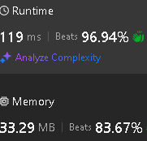

# PriorityQueue<Pair<Int,Int> + MutableList<Int>

**Author:** sav20011962
**Votes:** 2
**Link:** [https://leetcode.com/problems/maximum-swap/solutions/5924604/](https://leetcode.com/problems/maximum-swap/solutions/5924604/)

---

# Approach
PriorityQueue<Pair<Int,Int> + MutableList<Int>
# Complexity

# Code
```kotlin []
class Solution {
    fun maximumSwap(num: Int): Int {
        val pq_desc =  PriorityQueue<Pair<Int,Int>> { a,b -> 
                if(b.first==a.first) b.second-a.second else b.first-a.first}
        var list : MutableList<Int> = mutableListOf()
        var N = num
        var rez = 0
        var i = 0
        while (N>0) {
            pq_desc.add(Pair(N%10,i))
            list.add(0,N%10)
            N /= 10
            i++
        }
        val len = list.size
        var pr = true
        for (i in 0 until len) {
            if (pr) {
                var (num,ind) = pq_desc.poll()
                if (list[i]<num) {
                    while (pq_desc.isNotEmpty()) {
                        val (num1,ind1) = pq_desc.poll()
                        if (num1==num) ind = ind1 else break
                    }
                    val tmp = list[i]
                    list[i] = num
                    list[len-ind-1] = tmp
                    pr = false
                }
            }
            rez = rez*10 + list[i]
        }
        return rez
    }
}
```