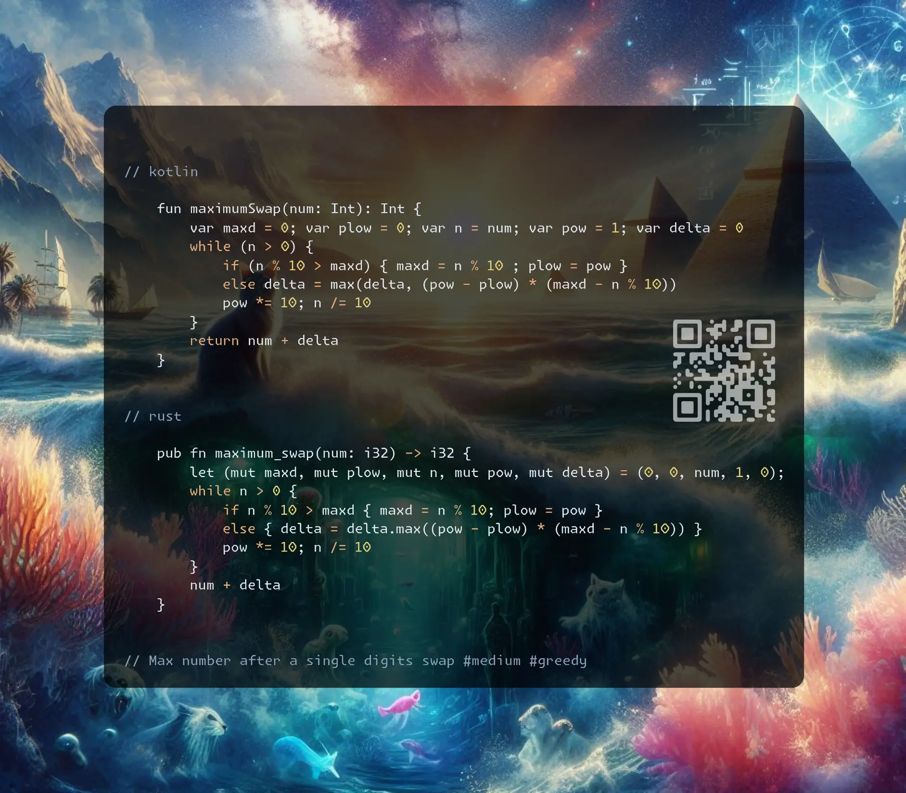

# Kotlin | Rust

**Author:** SamoylenkoDmitry
**Votes:** 1
**Link:** [https://leetcode.com/problems/maximum-swap/solutions/5924164/](https://leetcode.com/problems/maximum-swap/solutions/5924164/)

---



https://youtu.be/qq2cmVPrm7k

#### Join me on Telegram

https://t.me/leetcode_daily_unstoppable/771

#### Problem TLDR

Max number after a single digits swap #medium #greedy

#### Intuition

This can be done in a single pass, let's try an example:

```j

    // 43210
    // 90909
    //  .  * maxI = 0
    //  . *
    //  .*
    //  * j = 3
    // *

```
Going backwards we find the last `max` and a swap it with the most recent value lower than it.

#### Approach

* some arithmetics is applicable, for our example `90909 -> 99900` we do `-9` and `+9000`, so we can track and maximize the total delta `8991`

#### Complexity

- Time complexity:
$$O(lg(n))$$

- Space complexity:
$$O(1)$$

#### Code

```kotlin []

    fun maximumSwap(num: Int): Int {
        var maxd = 0; var plow = 0; var n = num; var pow = 1; var delta = 0
        while (n > 0) {
            if (n % 10 > maxd) { maxd = n % 10 ; plow = pow }
            else delta = max(delta, (pow - plow) * (maxd - n % 10)) 
            pow *= 10; n /= 10
        }
        return num + delta
    }

```
```rust []

    pub fn maximum_swap(num: i32) -> i32 {
        let (mut maxd, mut plow, mut n, mut pow, mut delta) = (0, 0, num, 1, 0);
        while n > 0 {
            if n % 10 > maxd { maxd = n % 10; plow = pow }
            else { delta = delta.max((pow - plow) * (maxd - n % 10)) }
            pow *= 10; n /= 10
        }
        num + delta
    }

```
```c++ []

    int maximumSwap(int num) {
        int maxd = 0, plow = 0, n = num, pow = 1, delta = 0;
        for (; n; pow *= 10, n /= 10) n % 10 > maxd ?
            (maxd = n % 10, plow = pow) : delta = max(delta, (pow - plow) * (maxd - n % 10));
        return num + delta;
    }

```