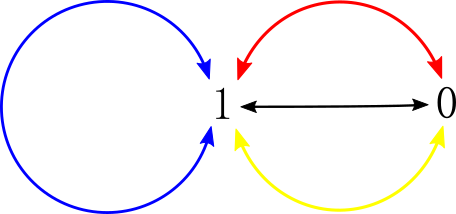

# Share my O(1) C++ solution with thinking process and explanation

**Author:** KJer
**Votes:** 18
**Link:** [https://leetcode.com/problems/bulb-switcher-ii/solutions/107277/](https://leetcode.com/problems/bulb-switcher-ii/solutions/107277/)

---

---
## 1. Problem

---
There is a room with n lights which are turned on initially and 4 buttons on the wall. After performing exactly m unknown operations towards buttons, you need to return how many different kinds of status of the n lights could be.

Suppose n lights are labeled as number [1, 2, 3, ..., n], function of these 4 buttons are given below:

    1. Flip all the lights.
    2. Flip lights with even numbers.
    3. Flip lights with odd numbers.
    4. Flip lights with (3k + 1) numbers, k = 0, 1, 2, ...

**Example 1:**

    Input: n = 1, m = 1.
    Output: 2
    Explanation: Status can be: [on], [off]

**Example 2:**

    Input: n = 2, m = 1.
    Output: 3
    Explanation: Status can be: [on, off], [off, on], [off, off]

**Example 3:**

    Input: n = 3, m = 1.
    Output: 4
    Explanation: Status can be: [off, on, off], [on, off, on], [off, off, off], [off, on, on].

**Note:** n and m both fit in range [0, 1000]. 

---
## 2. Thinking process

---
#### 2.1 Predefinition

---

In order to make the explanation much clearer, **the state of the lights** is defined by an **n-digit binary number K**.

Since n lights are labeled as number [1, 2, 3, ..., n], the **p-th (1 \u2264 p \u2264 n) digit of K** represents **the state of light p**, which means

- When the digit is 1, light p is on.

- When the digit is 0, light p is off.

Since all lights are turned on initially, **the initial K is 111....1 (with n 1's)**.

Here, the operations of the 4 buttons from 1 to 4 are also named to 

>#### **OP1, OP2, OP3, OP4**

The whole problem now becomes

>#### **By doing m operations in {OP1, OP2, OP3, OP4}, how many different K's can we get?**

---
In the following explanation, the **4 different operations** will be marked by **4 different colors**:

 

---
Here, we also need to introduce [2 definitions in mathematics](https://en.wikipedia.org/wiki/Closure_(mathematics)).

**Closure:**

> #### **A set has closure under an operation if performance of that operation on members of the set always produces a member of the same set; in this case we also say that the set is closed under the operation.**

**Closed under a collection of operations:**

>#### **A set is said to be **closed under a collection of operations** if it is closed under each of the operations individually.**

---
#### 2.2 Bi-directional proof

---
If the state of all the lights are represented by a binary number K,

- If we do **a single operation** (OP1, OP2, OP3 or OP4) **even times**, the **specified lights** (all in OP1, even in OP2, odd in OP3, 3k+1 in OP4) will be **toggled even times**.

- **The specified lights' status won't change, which means K won't change**.

---
It can be inferred that

>#### **The transition between different K's are always bi-directional.**

---
#### 2.3 Special case

---
If **m = 0, we do nothing, the result is only the initial K**, which means

> #### **The answer is 1.**

---

#### 2.4 When n = 1

---

The state diagram will be

 

---
**Initially, K = 1.**

- After OP1, light 1 is off, K = 0.
- After OP2, since 1 is odd, light 1 is still on, K = 1.
- After OP3, since 1 is odd, light 1 is off, K = 0.
- After OP4, since 1 mod 3 = 1, light 1 is off, K = 0.

Since the 4 transitions in the diagram are all bi-directional, the maximum number of probable K's is 2 (1 and 0).

---
Then, do the **mathematical Induction**

- When **m = 1**, the result can be 1(do OP2 once) and 0(do OP1, OP3 or OP4 once).
- Suppose after the q-th transition, **m = q (q \u2265 1)**, we are probably at 0, 1.(**2 probable statuses**)
   - If the **result is 1**, in the next transition **(m = q + 1), K can be 1 or 0**.
   - If the **result is 0**, in the next transition **(m = q + 1), K can only be 1**.
   - **Still 2 probable statuses.**
- When **m = q + 1**, the **probable result STILL** can be **0 or 1**.
- **When n = 1, for all m, K can only be 0 or 1, and the answer is 2**

---
It's clear that

> #### **The set {0,1} is a closure, and it is closed under the operation set {OP1, OP2, OP3, OP4}.**

which means

>#### **When n = 1, the answer is always 2.**

---
#### 2.5 When n = 2

---
The state diagram will be

 

---
**Here, since all transitions are bi-directional, all two-way arrows are omitted.**

**The maximum number of probable different K's is 4 (11, 00, 10, 01).**

**The 4 statuses of K are marked as A0, A1, A2 and A3.**

---

From the diagram, we can see

**Initially, K = A0 = 11.** Then, do the **mathematical Induction**

- When **m = 1**, go from A0 to A1, A2 or A3. There are 3 different K's. **The answer is 3.**
- **We are now at A1, A2 or A3 after first transition.** 
- When **m = 2**
    - Since A1, A2, A3 forms a **triangle loop**, they can **transit to each other**, which means A1, A2, A3 are all possible answer for K. 
    - Since A1, A2, A3 can transit to A0, A0 is also a possible answer for K.
    - **The answer is 3 + 1 = 4.**

- Suppose after the q-th transition, **m = q (q \u2265 2)**, we are probably at A0, A1, A2, A3. (**4 probable statuses**)
- When **m = q + 1**
   - If we are at A0, next status will probably be A1, A2, A3.
   - If we are at A1, A2 or A3, next status will probably be A0, A1, A2, A3.
   - We are still probably at A0, A1, A2, A3.
   - **Still 4 probable statuses in all.**

---
It's clear that

>#### **The set {A0, A1, A2, A3} is a closure, and it is closed under operation set {OP1, OP2, OP3, OP4}.**

The conclusion is

> #### **When n = 2, If m = 1, the answer is 3. If m \u2265 2, the answer is 4.**

---
#### 2.6 When n = 3

---
The state diagram will be

 

---
**Here, since all transitions are bi-directional, all two-way arrows are omitted.**

**The maximum number of probable different K's is 8 (111, 000, 101, 010, 011, 100, 001, 110).**

**The 8 statuses of K are marked as A0, A1, A2, A3 (vertices in the outer pyramid) and B0, B1, B2, B3 (vertices in the inner pyramid).**

---

From the diagram, we can see

**Initially, K = A0 = 111**. Then, do the **mathematical Induction**

- When **m = 1**, go from A0 to B0, A1, A2 or A3. There are 4 different K's. **The answer is 4.**
- **We are now at B0, A1, A2 or A3 after first transition.** 
- When **m = 2**
  - Since **A1, A2, A3 forms a triangle loop**, they can **transit to each other**, which means **A1, A2, A3 are possible answer for K**. 
  - Since **A1 can transit to B1, A2 can transit to B2, A3 can transit to B3**, **B1, B2, B3 are possible answer for K**. 
  - Since **B0, A1, A2 or A3 can transit to A0**, **A0 is a possible answer for K**.
  - Since **B0 can transit to B1, B2, B3**,  **B1, B2, B3 are possible answer for K**.
  - **All possible K's are A0, A1, A2, A3, B1, B2, B3 after second transition**.
  - **The answer is 7.**
- **We are now at A0, A1, A2, A3, B1, B2, B3 after second transition.**
- When **m = 3**
  - **A0 can transit to B0.**
  - **A1 can transit to B1.**
  - **A2 can transit to B2.**
  - **A3 can transit to B3.**
  - **A1, A2, A3 can transit to A0.**
  - **B1 can transit to A1.**
  - **B2 can transit to A2.**
  - **B3 can transit to A3.**
  - **All possible K's are A0, A1, A2, A3, B0, B1, B2, B3 after third transition**.
  - **The answer is 8.**
- Suppose after the q-th transition, **m = q (q \u2265 3)**, we are probably at A0, A1, A2, A3, B0, B1, B2, B3. (**8 probable statuses**)
- When **m = q + 1**
  - **A0 can transit to B0.**
  - **A1 can transit to B1.**
  - **A2 can transit to B2.**
  - **A3 can transit to B3.**
  - **B0 can transit to A0.**
  - **B1 can transit to A1.**
  - **B2 can transit to A2.**
  - **B3 can transit to A3.**
  - **All possible K's are STILL A0, A1, A2, A3, B0, B1, B2, B3**.
  - **Still, the answer is 8.**

---
It's clear that

> #### **The set {A0, A1, A2, A3, B0, B1, B2, B3} is a closure, and it is closed under operation set {OP1, OP2, OP3, OP4}.**

The conclusion is

> #### **When n = 3, If m = 1, the answer is 4. If m = 2, the answer is 7. If m \u2265 3, the answer is 8.**

---

#### 2.7 When n > 3

---
Suppose **K = A0 has n digits, and its p-th digit is A0(p), 1 \u2264 p \u2264 n.**

- **Initially, A0 = 111...1 (n 1's)**, which means
  - **A0(p) = 1, p mod 6 = 1.**
  - **A0(p) = 1, p mod 6 = 2.**
  - **A0(p) = 1, p mod 6 = 3.**
  - **A0(p) = 1, p mod 6 = 4.**
  - **A0(p) = 1, p mod 6 = 5.** 
  - **A0(p) = 1, p mod 6 = 0.**

---
- **By doing OP1 on A0 , we get A1,** and
  - **A1(p) = 0, p mod 6 = 1.**
  - **A1(p) = 0, p mod 6 = 2.**
  - **A1(p) = 0, p mod 6 = 3.**
  - **A1(p) = 0, p mod 6 = 4.**
  - **A1(p) = 0, p mod 6 = 5.**
  - **A1(p) = 0, p mod 6 = 0.**
- **By doing OP2 on A0 , we get A2,** and
  - **A2(p) = 1, p mod 6 = 1.**
  - **A2(p) = 0, p mod 6 = 2.**
  - **A2(p) = 1, p mod 6 = 3.**
  - **A2(p) = 0, p mod 6 = 4.**
  - **A2(p) = 1, p mod 6 = 5.**
  - **A2(p) = 0, p mod 6 = 0.**
- **By doing OP3 on A0 , we get A3,** and
  - **A3(p) = 0, p mod 6 = 1.**
  - **A3(p) = 1, p mod 6 = 2.**
  - **A3(p) = 0, p mod 6 = 3.**
  - **A3(p) = 1, p mod 6 = 4.**
  - **A3(p) = 0, p mod 6 = 5.**
  - **A3(p) = 1, p mod 6 = 0.**

---
- **By doing OP4 on A0 , we get B0,** and
  - **B0(p) = 0, p mod 6 = 1.**
  - **B0(p) = 1, p mod 6 = 2.**
  - **B0(p) = 1, p mod 6 = 3.**
  - **B0(p) = 0, p mod 6 = 4.**
  - **B0(p) = 1, p mod 6 = 5.**
  - **B0(p) = 1, p mod 6 = 0.**

---
- **By doing OP1 on B0 , we get B1,** and
  - **B1(p) = 1, p mod 6 = 1.**
  - **B1(p) = 0, p mod 6 = 2.**
  - **B1(p) = 0, p mod 6 = 3.**
  - **B1(p) = 1, p mod 6 = 4.**
  - **B1(p) = 0, p mod 6 = 5.**
  - **B1(p) = 0, p mod 6 = 0.**
- **By doing OP2 on B0 , we get B2,** and
  - **B2(p) = 0, p mod 6 = 1.**
  - **B2(p) = 0, p mod 6 = 2.**
  - **B2(p) = 1, p mod 6 = 3.**
  - **B2(p) = 1, p mod 6 = 4.**
  - **B2(p) = 1, p mod 6 = 5.**
  - **B2(p) = 0, p mod 6 = 0.**
- **By doing OP3 on B0 , we get B3,** and
  - **B3(p) = 1, p mod 6 = 1.**
  - **B3(p) = 1, p mod 6 = 2.**
  - **B3(p) = 0, p mod 6 = 3.**
  - **B3(p) = 0, p mod 6 = 4.**
  - **B3(p) = 0, p mod 6 = 5.**
  - **B3(p) = 1, p mod 6 = 0.**

---
Since it has already been proved in 2.2 that

> #### **The transition between different K's are always bi-directional.**

Since we only need to calculate on a single direction, we can get

- **By doing OP4 on B1 , we get A1.**
- **By doing OP4 on B2 , we get A2.**
- **By doing OP4 on B3 , we get A3.**

---
- **By doing OP3 on A1 , we get A2.**
- **By doing OP1 on A2 , we get A3.**
- **By doing OP2 on A3 , we get A1.**

Similarly,
- **By doing OP3 on B1 , we get B2.**
- **By doing OP1 on B2 , we get B3.**
- **By doing OP2 on B3 , we get B1.**

---
Since **the first 3 digits of A0, A1, A2, A3, B0, B1, B2, B3 are different**, we can inferred that

>#### **A0, A1, A2, A3, B0, B1, B2, B3 are all different binary numbers.**

which means

>#### **A0, A1, A2, A3, B0, B1, B2, B3 represents 8 different statuses.**

Since the result of doing {OP1, OP2, OP3, OP4} on the set {A0, A1, A2, A3, B0, B1, B2, B3} is still in the set  {A0, A1, A2, A3, B0, B1, B2, B3}, it can be inferred that when n > 3

> #### **The set {A0, A1, A2, A3, B0, B1, B2, B3} is STILL a closure, and it is STILL closed under operation set {OP1, OP2, OP3, OP4}.**

---
If we draw the state diagram

 

we can find **this diagram is as same as those in 2.6 when n = 3**.

---
Since we have already discussed on the diagram in 2.6, here we come to the conclusion

> #### **When n > 3, If m = 1, the answer is 4. If m = 2, the answer is 7. If m \u2265 3, the answer is 8.**

---
## 3. Conclusion

---
After the discussion, we can infer that **the final answer is**

- **When m = 0, the answer is 1.**


- **When n = 1, the answer is 2.**
- **When n = 2**
   - **If m = 1, the answer is 3.**
   - **If m \u2265 2, the answer is 4.**
- **When n \u2265 3**
   - **If m = 1, the answer is 4.**
   - **If m = 2, the answer is 7.**
   - **If m \u2265 3, the answer is 8.**

---
## 4. Complexity analysis

---
> #### **Both the time and space complexity are O(1).**

---
## 5. Code

---

```cpp
class Solution {
public:
    int flipLights(int n, int m) {
        if(m == 0)
        {
            return 1;
        }else{
            switch(n)
            {
                case 1: return 2;break;
                case 2: return (m == 1) ? 3 : 4;break;
                default:
                switch(m)
                {
                    case 1: return 4;break;
                    case 2: return 7;break;
                    default: return 8;break;
                }
                break;
            }
        }
    }
};
```