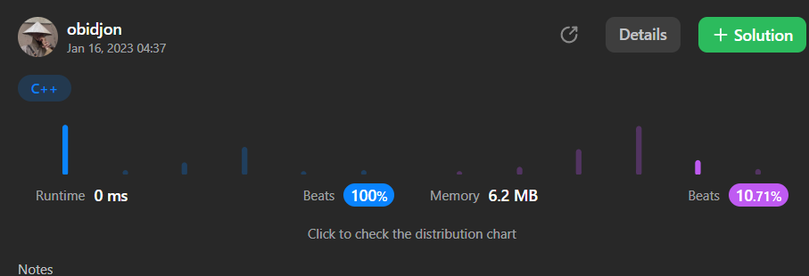

# [Java/C++] 0ms || Awesome approach || 100% faster

**Author:** im_obid
**Votes:** 12
**Link:** [https://leetcode.com/problems/monotone-increasing-digits/solutions/3056255/](https://leetcode.com/problems/monotone-increasing-digits/solutions/3056255/)

---

# Attention \u2757
Avoid the following approach, it is too expensive because of ```n--``` statements\u2757. 
```
public int monotoneIncreasingDigits(int n) {
        while (!isSatisfies(n)) {
            n--;
        }
        return n;
    }

    public boolean isSatisfies(int n) {
        int k = 10;
        while (n > 0) {
            if (k < n % 10) {
                return false;
            } else {
                k = n % 10;
                n /= 10;
            }
        }
        return true;
    }
```

# My Approach

Let's we will improve above code.
```isSatisfies(int n)``` method returns just ```true``` , ```false``` if ```n``` has ```monotone``` ```increasing digits```, hasn't  respectively. 
I changed it to ```getThePositionNotSatisfied(int n)``` and it returns the position of the digit not satisfied the condition or -1 if satisfies all condition. 

And, instead of ```n--```, I write the following statements to increase loop steps and to improve speed : 
```
digitInTheNextPosition = ((int) (n / Math.pow(10, position - 1))) % 10;
            n -= Math.pow(10, position - 1) * (digitInTheNextPosition + 1);
            n -= n % Math.pow(10, position);
            n += Math.pow(10, position) - 1;
```

For example, if ```n=3423```.
Then ```getThePositionNotSatisfied(3423) = 2```, it means that from right the digit in 
```2-index```, i.e ```4``` not satisfies the condition.
Then 
    ```position = 2```
    ```digitNextInThePosition = 3423/ Math.pow(10,2 - 1) % 10 = 2;```
    ```n = 3423 - Math.pow(10,2 - 1)(2+1) = 3393;```

Probably, there are other numbers between ```3393``` and ```3399``` that we looking for. So we need to check these numbers. And new value of ```n``` to check should be ```3399```.
For this, we need to swap all digits after the ```position``` with 9. In my code, I achive it as following :

```n = 3393 - 3393 % Math.pow(10, 2) = 3300;```
```n = 3300 + (Math.pow(10, 2) - 1) = 3300 + 99 = 3399;```

and, so on. 

In the first approach to down from ```3423``` to ```3399``` you have to walk **23 steps**, in the second approach just **1 step** :)


*Please upvote, if you find it useful*\uD83D\uDE0A


# Java
```
class Solution {
    public int monotoneIncreasingDigits(int n) {
        int position;
        int digitInTheNextPosition;
        while ((position = getThePositionNotSatisfied(n)) != -1) {
            digitInTheNextPosition = ((int) (n / Math.pow(10, position - 1))) % 10;
            n -= Math.pow(10, position - 1) * (digitInTheNextPosition + 1);
            n -= n % Math.pow(10, position);
            n += Math.pow(10, position) - 1;
        }
        return n;
    }

    public int getThePositionNotSatisfied(int n) {
        int k = 10;
        int position = 0;
        while (n > 0) {
            if (k < n % 10) {
                return position;
            } else {
                k = n % 10;
                n /= 10;
                position++;
            }
        }
        return -1;
    }
}
```
---

# C++
```
#include<math.h>
class Solution {
public: 
    int getThePositionNotSatisfied(int n) {
        int k = 10;
        int position = 0;
        while (n > 0) {
            if (k < n % 10) {
                return position;
            } else {
                k = n % 10;
                n /= 10;
                position++;
            }
        }
        return -1;
    }
public:
    int monotoneIncreasingDigits(int n) {
        int position;
        int digitInTheNextPosition;
        while ((position = getThePositionNotSatisfied(n)) != -1) {
            digitInTheNextPosition = ((int) (n / pow(10, position - 1))) % 10;
            n -= pow(10, position - 1) * (digitInTheNextPosition + 1);
            n -= (n %(int) pow(10, position));
            n += pow(10, position) - 1;
        }
        return n;
    }
};
```
# Result

