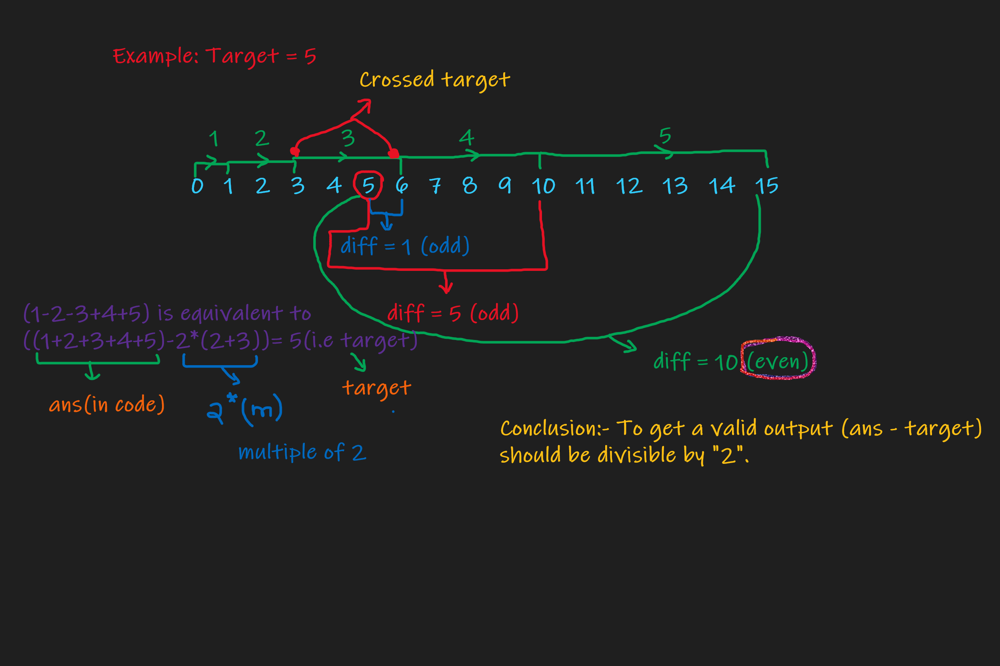

# "Python" easy explanation blackboard

**Author:** harish_sahu
**Votes:** 28
**Link:** [https://leetcode.com/problems/reach-a-number/solutions/990901/](https://leetcode.com/problems/reach-a-number/solutions/990901/)

---

**The approach is explained in the image**
*Simple and easy python3 solution*
Note:- The minimum steps to target is same as the minimum steps to abs(target).


```
class Solution:
    def reachNumber(self, target: int) -> int:
        ans, k = 0, 0
        target = abs(target)
        while ans < target:
            ans += k
            k += 1
        while (ans - target) % 2:
            ans += k
            k += 1
        return k - 1  
```
