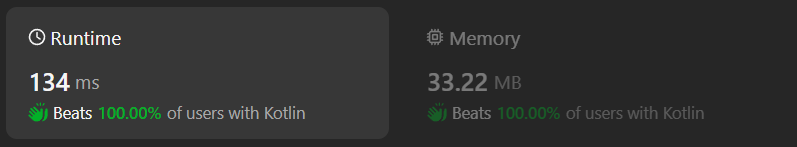

# Kotlin solution with built-in function and sqrt

**Author:** chayangkoon
**Votes:** 0
**Link:** [https://leetcode.com/problems/prime-number-of-set-bits-in-binary-representation/solutions/4971224/](https://leetcode.com/problems/prime-number-of-set-bits-in-binary-representation/solutions/4971224/)

---



# Code
```
class Solution {
    fun countPrimeSetBits(left: Int, right: Int): Int {
        var count = 0
        for(number in left..right) {
            val numberOfSetBits = number.countOneBits()
            if(numberOfSetBits.isPrime()) count++
        }
        return count
    }

    private fun Int.isPrime(): Boolean {
        if(this <= 1)  return false
        if(this == 2 || this == 3) return true
        if(this % 2 == 0 || this % 3 == 0) return false

        var i = 5
        while(i <= sqrt(this.toDouble())) {
            if(this % i == 0 || this % (i + 2) == 0) {
                return false
            }
            i = i + 6
        }

        return true
    }
}
```