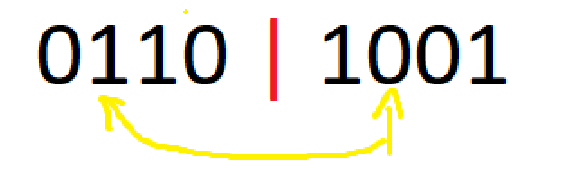
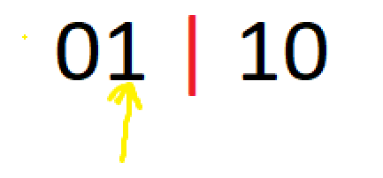
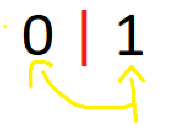

# 🚀 100% || Easy Iterative Approach || Explained Intuition 🚀

**Author:** MohamedMamdouh20
**Votes:** 204
**Link:** [https://leetcode.com/problems/k-th-symbol-in-grammar/solutions/4205730/](https://leetcode.com/problems/k-th-symbol-in-grammar/solutions/4205730/)

---

# Porblem Description

The task is **constructing** a table consisting of `n` rows, with each row generated from the row immediately above it according to a specific **rule**. 
The rule involves **replacing** each `0` with `01` and each `1` with `10` in the **previous** row. 
The task is to **determine** the value of the `kth` element (1-indexed) in the `nth` row of this table.

- **Constraints:**
    - `1 <= n <= 30`
    - `1 <= k <= 2e(n - 1)`


---


# Intuition

Hello there,\uD83D\uDE04

Let's zoom\uD83D\uDD0E in and examine the details in our today's problem.
The problem today wants us to calculate what is the `k-th` element in the `n-th` level of some tower.\uD83E\uDD28
- We have some rule to calculate current tower from previous one by:
    - Replace each `0` with `01`
    - Replace each `1` with `10`
    - First level is only `0`

**First** solution we will think of is our savior in all situations, **Brute Force** by **iterating** `n` loops and replace characters in each loop.
Unfortunately, It won't work. Let's see why.\uD83D\uDE22

```
First Level -> 1 element
0
```
```
Second Level -> 2 element
01
```
```
Third Level -> 4 element
0110
```
```
Fourth Level -> 8 element
01101001
```
```
Fifth Level -> 16 element
0110100110010110
```
```
Sixth Level -> 32 element
01101001100101101001011001101001
```

We can see that the levels are growing **exponentially** and by the `30-th` row we will have `2^(n - 1)` element. which will eventually give us **TLE**.\uD83D\uDE14

Can we do better ?\uD83E\uDD14
There is some **observation**, did you see it ?\uD83E\uDD2F
Each time we hop from a row to the next row we only add the **inverse** of the elements of **previous** row. how?
```
First Level
0
```
```
Second Level
0 | 1
```
```
Third Level
01 | 10
```
```
Fourth Level
0110 | 1001
```
```
Fifth Level
01101001 | 10010110
```

- We can see that we have **two halves** in each level -except level one- where: 
    - **first** element of **second half** is **inverse** of **first** element of **first half**.
    - **second** element of **second half** is inverse of **second** element of **first half**.
    - **third** element of **second half** is inverse of **third** element of **first half**.
    - And so on so forth.
And the first half of some level **exact** is the level before it.\uD83E\uDD2F
```
Third Level
0110

Fourth Level
0110 | 1001
```
```
Fourth Level
01101001

Fifth Level
01101001 | 10010110
```

How can we utilize these great **observations** ?\uD83E\uDD29
- Since we want the `k-th` element why don't we look where it is in the row, the first half or second half.\uD83E\uDD28
    - If it in the **first half** then great we can proceed to the previous level since the `k-th` element in it will be the **exact** `k-th` element we are looking for.
    - If it in the **second half** then it is the **inverse** of the `(k - half elements in the row)` element in the first half then it is the inverse of `(k - half elements in the row)` element in the previous level.
Until we reach **level one** which is only `0`.

Let's this example where `n = 4` and `K = 6`.

**fourth** level:

`6-th` element is the **inverse** of the `second` element of the first half and previous level.

**third** level:

`second` element is the `second` element of the first half and previous level.

**second** level:

`second` element is the **inverse** of the `first` element of the first half and previous level.
The previous level is **first level** which is only `0`.

Since we **inversed** **two times**, then the `k-th` element is the **same** of the **first row** which is `0`.

And this is the solution for our today'S problem I hope that you understood it\uD83D\uDE80\uD83D\uDE80


---


# Approach
1. Initialize a boolean flag, `areValuesSame`, to **track** if the values of `k` and the **first** element in the row are the same.
2. Calculate the total **number** of elements in the `nth` row using the formula `2^(n-1)`.
3. Enter a **loop** that continues until you reach the **first** row (where `n` equals `1` and its element is `0`):
    - **Halve** the number of elements in the row by dividing `n` by 2.
    - **Check** if `k` is in the **second half** of the current row by comparing it to `n`.
    - If `k` is in the second half, **adjust** its value by **subtracting** new `n`, and **toggle** the value of `areValuesSame` (if it was `true`, make it `false`, and vice versa).
4. **Return** `0` if the `areValuesSame` flag indicates that the values are the same; otherwise, return `1`.


## Complexity
- **Time complexity:** $O(N)$
Since we are start looping with $2^n$ elements and in each loop we divide `n` by two so the complexity is $O(log(2^N))$ which is $O(N)$.
- **Space complexity:** $O(1)$
Since we are using constant variables.


---


# Code

```C++ []
class Solution {
public:
    int kthGrammar(int n, int k) {
        // Initialize a flag to track if the values of k and first element are the same.
        bool areValuesSame = true; 

        // Calculate the total number of elements in the nth row, which is 2^(n-1).
        n = pow(2, n - 1);

        // Continue until we reach the first row.
        while (n != 1) {
            // Halve the number of elements in the row.
            n /= 2;

            // If k is in the second half of the row, adjust k and toggle the flag.
            if (k > n) {
                k -= n;
                areValuesSame = !areValuesSame;
            }
        }

        // Return 0 if the flag indicates that the values are the same; otherwise, return 1.
        return ((areValuesSame) ? 0 : 1) ;
    }
};
```
```Java []
public class Solution {
    public int kthGrammar(int n, int k) {
        // Initialize a flag to track if the values of k and the first element are the same.
        boolean areValuesSame = true;

        // Calculate the total number of elements in the nth row, which is 2^(n-1).
        n = (int) Math.pow(2, n - 1);

        // Continue until we reach the first row.
        while (n != 1) {
            // Halve the number of elements in the row.
            n /= 2;

            // If k is in the second half of the row, adjust k and toggle the flag.
            if (k > n) {
                k -= n;
                areValuesSame = !areValuesSame;
            }
        }

        // Return 0 if the flag indicates that the values are the same; otherwise, return 1.
        return (areValuesSame ? 0 : 1);
    }
}
```
```Python []
class Solution:
    def kthGrammar(self, n, k):
        # Initialize a flag to track if the values of k and the first element are the same.
        are_values_same = True

        # Calculate the total number of elements in the nth row, which is 2^(n-1).
        n = 2**(n - 1)

        # Continue until we reach the first row.
        while n != 1:
            # Halve the number of elements in the row.
            n //= 2

            # If k is in the second half of the row, adjust k and toggle the flag.
            if k > n:
                k -= n
                are_values_same = not are_values_same

        # Return 0 if the flag indicates that the values are the same; otherwise, return 1.
        return 0 if are_values_same else 1
```
```C []
int kthGrammar(int n, int k) {
    // Initialize a flag to track if the values of k and the first element are the same.
    bool areValuesSame = true;

    // Calculate the total number of elements in the nth row, which is 2^(n-1).
    n = (int)pow(2, n - 1);

    // Continue until we reach the first row.
    while (n != 1) {
        // Halve the number of elements in the row.
        n /= 2;

        // If k is in the second half of the row, adjust k and toggle the flag.
        if (k > n) {
            k -= n;
            areValuesSame = !areValuesSame;
        }
    }

    // Return 0 if the flag indicates that the values are the same; otherwise, return 1.
    return (areValuesSame) ? 0 : 1;
}
```


---

## Edit
A good note from our friend [@kenlau](/kenlau).

Instead of using `pow(2, n - 1)` we can simply use shifting operation `1 << (n - 1)`.
`pow(2, n - 1)` has complexity of `O(log(N))` and `1 << (n - 1)` has complexity of `O(1)`.
simply `1 << (n - 1)` means that put `1` and shift it `n - 1` positions in its binary representation. 
| Operation | Binary Representation | Integer | 
| :--- | :---:| :---: | 
| 1 << 0 | 00001 | 1 | 
| 1 << 1 | 00010 | 2 | 
| 1 << 2 | 00100 | 4 | 
| 1 << 3 | 01000 | 8 | 
| 1 << 4 | 10000 | 16 | 


