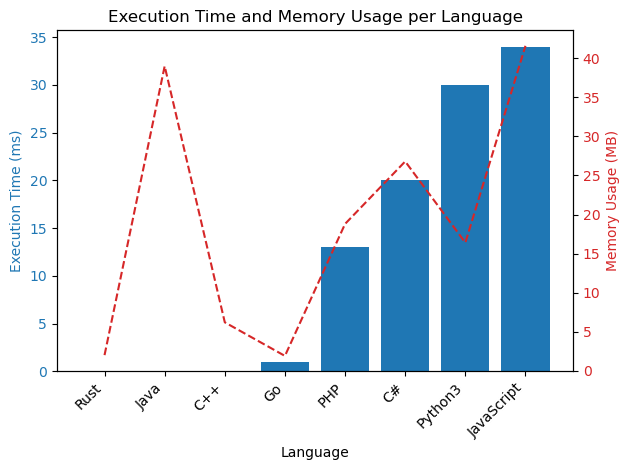

# ✅ 100% Recursive  & Bit Count

**Author:** vanAmsen
**Votes:** 68
**Link:** [https://leetcode.com/problems/k-th-symbol-in-grammar/solutions/4205266/](https://leetcode.com/problems/k-th-symbol-in-grammar/solutions/4205266/)

---

# Solution 1: Recursive Approach

## Intuition
The initial thought on solving the problem revolves around understanding the pattern of sequence generation as described in the problem statement. As the sequence grows by replacing 0 with 01 and 1 with 10, we can observe a recursive relationship between the nth row and the (n-1)th row.

## Live Coding with Comments
https://youtu.be/gYuvglDHXlU?si=owdAdZx3wrRb49NM

## Approach
Our approach is to leverage the recursive pattern observed. The length of the nth row is double the length of the (n-1)th row. If k is in the first half of the nth row, the symbol at position k in the nth row is the same as the symbol at position k in the (n-1)th row. If k is in the second half of the nth row, the symbol at position k in the nth row is the opposite of the symbol at position (k - length of (n-1)th row) in the (n-1)th row.

## Complexity
- Time complexity: The time complexity is O(n) as there is a single recursive call for every level of n.
- Space complexity: The space complexity is also O(n) due to the stack space used by the recursive calls.

## Code
```python []
class Solution:
    def kthGrammar(self, n: int, k: int) -> int:
        if n == 1:
            return 0
        length = 2 ** (n - 2)
        if k <= length:
            return self.kthGrammar(n - 1, k)
        else:
            return 1 - self.kthGrammar(n - 1, k - length)
```
``` Rust []
impl Solution {
    pub fn kth_grammar(n: i32, k: i32) -> i32 {
        if n == 1 { return 0; }
        let length = 1 << (n - 2);
        if k <= length { Solution::kth_grammar(n - 1, k) }
        else { 1 - Solution::kth_grammar(n - 1, k - length) }
    }
}
```
``` Go []
func kthGrammar(n int, k int) int {
    if n == 1 {
        return 0
    }
    length := 1 << (n - 2)
    if k <= length {
        return kthGrammar(n - 1, k)
    } else {
        return 1 - kthGrammar(n - 1, k - length)
    }
}
```
``` C++ []
class Solution {
public:
    int kthGrammar(int n, int k) {
        if (n == 1) return 0;
        int length = 1 << (n - 2);
        if (k <= length) return kthGrammar(n - 1, k);
        else return 1 - kthGrammar(n - 1, k - length);
    }
};
```
``` Java []
class Solution {
    public int kthGrammar(int n, int k) {
        if (n == 1) return 0;
        int length = 1 << (n - 2);
        if (k <= length) return kthGrammar(n - 1, k);
        else return 1 - kthGrammar(n - 1, k - length);
    }
}
```
``` C# []
public class Solution {
    public int KthGrammar(int n, int k) {
        if (n == 1) return 0;
        int length = 1 << (n - 2);
        if (k <= length) return KthGrammar(n - 1, k);
        else return 1 - KthGrammar(n - 1, k - length);
    }
}
```
``` JS []
var kthGrammar = function(n, k) {
    if (n === 1) return 0;
    let length = 1 << (n - 2);
    if (k <= length) return kthGrammar(n - 1, k);
    else return 1 - kthGrammar(n - 1, k - length);
};
```
``` PHP []
class Solution {

    /**
     * @param Integer $n
     * @param Integer $k
     * @return Integer
     */
    function kthGrammar($n, $k) {
        if ($n == 1) return 0;
        $length = 1 << ($n - 2);
        if ($k <= $length) return $this->kthGrammar($n - 1, $k);
        else return 1 - $this->kthGrammar($n - 1, $k - $length);
    }
}
```

## Performance

| Language | Execution Time (ms) | Memory Usage |
|----------|---------------------|--------------|
| Rust     | 0 ms                | 2 MB         |
| Java     | 0 ms                | 39 MB        |
| C++      | 0 ms                | 6.2 MB       |
| Go       | 1 ms                | 1.9 MB       |
| PHP      | 13 ms               | 18.8 MB      |
| C#       | 20 ms               | 26.8 MB      |
| Python3  | 30 ms               | 16.4 MB      |
| JavaScript| 34 ms              | 41.6 MB      |




# Solution 2: Bit Count Approach

## Intuition
The second approach is derived from the observation that the kth symbol in the nth row is determined by the parity (odd or even nature) of the count of 1-bits in the binary representation of (k-1).

## Approach
Convert the index (k-1) to its binary representation and count the number of 1-bits. If the count is even, the kth symbol is 0; if the count is odd, the kth symbol is 1. This approach leverages bitwise operation and avoids the need for recursion, making it more efficient.

## Complexity
- Time complexity: The time complexity is O(log k) as the time taken to convert the number to binary and count the 1-bits is logarithmic with respect to k.
- Space complexity: The space complexity is O(1) as no extra space is used apart from the input and output variables.

## Code
```python []
class Solution:
    def kthGrammar(self, n: int, k: int) -> int:
        return bin(k - 1).count('1') % 2
```

## What did we learn?
  - We learned that recognizing patterns and relationships between different parts of the problem can lead to efficient solutions.
  - Recursive relationships can sometimes be optimized further by using mathematical or bitwise operations.
## Why does it work?
  - The recursive approach works because of the defined recursive relationship between the nth row and the (n-1)th row.
  - The bit count approach works due to the observed correlation between the count of 1-bits in (k-1) and the kth symbol in the nth row.
## Logic behind solutions?
  - The logic behind the recursive solution is the direct application of the recursive relationship between successive rows as defined in the problem.
  - The logic behind the bit count solution is derived from analyzing the pattern of symbol generation and correlating it with bitwise properties of the index k.