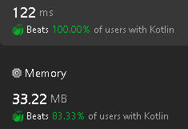

# A brute force search for the right numbers.

**Author:** sav20011962
**Votes:** 0
**Link:** [https://leetcode.com/problems/rotated-digits/solutions/5079234/](https://leetcode.com/problems/rotated-digits/solutions/5079234/)

---

# Approach
A search of the right

# Code

```
class Solution {
    fun rotatedDigits(n: Int): Int {
        fun test(n: Int): Boolean {
            var N = n
            var rev = false
            while (N>0) {
                val C = N % 10
                if (C == 3 || C == 4 || C == 7) return false
                if (C == 6 || C == 9 || C == 2 || C == 5) rev = true
                N = N / 10
            }
            return rev
        }
        var rez = 0
        for (i in 1..n) {
            if (test(i)) rez++
        }
        return rez
    }
}
```