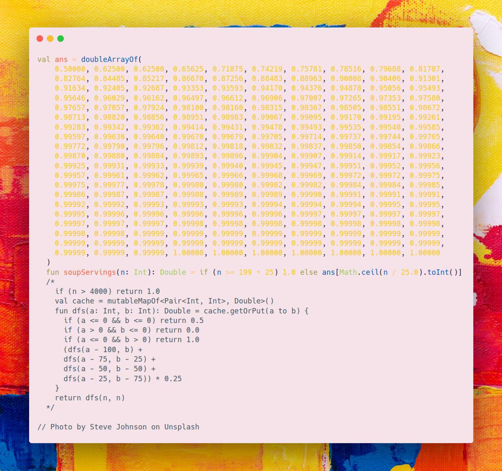

# Kotlin | generate all the answers

**Author:** SamoylenkoDmitry
**Votes:** 1
**Link:** [https://leetcode.com/problems/soup-servings/solutions/3831785/](https://leetcode.com/problems/soup-servings/solutions/3831785/)

---



#### Join me on Telegram

https://t.me/leetcode_daily_unstoppable/290

#### Problem TLDR

Probability of soup `A` drained first or both `A and B` with `0.5` multiplier.

#### Intuition

The formula in the examples gives us the correct way to calculate the probabilities: each time we make a choice with probability of `1/4`. After we arrive with the final condition, we use multipliers `1.0` for A win, `0.5` for both A and B and `0.0` for B win.

This is a simple DFS + cache dynamic programming problem. 
However, this give TLE or OOM, as the `N` is too big.

At that point, the interview is over, and you safely can go home and see the answers in leetcode.com website.

To solve TLE & OOM, we must observe all the possible answers:

```
  val ans = doubleArrayOf(
    0.50000, 0.62500, 0.62500, 0.65625, 0.71875, 0.74219, 0.75781, 0.78516, 0.79688, 0.81787, 
    0.82764, 0.84485, 0.85217, 0.86670, 0.87256, 0.88483, 0.88963, 0.90008, 0.90406, 0.91301, 
    0.91634, 0.92405, 0.92687, 0.93353, 0.93593, 0.94170, 0.94376, 0.94878, 0.95056, 0.95493, 
    0.95646, 0.96029, 0.96162, 0.96497, 0.96612, 0.96906, 0.97007, 0.97265, 0.97353, 0.97580, 
    0.97657, 0.97857, 0.97924, 0.98100, 0.98160, 0.98315, 0.98367, 0.98505, 0.98551, 0.98672, 
    0.98713, 0.98820, 0.98856, 0.98951, 0.98983, 0.99067, 0.99095, 0.99170, 0.99195, 0.99261, 
    0.99283, 0.99342, 0.99362, 0.99414, 0.99431, 0.99478, 0.99493, 0.99535, 0.99548, 0.99585, 
    0.99597, 0.99630, 0.99640, 0.99670, 0.99679, 0.99705, 0.99714, 0.99737, 0.99744, 0.99765, 
    0.99772, 0.99790, 0.99796, 0.99812, 0.99818, 0.99832, 0.99837, 0.99850, 0.99854, 0.99866, 
    0.99870, 0.99880, 0.99884, 0.99893, 0.99896, 0.99904, 0.99907, 0.99914, 0.99917, 0.99923, 
    0.99925, 0.99931, 0.99933, 0.99939, 0.99940, 0.99945, 0.99947, 0.99951, 0.99952, 0.99956, 
    0.99957, 0.99961, 0.99962, 0.99965, 0.99966, 0.99968, 0.99969, 0.99972, 0.99972, 0.99975, 
    0.99975, 0.99977, 0.99978, 0.99980, 0.99980, 0.99982, 0.99982, 0.99984, 0.99984, 0.99985, 
    0.99986, 0.99987, 0.99987, 0.99988, 0.99989, 0.99989, 0.99990, 0.99991, 0.99991, 0.99991, 
    0.99992, 0.99992, 0.99993, 0.99993, 0.99993, 0.99994, 0.99994, 0.99994, 0.99995, 0.99995, 
    0.99995, 0.99996, 0.99996, 0.99996, 0.99996, 0.99996, 0.99997, 0.99997, 0.99997, 0.99997, 
    0.99997, 0.99997, 0.99997, 0.99998, 0.99998, 0.99998, 0.99998, 0.99998, 0.99998, 0.99998, 
    0.99998, 0.99998, 0.99999, 0.99999, 0.99999, 0.99999, 0.99999, 0.99999, 0.99999, 0.99999, 
    0.99999, 0.99999, 0.99999, 0.99999, 0.99999, 0.99999, 0.99999, 0.99999, 0.99999, 0.99999, 
    0.99999, 0.99999, 0.99999, 1.00000, 1.00000, 1.00000, 1.00000, 1.00000, 1.00000, 1.00000
  )
```
 
Basically, after a certain point, there is no new kind of answer.

#### Approach
As to solve this problem we must observe all the answers, a lookup table as a valid choice for the solution.

#### Complexity
- Time complexity:
$$O(1)$$

- Space complexity:
$$O(1)$$

#### Code

```kotlin

  val ans = doubleArrayOf(
    0.50000, 0.62500, 0.62500, 0.65625, 0.71875, 0.74219, 0.75781, 0.78516, 0.79688, 0.81787, 
    0.82764, 0.84485, 0.85217, 0.86670, 0.87256, 0.88483, 0.88963, 0.90008, 0.90406, 0.91301, 
    0.91634, 0.92405, 0.92687, 0.93353, 0.93593, 0.94170, 0.94376, 0.94878, 0.95056, 0.95493, 
    0.95646, 0.96029, 0.96162, 0.96497, 0.96612, 0.96906, 0.97007, 0.97265, 0.97353, 0.97580, 
    0.97657, 0.97857, 0.97924, 0.98100, 0.98160, 0.98315, 0.98367, 0.98505, 0.98551, 0.98672, 
    0.98713, 0.98820, 0.98856, 0.98951, 0.98983, 0.99067, 0.99095, 0.99170, 0.99195, 0.99261, 
    0.99283, 0.99342, 0.99362, 0.99414, 0.99431, 0.99478, 0.99493, 0.99535, 0.99548, 0.99585, 
    0.99597, 0.99630, 0.99640, 0.99670, 0.99679, 0.99705, 0.99714, 0.99737, 0.99744, 0.99765, 
    0.99772, 0.99790, 0.99796, 0.99812, 0.99818, 0.99832, 0.99837, 0.99850, 0.99854, 0.99866, 
    0.99870, 0.99880, 0.99884, 0.99893, 0.99896, 0.99904, 0.99907, 0.99914, 0.99917, 0.99923, 
    0.99925, 0.99931, 0.99933, 0.99939, 0.99940, 0.99945, 0.99947, 0.99951, 0.99952, 0.99956, 
    0.99957, 0.99961, 0.99962, 0.99965, 0.99966, 0.99968, 0.99969, 0.99972, 0.99972, 0.99975, 
    0.99975, 0.99977, 0.99978, 0.99980, 0.99980, 0.99982, 0.99982, 0.99984, 0.99984, 0.99985, 
    0.99986, 0.99987, 0.99987, 0.99988, 0.99989, 0.99989, 0.99990, 0.99991, 0.99991, 0.99991, 
    0.99992, 0.99992, 0.99993, 0.99993, 0.99993, 0.99994, 0.99994, 0.99994, 0.99995, 0.99995, 
    0.99995, 0.99996, 0.99996, 0.99996, 0.99996, 0.99996, 0.99997, 0.99997, 0.99997, 0.99997, 
    0.99997, 0.99997, 0.99997, 0.99998, 0.99998, 0.99998, 0.99998, 0.99998, 0.99998, 0.99998, 
    0.99998, 0.99998, 0.99999, 0.99999, 0.99999, 0.99999, 0.99999, 0.99999, 0.99999, 0.99999, 
    0.99999, 0.99999, 0.99999, 0.99999, 0.99999, 0.99999, 0.99999, 0.99999, 0.99999, 0.99999, 
    0.99999, 0.99999, 0.99999, 1.00000, 1.00000, 1.00000, 1.00000, 1.00000, 1.00000, 1.00000
  )
  fun soupServings(n: Int): Double = if (n >= 199 * 25) 1.0 else ans[Math.ceil(n / 25.0).toInt()]
  /*
    if (n > 4000) return 1.0
    val cache = mutableMapOf<Pair<Int, Int>, Double>()
    fun dfs(a: Int, b: Int): Double = cache.getOrPut(a to b) {
      if (a <= 0 && b <= 0) return 0.5
      if (a > 0 && b <= 0) return 0.0
      if (a <= 0 && b > 0) return 1.0
      (dfs(a - 100, b) +
      dfs(a - 75, b - 25) +
      dfs(a - 50, b - 50) +
      dfs(a - 25, b - 75)) * 0.25
    }
    return dfs(n, n)
  */

```