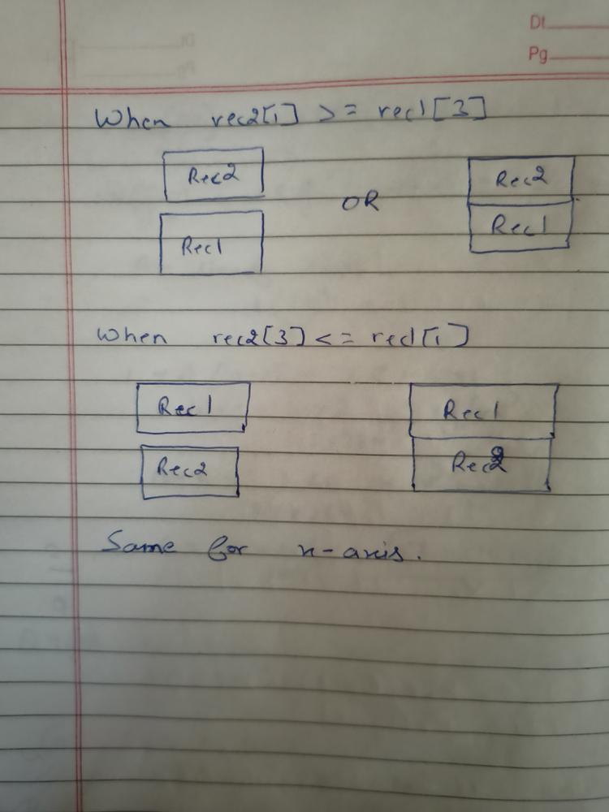

# 1 line | C++ | Think when rectangles don't overlap

**Author:** aman282571
**Votes:** 17
**Link:** [https://leetcode.com/problems/rectangle-overlap/solutions/1308541/](https://leetcode.com/problems/rectangle-overlap/solutions/1308541/)

---

**Intution**
Think of the cases when rectangles don't overlap.
```
class Solution {
public:
    bool isRectangleOverlap(vector<int>& rec1, vector<int>& rec2) {
     return(rec2[1]>=rec1[3] || rec2[3]<=rec1[1] ||rec2[0]>=rec1[2] || rec2[2]<=rec1[0] )?false:true;
       
    }
};
```


Do UPVOTE if it helps :)
If you have any doubt or suggestion then please write in comments.