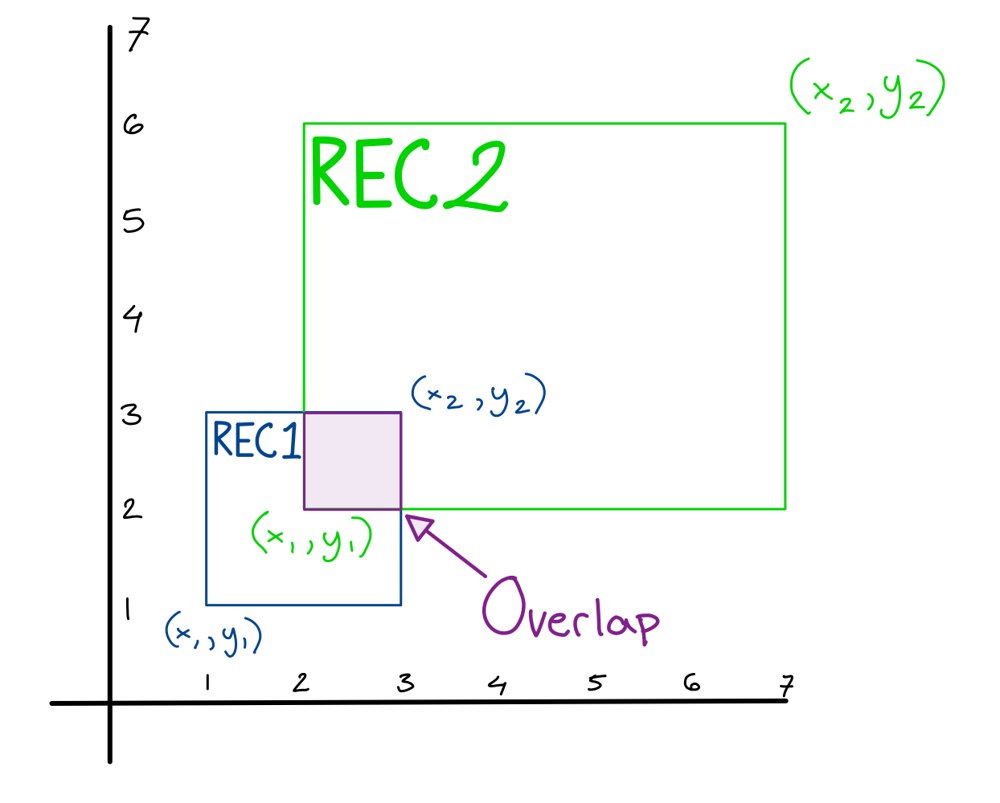
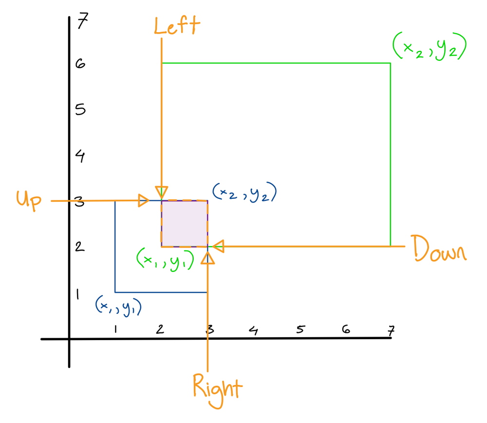

# Golang solution faster than 100% with explanation and images

**Author:** nathannaveen
**Votes:** 4
**Link:** [https://leetcode.com/problems/rectangle-overlap/solutions/1103101/](https://leetcode.com/problems/rectangle-overlap/solutions/1103101/)

---

**Code On The Bottom, If This Helps Please Up Vote**

This solution is pretty simular to my other solution [Leetcode: 223](https://nathannaveen.dev/posts/leetcode-223/) This is the part in the other solution which I based this solution on:

``` go
// A = rec1[0], B = rec1[1], C = rec1[2], D = rec1[3]
// E = rec2[0], F = rec2[1], G = rec2[2], H = rec2[3]
left, right := max(A, E), min(G, C)
up, down := min(D, H), max(F, B)

if right > left && up > down {
    sum -= (right - left) * (up - down) // overlap
}
```

The idea of this solution can be shown using some images:

We can get the input `[1, 1, 3, 3], [2, 2, 7, 6]` and graph it:





And when the `left, right, up, down` lines are shown we get the overlap. We can find the `left, right, up, down` lines by doing the folowing:

* `Left =` the maximum of `rec1 x1` and `rec2 x1`, and as you can see `rec2 x1` is `left` because it is greater than `rec1 x1`
* `Right =` the minimum of `rec1 x2` and `rec2 x2`. As we can see `right` is `rec1 x1`.
* `Down =` the maximum of `rec1 y1` and `rec2 y1`. As we can also see the max is `rec2 y1`.
* `Up =` the minimum of `rec1 y2` and `rec2 y2`. Al we can see the min is `rec1 y2`.

And now you can see that this is how we find whether there is an overlap.

``` go
func isRectangleOverlap(rec1 []int, rec2 []int) bool {

    left, right := max(rec1[0], rec2[0]), min(rec1[2], rec2[2])
    up, down := min(rec1[3], rec2[3]), max(rec1[1], rec2[1])

    if right > left && up > down {
        return true
    }

    return false

}

func max(a, b int) int {
    if a < b {
        return b
    }
    return a
}

func min(a, b int) int {
    if a < b {
        return a
    }
    return b
}
```